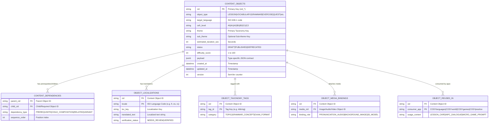
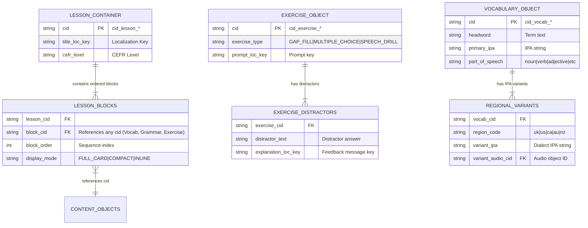

# COSYstudio Architecture Specification: Database-First Content Operating System (COS)

## Executive Summary & Database-First Philosophy

**COSYstudio is NOT a Learning Management System (LMS).**

It is the **Central Content Operating System (COS)** that powers the entire **COSYlanguages** ecosystem across all 11 organization repositories (`cosylanguages/*`). An LMS or platform service (`COSYplatform`) manages student logins, classroom hubs, teacher-student sessions, user accounts, and paid course subscriptions. In contrast, **COSYstudio** serves as the single source of truth (SSOT) for creating, localizing, versioning, orchestrating, and distributing thousands of **Reusable Learning Objects (RLOs)**.

### Core Architectural Paradigm: Database-First & Folderless Architecture
Traditional content management systems rely on hierarchical nested folders (`/es/b1/grammar/verbs/unit1/`). This creates content duplication, broken links, and rigid navigation silos.

**COSYstudio eliminates nested folders entirely.**

Instead, COSYstudio implements a **Database-First Content Architecture**:
1. **Everything is a Content Object (`ContentObject`)**: Every piece of content—a lesson, word, audio clip, quest dialogue, or quiz—is an atomic row in a flat, indexed content database with an immutable Content ID (`cid_*`).
2. **Metadata-Driven Organization**: Dynamic filtering, grouping, and relational querying replace folder navigation.
3. **Airtable / Notion Database UI**: Authors interact with content via customizable database views (Grid, Kanban Board, Gallery, Calendar, Node Graph Canvas) and instant multi-dimensional filters.

---

## 1. Unified Content Object Model

In COSYstudio, there are no separate siloed databases for different content types. Every entity inherits from the base **`ContentObject`** schema and carries standardized metadata attributes.

```
+---------------------------------------------------------------------------------------------------------+
|                                        UNIFIED CONTENT OBJECT (ContentObject)                            |
+---------------------------------------------------------------------------------------------------------+
|  Primary Key: cid (e.g. cid_vocab_8921, cid_lesson_104)                                                 |
|  Type: [ Lesson | Dialogue | Vocabulary | Grammar | Exercise | Quiz | Image | Video | Audio            |
|          | Prompt | Worksheet | Article | Quest | Game ]                                               |
+---------------------------------------------------------------------------------------------------------+
|                                          STANDARDIZED METADATA                                          |
|  * Language: Target (ISO 639-1) & Native Locales                                                        |
|  * CEFR: A0 | A1 | A2 | B1 | B2 | C1 | C2                                                              |
|  * Theme & Sub-theme: Taxonomy Key (e.g. housing.furniture)                                             |
|  * Grammar: Related Rule IDs (e.g. cid_gram_104)                                                        |
|  * Skills: Reading | Writing | Listening | Speaking | Pronunciation | Grammar | Vocabulary           |
|  * Age Group: Children (3-7) | Kids (8-12) | Teens (13-17) | Adults (18+) | Business                     |
|  * Target Audience: General | Spoken | Exam | Professional | Travel | Relocation                        |
|  * Estimated Duration: Minutes / Seconds                                                                |
|  * Learning Objectives: Bloom Taxonomy Competencies & Can-Do Statements                                |
|  * Status: DRAFT | REVIEW | STAGING | PUBLISHED | ARCHIVED | DEPRECATED                                 |
|  * Tags: Multi-select Taxonomy Strings (#dining, #past-tense)                                            |
|  * Difficulty Score: Numeric Scale (1-100) & IRT Calibrated Delta                                        |
|  * Dependencies: Prerequisite IDs | Child Composition IDs | Related Variant IDs                         |
+---------------------------------------------------------------------------------------------------------+
```

### 1.1 Supported Content Object Types

| Object Type | Description & Primary Use Case | Sample Payload Contract |
| :--- | :--- | :--- |
| **Lesson** | Container object orchestrating multiple RLO blocks into a structured learning flow | Ordered array of child RLO `cid` references, timing offsets |
| **Dialogue** | Multi-turn conversational script between avatars or NPCs | Character speakers, audio timestamps, localized lines |
| **Vocabulary** | Lexical headword item with IPA, definitions, and translations | Headword, IPA, part of speech, gender, translations |
| **Grammar** | Structural rule explanation, pattern formula, and CCQ checks | Form-meaning-use blocks, formula visualizer, CCQs |
| **Exercise** | Interactive practice block (gap-fill, multiple choice, matching) | Prompt key, correct answers, distractors, hint text |
| **Quiz** | Graded assessment evaluation container | Question RLO references, scoring weights, pass threshold |
| **Image** | Visual asset with localized alt text and hotspots | CDN URL, focal point coordinates, localized alt keys |
| **Video** | Video lesson clip or cultural recording | Streaming HLS URL, subtitle `.vtt` tracks, chapters |
| **Audio** | Native speaker voice track or neural TTS audio snippet | CDN URL, duration, word-level force alignment JSON |
| **Prompt** | AI/Teacher prompt for speaking or writing exercise | Prompt text, target vocabulary constraints, rubrics |
| **Worksheet** | Printable PDF reference layout or offline workbook page | Layout template ID, print dimensions, vector assets |
| **Article** | Cultural read, magazine post, or literary breakdown | RichText / Markdown blocks, podcast link, vocabulary popups |
| **Quest** | Open-world RPG quest script for `COSYworld` | Quest steps, district coordinates, NPC dialogue trees |
| **Game** | Interactive micro-game bundle configuration for `COSYgames` | Word pool `cid` arrays, time limits, bonus rules |

---

## 2. Standardized Object Metadata Specification

Every `ContentObject` MUST include the following standardized metadata fields:

```typescript
export type CEFRLevel = 'A0' | 'A1' | 'A2' | 'B1' | 'B2' | 'C1' | 'C2';

export type LanguageCode = 'en' | 'fr' | 'it' | 'ru' | 'el' | 'es' | 'de' | 'pt' | 'hy' | 'ka' | 'ba' | 'br' | 'cv' | 'tt';

export type SkillCategory =
  | 'READING'
  | 'WRITING'
  | 'LISTENING'
  | 'SPEAKING'
  | 'PRONUNCIATION'
  | 'GRAMMAR'
  | 'VOCABULARY';

export type AgeGroup = 'CHILDREN' | 'KIDS' | 'TEENS' | 'ADULTS' | 'BUSINESS';

export type TargetAudience = 'GENERAL' | 'SPOKEN' | 'EXAM' | 'PROFESSIONAL' | 'TRAVEL' | 'RELOCATION';

export type ObjectStatus = 'DRAFT' | 'REVIEW' | 'STAGING' | 'PUBLISHED' | 'ARCHIVED' | 'DEPRECATED';

export interface ObjectDependencies {
  prerequisiteCids: string[]; // Content required before this object
  childCids: string[];        // Composition children (for Lessons/Quizzes/Quests)
  relatedCids: string[];      // Cross-referenced objects
  variantCids: string[];      // Regional or difficulty variants
}

export interface ContentObjectMetadata {
  /** Unique Content Identifier (Primary Key) */
  cid: string; // e.g. "cid_vocab_01H8X..."

  /** Content Object Classification */
  objectType: 'LESSON' | 'DIALOGUE' | 'VOCABULARY' | 'GRAMMAR' | 'EXERCISE' | 'QUIZ' | 'IMAGE' | 'VIDEO' | 'AUDIO' | 'PROMPT' | 'WORKSHEET' | 'ARTICLE' | 'QUEST' | 'GAME';

  /** ISO 639-1 Language Code */
  targetLanguage: LanguageCode;

  /** Standardized CEFR Difficulty Level */
  cefrLevel: CEFRLevel;

  /** Taxonomy Key (from schemas/themes.json) */
  theme: string;       // e.g. "housing"
  subTheme?: string;   // e.g. "furniture"

  /** Related Canonical Grammar Rule Identifiers */
  grammarRuleCids: string[];

  /** Primary & Secondary Targeted Skills */
  skills: SkillCategory[];

  /** Target Audience Age Brackets */
  ageGroups: AgeGroup[];

  /** Intended Learning Objective / Domain Track */
  targetAudiences: TargetAudience[];

  /** Expected Time to Complete / Play in Seconds */
  estimatedDurationSeconds: number;

  /** Bloom Taxonomy Competency & Can-Do Statement Identifiers */
  learningObjectives: string[]; // e.g. ["can_order_food_in_restaurant"]

  /** Editorial Lifecycle Status */
  status: ObjectStatus;

  /** Multi-dimensional Search & Categorization Tags */
  tags: string[]; // e.g. ["#restaurant", "#past-tense", "#interactive"]

  /** IRT Calibrated Difficulty Score (1 - 100) */
  difficultyScore: number;

  /** Structural & Pedagogical Object Relations */
  dependencies: ObjectDependencies;

  /** Audit Timestamps & Versioning */
  createdBy: string; // User ID / Author
  createdAt: string; // ISO 8601 Timestamp
  updatedAt: string;
  version: number;
}
```

---

## 3. Entity Relationship Diagrams (ERDs)

The following Mermaid ERDs detail the relational schema powering COSYstudio's database-first content engine.

### 3.1 Core Content Object ERD



### 3.2 Relational Structure for Lessons, Exercises & Vocabulary RLOs



---

## 4. Airtable / Notion Database UI Paradigm

COSYstudio replaces nested folder navigation with dynamic database view modes and instant multi-dimensional filtering.

```
+---------------------------------------------------------------------------------------------------------+
|  [COSYstudio]  Database View: [ Grid | Board | Gallery | Calendar | Node Canvas ]    [+ Filter] [+ Group]|
+---------------------------------------------------------------------------------------------------------+
|  Active Filters:  [Language: Spanish (es) x]  [CEFR: B1 x]  [Status: Published x]  [Skill: Speaking x]  |
+---------------------------------------------------------------------------------------------------------+
| [ ] CID           | Object Type | Headword / Title           | CEFR | Theme       | Reused In   | Status    |
|---+---------------+-------------+----------------------------+------+-------------+-------------+-----------|
| [x] cid_vocab_9021| VOCABULARY  | El Cubierto                | B1   | housing     | 14 Apps     | PUBLISHED |
| [ ] cid_gram_104  | GRAMMAR     | Present Subjunctive Rules  | B1   | syntax      | 8 Apps      | PUBLISHED |
| [ ] cid_drill_501 | EXERCISE    | Restaurant Order Practice  | B1   | restaurant  | 22 Apps     | STAGING   |
| [ ] cid_quest_302 | QUEST       | Ordering at COSY Cafe      | B1   | commercial  | 2 Apps      | DRAFT     |
| [ ] cid_less_402  | LESSON      | Dining Out Masterclass     | B1   | restaurant  | 6 Apps      | PUBLISHED |
+---------------------------------------------------------------------------------------------------------+
| Selected: 1 object  |  Actions: [Batch Tag]  [Change CEFR]  [Generate AI Variants]  [Publish to Edge]   |
+---------------------------------------------------------------------------------------------------------+
```

### 4.1 Core View Modes
1. **Grid View (Airtable Style)**: High-density tabular spreadsheet with inline metadata editing, formula columns (e.g. `ReusedInCount`), and rollup properties.
2. **Board View (Kanban Style)**: Group content objects by `Status` (`DRAFT` -> `REVIEW` -> `STAGING` -> `PUBLISHED`), `CEFR Level`, or `Theme`. Drag objects across columns to update metadata state.
3. **Gallery View (Notion Style)**: Visual card preview displaying thumbnail media assets (`Image`, `Video`), audio player controls (`Audio`), and headword titles.
4. **Calendar View**: Schedule publishing pipelines and track event session dates (`COSYevents`).
5. **Node Graph Canvas (Figma Style)**: Visual node connector illustrating prerequisite dependencies (`prerequisiteCids`) and lesson child compositions (`childCids`).

### 4.2 Replacing Folders with Dynamic Filtering
Instead of navigating through `folders/es/b1/verbs/`, authors filter by criteria in 1 click:
* `targetLanguage == "es"`
* `cefrLevel == "B1"`
* `theme == "dining"`
* `objectType IN ["VOCABULARY", "EXERCISE"]`

View configurations can be saved as **View Presets** (e.g., *"Missing Audio in Spanish B1"*, *"Pending German Quests"*).

---

## 5. Verified Repository Boundary Analysis (11 Repositories)

Below is the definitive boundary analysis for all 11 repositories in the `cosylanguages/` organization based on direct verification of their source trees, schemas, and live documentation.

### 5.1 COSYstudio (`cosylanguages/COSYstudio`)
* **Responsibility**: Central Content Operating System (COS). Authoring, versioning, publishing workflows, asset ingestion/pipeline (transcoding, audio alignment, 3D model processing), taxonomy tree management (`schemas/themes.json`), localization master translation, edge content distribution, and content graph relations.
* **Owned Data**:
  * Canonical Content Nodes / Reusable Learning Objects (Vocabulary, Grammar, Exercises, Articles, Quest Scenarios, Drills, Manual Articles).
  * Asset Metadata & Binary Manifests (CDN URLs, audio timestamps, transcriptions, video renditions, 3D models).
  * Localization Master Keys & Multi-language Translations.
  * Taxonomy Trees, Categories, Tags, and CEFR Alignment Maps (`A0`–`C2`).
  * Content Version History, Revisions & Audit Logs.
* **Data It Must NEVER Own**:
  * Student Enrollments, Paid Classroom Sessions, or Private Student Data (Owned by `COSYplatform`).
  * Practice Session Execution State, Local Storage Timers & Audio Submissions (Owned by `COSYpractice`).
  * Event RSVPs, Attendee Registrations & WebRTC Tokens (Owned by `COSYevents`).
  * RPG Player Local Storage Saves & COSY Passport Files (Owned by `COSYworld`).
  * Raw Analytics Event Logs & Warehouse Processing (Owned by `COSYdata`).
* **Exposed APIs**:
  * `Content Query API` (GraphQL / gRPC / REST) for fetching published content nodes and media manifests.
  * `Content Authoring API` (gRPC / GraphQL) for CMS editors and automated ingestion pipelines.
  * `Search & Taxonomy Index API` for vector and keyword search across canonical content.
  * `Content Event Stream` (Kafka / NATS Event Bus) emitting `content.published`, `content.updated`, `content.deprecated`.
* **Consumed APIs from COSYstudio**: N/A (Core Provider).

---

### 5.2 COSYlanguages (`cosylanguages/COSYlanguages`)
* **Responsibility**: The free public front door to the ecosystem. Serves as the landing portal, language hubs (English, French, Italian, Russian, Greek, etc.), course catalogue, placement quiz, price calculator, and "Hybrid & Community" pages.
* **Owned Data**:
  * Public Portal Page UI State & Static Interface Translations (`data/ui/<lang>.json`).
  * Ecosystem URL Configuration Registry (`js/core/config.js`).
  * Placement Quiz Logic & Course Price Calculation State.
* **Data It Must NEVER Own**:
  * Master Vocabulary & Grammar Datasets (Read-only mirror from `COSYdata` / `COSYstudio`).
  * User Auth Passwords & Student Classrooms (Delegates to `COSYplatform` on `login.html`).
* **Exposed APIs**:
  * Static Web Portal Pages & Client Navigation Engine.
* **Consumed APIs from COSYstudio**:
  * Fetches course catalog metadata, localized UI descriptors, and placement quiz content nodes by `cid`.

---

### 5.3 COSYdata (`cosylanguages/COSYdata`)
* **Responsibility**: The canonical, machine-readable data repository and vocabulary hub for the ecosystem. Serves standardized dictionary entries (`vocabulary/<lang>/`), functional phrases, curriculum competencies, and taxonomy schemas (`schemas/themes.json`) across 14 ISO languages via GitHub Pages.
* **Owned Data**:
  * Standardized Vocabulary JSON Entries across 14 ISO languages (`en`, `fr`, `it`, `ru`, `el`, `es`, `de`, `pt`, `hy`, `ka`, `ba`, `br`, `cv`, `tt`) spanning CEFR levels `A0`–`C2`.
  * Canonical Taxonomy Schema (`schemas/themes.json`) containing 46 primary themes & sub-themes.
  * Functional Phrase Datasets & IPA Phonetic Transcriptions with Regional IPA Variants (`uk`, `us`, `ca`, `au`, `nz`).
  * Dictionary Index Artifacts (`index.json`, `flat-index.json`, `search-index.json`, `themes-index.json`).
* **Data It Must NEVER Own**:
  * Student Progress, SRS Card State, or Quiz Answers.
  * Private User Profiles or Authentication Secrets.
* **Exposed APIs**:
  * REST / Static CDN Data Endpoints (`vocabulary/<lang>/<level>/<theme>.json`).
  * Client Utilities (`vocab-resolver.js`, `cosy-word-popup.js`, `dictionary-ui.js`).
* **Consumed APIs from COSYstudio**:
  * Subscribes to `content.published` to ingest updated vocabulary definitions, IPA transcriptions, and taxonomy schemas into static CDN artifacts.

---

### 5.4 COSYplatform (`cosylanguages/COSYplatform`)
* **Responsibility**: Web application for COSY Languages students, teachers, and the founder. Provides authentication (`login.html`), student hub, paid course execution, interactive lessons, and online virtual classroom.
* **Owned Data**:
  * User Accounts, Auth Credentials, OAuth Tokens, and Student/Teacher Roles.
  * Student Course Enrollments, Paid Lesson Access Rights, and Classroom State.
  * Private Lesson Execution History & Gated Course Content (stored in private Supabase DB with RLS policies).
* **Data It Must NEVER Own**:
  * Canonical Vocabulary Master Data & Public Dictionaries (Owned by `COSYdata` / `COSYstudio`).
  * Offline Manual Booklets or Public Help Guides (Owned by `COSYmanuals`).
* **Exposed APIs**:
  * `Classroom Service API` (`GET /v1/classroom/session`)
  * `Student Progress API` (`GET /v1/student/progress`)
* **Consumed APIs from COSYstudio**:
  * Queries `ContentNode` schemas by `cid` to render structured lesson templates in the live classroom player.

---

### 5.5 COSYpractice (`cosylanguages/COSYpractice`)
* **Responsibility**: Free interactive practice exercise engine for vocabulary, grammar, and speaking across 5 languages (`en`, `fr`, `it`, `ru`, `el`). Features daily challenges, SRS memory reviews, weak spot practice, a fortune wheel, and projector presentation mode.
* **Owned Data**:
  * Local Storage SRS Memory State & Review Intervals.
  * Practice Session Scores, Weak Spot Indicators, and Progress Dashboard Metrics (stored locally in browser).
* **Data It Must NEVER Own**:
  * Master Vocabulary JSON Files (Dynamically fetches from `COSYdata` and `COSYtools`).
  * Master Grammar Explanations or CCQ Checks (Loads CCQ files from `COSYmanuals`).
* **Exposed APIs**:
  * Client-side practice engine (`_engine/`) and progress dashboard (`progress-dashboard.html`).
* **Consumed APIs from COSYstudio**:
  * Dynamically fetches vocabulary RLOs, grammar exercise blocks, and CCQ prompts from COSYstudio / COSYdata.

---

### 5.6 COSYtools (`cosylanguages/COSYtools`)
* **Responsibility**: Offline-first, 100% client-side language reference suite featuring verb conjugators, noun gender/case declension checkers, case matrices, prepositional regime lookup, and grammar practice drills across 14 languages.
* **Owned Data**:
  * Tool-Specific Datasets (`tools/<lang>/<tool>/data/`) for verb conjugation, case tables, and syntax.
  * Letter-Sharded Supplemental Lexicon Shards (`tools/<lang>/data/shards/`).
  * Central Tool Inventory (`catalog.json`).
* **Data It Must NEVER Own**:
  * Master Course Curriculums or Lesson Execution Logs.
  * User Accounts or Student Classrooms.
* **Exposed APIs**:
  * Deep-Linking URL Query Interfaces (`?verb=<lemma>`, `?noun=<word>`, `?q=<keyword>`).
* **Consumed APIs from COSYstudio**:
  * Reads canonical headword definitions, grammatical properties, and conjugation tables published by COSYstudio.

---

### 5.7 COSYgames (`cosylanguages/COSYgames`)
* **Responsibility**: Open-source suite of 20 interactive, standalone language-learning games for communicative fluency, vocabulary practice, speaking drills, and classroom activities across multiple CEFR levels without requiring registration.
* **Owned Data**:
  * Game Match State, Session Scores, and Local High Score History.
* **Data It Must NEVER Own**:
  * Master Vocabulary Lists or Dictionaries (Pulls word lists from `COSYdata`).
  * User Accounts or Course Enrollments.
* **Exposed APIs**:
  * Standalone client-side game runners (HTML5 / ES6 Modules).
* **Consumed APIs from COSYstudio**:
  * Fetches mini-game content bundles (`cid_gamepack_*`) containing prompt words, distractor items, and media assets.

---

### 5.8 COSYevents (`cosylanguages/COSYevents`)
* **Responsibility**: Public calendar, event directory, and complete session-material repository. Hosts speaking-club prompt decks, cinema immersion guides, teacher-led masterclasses, multimedia nights, and session archives.
* **Owned Data**:
  * Event Definitions (`events/<slug>/event.json`) and Session Material JSON Files (`events/<slug>/sessions/<slug>.json`).
  * Calendar Discovery Index (`public-events.json`).
* **Data It Must NEVER Own**:
  * Private Student Classrooms or Billing Records (Delegates to `COSYplatform`).
* **Exposed APIs**:
  * Static Calendar Directory (`index.html`, `public-events.json`).
* **Consumed APIs from COSYstudio**:
  * Fetches session prompt decks (`cid_eventpack_*`), localized event titles, and supporting media assets.

---

### 5.9 COSYmanuals (`cosylanguages/COSYmanuals`)
* **Responsibility**: Public catalog and gated learning portal holding grammar, vocabulary, communication manuals, teacher guides, student workbooks, and printable offline reference booklets across 13 active ISO languages + Chuvash.
* **Owned Data**:
  * Public Manual Catalog Metadata (`catalog/*.json`) and Course Curriculum Maps (`curriculums/<iso>/<track>/<LEVEL>.json`).
  * Gated Manual Body Text (Stored in Supabase `manual_content` table with RLS policies).
  * Printable Offline Booklet Layouts (`manuals/<iso>/print/`).
* **Data It Must NEVER Own**:
  * Vocabulary Datasets (Mirrors `COSYdata` / `COSYlanguages` as read-only).
  * Live Classroom Telemetry (Owned by `COSYplatform`).
* **Exposed APIs**:
  * Public Catalog Index (`catalog/manifest.json`) and Manual Viewers.
* **Consumed APIs from COSYstudio**:
  * Fetches canonical manual documentation nodes (`cid_manual_*`), grammar rule definitions, and vocabulary sets.

---

### 5.10 COSYmagazine (`cosylanguages/COSYmagazine`)
* **Responsibility**: Short, speaking-first digital publication (articles, sentence frames, podcasts, cultural reads) in English, French, Italian, Russian, and Greek, featuring flipbook and stage/teleprompter reading modes (`?stage=1`, `?script=1`).
* **Owned Data**:
  * Editorial Article JSON Files (`posts/*.json`) and Podcast Feed (`podcast.xml`).
  * Generated Static Post HTML Pages and Newsstand Index (`posts.json`).
* **Data It Must NEVER Own**:
  * Embedded Master Dictionary Definitions (References `COSYdata` popup terms).
* **Exposed APIs**:
  * Newsstand Interface (`index.html`), RSS Podcast Feed (`podcast.xml`).
* **Consumed APIs from COSYstudio**:
  * Fetches magazine article content nodes (`cid_article_*`), inline vocabulary popups (`cid_vocab_*`), and podcast audio assets.

---

### 5.11 COSYworld (`cosylanguages/COSYworld`)
* **Responsibility**: Standalone open-world RPG for direct language immersion in COSY Town across 14 target languages. Features character selection (James York, Ella Bronx, Anna), district exploration (Residential, Commercial, Cultural), and quest dialogues.
* **Owned Data**:
  * COSY Town Map Hotspots, RPG Instance State, and NPC Positions.
  * Character Citizen Level, XP, and COSY Passport Progress Save Schema (LocalStorage / JSON export).
* **Data It Must NEVER Own**:
  * Master Dictionary & Grammar Rules (Links to `COSYtools` & `COSYgames`).
* **Exposed APIs**:
  * Standalone Web App & COSY Passport Export/Import Engine.
* **Consumed APIs from COSYstudio**:
  * Fetches NPC dialogue trees (`cid_dialogue_*`), quest script nodes (`cid_quest_*`), and localized object names (`cid_loc_*`).

---

## 6. Detailed Application Modules (12 Modules)

COSYstudio is structured into **12 dedicated modules**, each engineered to handle Reusable Learning Objects (RLOs) at scale.

1. **Dashboard**: Ecosystem content health, velocity metrics, and real-time activity stream.
2. **Content Library**: Central searchable repository for all RLOs with Linear-style filtering and "Reused In" impact graphs.
3. **Curriculum**: Scope & sequence tree editor mapping RLOs into learning paths and CEFR tracks.
4. **Lesson Builder**: Notion-style slash command block editor and Figma-style canvas visualizer for interactive lesson flows.
5. **Vocabulary Database**: Master lexicon manager with IPA phonetics, multi-target translation matrices, and audio attachments.
6. **Grammar Database**: Canonical grammar rules with form-meaning-use breakdown blocks and pattern visualizers.
7. **Media Library**: Asset pipeline with automated audio-text alignment, video transcoding, and 3D asset ingestion.
8. **Assessment Builder**: Dynamic test generator, question variant transformer, and IRT difficulty calibrator.
9. **Publishing**: Multi-environment deployment pipeline (`DRAFT` -> `STAGING` -> `PRODUCTION`) with instant CDN cache invalidation.
10. **Analytics**: RLO Performance Index tracking exercise failure rates, drop-offs, and pedagogical effectiveness.
11. **AI Assistant**: Auto-generator for contextual sentences, CEFR estimator, and automated translator.
12. **Settings**: Role-based access control (RBAC), localization locales, webhooks, and schema contracts.

---

## 7. Shared Packages & Governance

To guarantee type safety, consistent content referencing, and schema validation across all 11 repositories, shared packages are maintained in the `@cosy/` registry.

### 7.1 Package Directory Structure
```
@cosy/
├── schema-content/       # Canonical TypeScript & JSON Schemas for Content Nodes
├── schema-events/        # Event payload schemas for NATS / Kafka event bus
├── sdk-client/           # Multi-platform Client SDK (TypeScript / Rust / C# Unity)
├── ui-tokens/            # Shared design system tokens, typography, iconography
└── core-utils/           # CID generators, CEFR helpers, language code parsers
```

### 7.2 Governance Rules
1. **Zero Runtime Side-Effects**: Shared packages contain **only types, schemas, validation utilities, and client contracts**.
2. **Semantic Versioning (SemVer)**: Major for breaking schema changes, Minor for additive changes, Patch for bug fixes.
3. **Automated Schema Codegen**: Protobuf / JSON Schemas generate TypeScript, Rust, and C# code.

---

## 8. Migration Strategy

Migrating existing applications across all 11 repositories to the strict COSYstudio COS architecture follows a 5-phase zero-downtime plan.

1. **Phase 1: Foundation Setup & Package Publishing (`@cosy/*`)**: Deploy edge CDN, NATS event bus, and shared packages.
2. **Phase 2: Extraction & Deduplication into COSYstudio SSOT**: Extract raw content tables from consumer repos (`COSYdata`, `COSYevents`, `COSYmanuals`, `COSYmagazine`) and deduplicate into canonical `ContentNode` graphs with `cid_*`.
3. **Phase 3: Dual-Read & Translation Shim Deployment**: Enable consumer services to fetch content via `cid` while maintaining legacy fallback.
4. **Phase 4: Full Read-Switch & Consumer DB Content Purge**: Route 100% of content reads to COSYstudio Edge APIs and purge raw content tables from consumer DBs.
5. **Phase 5: Automated CI/CD Guardrails**: Enforce linter rules preventing raw content/translation tables from being introduced into consumer apps.

---

## Conclusion

By combining modern creator UI paradigms (Airtable views, Notion blocks, Linear speed, Figma node visualizers) with a database-first, folderless Content Operating System architecture verified against all 11 `cosylanguages/*` repositories:
* **Zero Content Duplication**: Every piece of content exists exactly once in `COSYstudio` as a `ContentObject` and is referenced via `cid`.
* **Database Filtering Over Folders**: Content is queried and grouped dynamically using standardized metadata fields.
* **High Scale Capability**: Designed to support tens of thousands of Reusable Learning Objects (RLOs) seamlessly.
* **Domain Ownership**: Clean isolation across all 11 `cosylanguages/` repositories.
