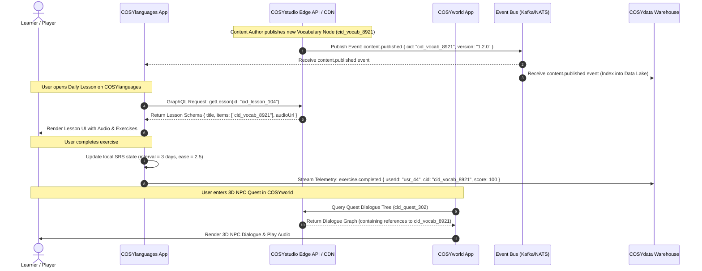

# COSYstudio Architecture Specification: Central Content Operating System (COS)

## Executive Summary & Core Architectural Philosophy

**COSYstudio is NOT a Learning Management System (LMS).**

It is the **Central Content Operating System (COS)** that powers the entire **COSYlanguages** ecosystem. An LMS manages student enrollments, course completions, grades, class rosters, teacher assignments, and active user subscriptions. In contrast, **COSYstudio** serves exclusively as the single source of truth for all content creation, localization, orchestration, versioning, taxonomy tagging, asset transformation, and edge content delivery across the ecosystem.

### Key Architectural Axioms:
1. **Single Source of Truth (SSOT)**: Every piece of content—vocabulary items, grammar explanations, audio snippets, video lessons, 3D world dialogues, micro-game prompt packs, magazine articles, and localization strings—exists **exactly once** within COSYstudio.
2. **Strict Decoupling via Content IDs (`cid`)**: External consumer applications (e.g., `COSYlanguages`, `COSYworld`, `COSYgames`) **never** duplicate, re-author, or embed raw content into their own databases. They store only immutable Content Identifiers (`cid_*`) and fetch or stream resolved content schemas via high-performance edge APIs or global CDN caches.
3. **Domain Ownership Isolation**: Repositories maintain strict boundaries. Data belonging to user progress, spatial rendering, telemetry, or game leaderboards is isolated within its respective domain and communicates via explicit, versioned APIs.

---

## 1. Repository Boundary Analysis

Below is the definitive analysis for each repository in the COSY ecosystem.

### 1.1 COSYstudio (Central Content Operating System)
* **Responsibility**: Authoring, versioning, publishing workflow, asset ingestion/pipeline (transcoding, audio alignment), taxonomy, localization management, edge content distribution, and content graph relations.
* **Owned Data**:
  * Canonical Content Nodes (Vocabulary, Grammar, Sentences, Exercises, Articles, Quest Scenarios).
  * Asset Metadata & Binary Manifests (CDN URLs, audio timestamps, transcriptions, video renditions).
  * Localization Master Keys & Translations.
  * Taxonomy Trees, Categories, Tags, and CEFR Alignment Maps.
  * Content Version History & Audit Logs.
* **Data It Must NEVER Own**:
  * User Profiles, Credentials, and Personal Identifiable Information (PII).
  * Student Enrollments, Course Progress, Quiz Scores, and SRS (Spaced Repetition System) States.
  * Payment/Subscription Billing Data.
  * Gameplay States, Real-Time Multiplayer Session Data, Leaderboards.
  * User Interaction Telemetry & Raw Analytics Logs.
* **Exposed APIs**:
  * `Content Query API` (GraphQL / gRPC / REST) for fetching published content nodes and media manifests.
  * `Content Authoring API` (gRPC / GraphQL) for CMS editors and automated ingestion tools.
  * `Search & Taxonomy Index API` for vector and keyword search across canonical content.
  * `Content Event Stream` (Kafka / NATS Event Bus) emitting `content.published`, `content.updated`, `content.deprecated`.
* **Consumed APIs from COSYstudio**: N/A (Core Provider).

---

### 1.2 COSYlanguages (Primary Learning Experience Platform & Pedagogy Engine)
* **Responsibility**: User study paths, adaptive learning algorithms (SRS scheduling), quiz execution, student streak tracking, lesson completion logic, and tutor/student study interactions.
* **Owned Data**:
  * User Learning Profiles & Preferences.
  * Spaced Repetition (SRS) Card States (e.g., SM-2 / Leitner intervals, ease factors, next review dates).
  * Lesson Progress Records, Mastery Levels, Study Streaks, Quiz Results.
  * Teacher-Student Class Rosters & Assignments (if applicable).
* **Data It Must NEVER Own**:
  * Raw Vocabulary Definitions, Etymology, and Translations.
  * Canonical Grammar Rule Definitions.
  * Audio/Video Raw Source Files or Asset Transcode Pipelines.
  * Global Taxonomy and Tag Definitions.
* **Exposed APIs**:
  * `User Progress API` (`GET /v1/users/{id}/progress`)
  * `SRS Queue Service` (`GET /v1/users/{id}/srs/next`)
  * `Mastery Evaluation API` (`POST /v1/users/{id}/evaluate`)
* **Consumed APIs from COSYstudio**:
  * Fetches `ContentNode` schemas by `cid` for lessons, vocabulary, and grammar rules.
  * Fetches localized strings for learning UI.
  * Listens to `content.published` event stream to refresh cached content references.

---

### 1.3 COSYworld (Immersive 3D Spatial Language Environment)
* **Responsibility**: 3D spatial rendering, avatar movement, spatial audio, real-time NPC interactions, location-based language quests, multiplayer spatial instances.
* **Owned Data**:
  * 3D Instance Session State & Player Coordinates.
  * Avatar Customization State & Cosmetic Inventories.
  * NPC Runtime Interaction State (e.g., current quest step state per player session).
  * Spatial Instance Telemetry & Player Proximity Logs.
* **Data It Must NEVER Own**:
  * Canonical NPC Dialogue Scripts and Translations.
  * Dictionary Definitions and Grammar Knowledge Nodes.
  * Global Learning Curriculum Data.
* **Exposed APIs**:
  * `Spatial World Gateway API` (WebSocket / gRPC) for player instance connection.
  * `NPC Session Service` (`POST /v1/spatial/npc/interact`).
* **Consumed APIs from COSYstudio**:
  * Fetches `cid_dialogue_*` trees, `cid_quest_*` nodes, localized object names (`cid_loc_*`), and spatial audio asset URLs (`cid_audio_*`).

---

### 1.4 COSYgames (Gamified Micro-Games & Interactive Challenges Engine)
* **Responsibility**: Arcade micro-games, time-attack challenges, multiplayer competitive word games, global leaderboards, achievement unlock logic.
* **Owned Data**:
  * Micro-game Match Sessions & Real-time Game State.
  * High Score Tables & Leaderboard Rankings.
  * Game Achievements & Badge Unlocks.
  * Power-up Inventories & In-Game Virtual Currency (Match Points).
* **Data It Must NEVER Own**:
  * Master Word Lists and Translation Dictionaries.
  * Pedagogical Rules & CEFR Difficulty Mapping (Reads CEFR tag attached to `cid`).
  * Overall User Academic Course Progress.
* **Exposed APIs**:
  * `Matchmaking API` (`POST /v1/matchmaking/join`)
  * `Leaderboard Service` (`GET /v1/leaderboards/{game_id}`)
  * `Game Score Submission API` (`POST /v1/games/scores`)
* **Consumed APIs from COSYstudio**:
  * Fetches mini-game content bundles (`cid_gamepack_*`) containing targeted prompt words, media assets, and distractors.

---

### 1.5 COSYtools (Utility & Productivity Tooling: Dictionaries, Analyzers, Extensions)
* **Responsibility**: Instant dictionary search, verb conjugation helpers, text difficulty analysis (CEFR level estimator), browser reading extensions.
* **Owned Data**:
  * Tool-Specific User Preferences & Quick-Bookmark Lists.
  * Analysis History Cache (e.g., user-submitted text analysis results).
  * Extension Settings & Offline Lookup Caches.
* **Data It Must NEVER Own**:
  * Master Dictionary Definitions & Conjugation Source Tables.
  * User Learning Progress & Subscription Account Records.
* **Exposed APIs**:
  * `Text Readability & CEFR Analyzer API` (`POST /v1/tools/analyze-text`)
  * `Conjugation Helper Endpoint` (`GET /v1/tools/conjugate/{verb_id}`)
* **Consumed APIs from COSYstudio**:
  * Queries COSYstudio Content & Search API directly for instant dictionary definitions (`cid_vocab_*`), grammatical conjugations (`cid_grammar_*`), and reference examples.

---

### 1.6 COSYdata (Data Platform, Telemetry, Analytics & AI/ML Pipelines)
* **Responsibility**: Ecosystem-wide event ingestion, data lake/warehouse management, cross-app user journey analytics, AI model training (e.g., speech recognition, adaptive recommendations).
* **Owned Data**:
  * Anonymized Behavioral Telemetry Logs.
  * Processed Data Warehouse Tables (ClickHouse / BigQuery).
  * Machine Learning Models & Trained Weights.
  * Ecosystem Aggregate Metrics & Business Intelligence Reports.
* **Data It Must NEVER Own**:
  * Live Transactional Content Source (Must read content state from COSYstudio).
  * Live User Auth Passwords / Billing Secrets.
* **Exposed APIs**:
  * `Telemetry Ingest API` (`POST /v1/telemetry/events`)
  * `ML Recommendation Inference API` (`POST /v1/ml/recommend-content`)
  * `BI Analytics Query API` (`GET /v1/analytics/dashboards`)
* **Consumed APIs from COSYstudio**:
  * Subscribes to `content.*` streams to index metadata (tags, CEFR level, content type) into the data warehouse for cross-referencing user behavior with content attributes.

---

### 1.7 COSYmagazine (Digital Publishing, Cultural Articles & Media)
* **Responsibility**: Presentation of digital culture magazine articles, podcasts, interviews, reader comment sections, issue publishing layout.
* **Owned Data**:
  * Article Reader Comments & Reaction Counts.
  * Reader Article Bookmarks & Reading Position (Scroll % / Last Read Node).
  * Editorial Issue Layout Configurations.
* **Data It Must NEVER Own**:
  * Article Master Copy & Source Markdown/RichText (Owned by COSYstudio).
  * Embedded Vocabulary/Grammar Explanations (Owned by COSYstudio).
  * Binary Audio / Video Files (Owned by COSYstudio Media Pipeline).
* **Exposed APIs**:
  * `Article Comments API` (`GET/POST /v1/magazine/articles/{id}/comments`)
  * `Reader Bookmark Service` (`GET/POST /v1/magazine/bookmarks`)
* **Consumed APIs from COSYstudio**:
  * Fetches magazine articles (`cid_article_*`), inline vocabulary popups (`cid_vocab_*`), podcasts (`cid_media_*`), and magazine issue indexes.

---

### 1.8 Additional Future Ecosystem Apps (e.g., COSYkids, COSYbusiness, COSYaudio)
* **Responsibility**: Special audience experiences (e.g., gamified child interface, corporate enterprise dashboard, audio-only passive listening app).
* **Owned Data**: Domain-specific UI state, audience-specific settings (e.g., parental controls, corporate team hierarchies).
* **Data It Must NEVER Own**: Core content, media, translations, or dictionary data.
* **Exposed APIs**: Domain-specific endpoints.
* **Consumed APIs from COSYstudio**: Queries tagged content slices (`cid_tag_kids_*`, `cid_tag_business_*`) and localized media directly from COSYstudio Edge API.

---

## 2. High-Level Architecture Diagram

```
+-----------------------------------------------------------------------------------+
|                                 COSYstudio (COS)                                  |
|  +--------------------+   +-----------------------+   +------------------------+  |
|  | Authoring & CMS    |   | Localization Manager  |   | Asset Pipeline (Media) |  |
|  +--------------------+   +-----------------------+   +------------------------+  |
|  |  Content Graph SSOT: Vocabulary, Grammar, Exercises, Media, Quests, Articles    |  |
|  +--------------------------------------------------------------------------------+  |
|  | Exposed: GraphQL API / gRPC Service / Global Edge CDN / Event Stream (Kafka/NATS)|  |
+------------------------------------------+----------------------------------------+
                                           |
                    +----------------------+----------------------+
                    |                      |                      |
            (Fetch Content Node)   (Fetch Media Assets)   (Event Stream Sub)
                    |                      |                      |
        +-----------v-----------+          |          +-----------v-----------+
        |     COSYlanguages     |          |          |        COSYdata       |
        | (LMS/SRS/Pedagogy)    |          |          | (Telemetry/Analytics) |
        | Owns: User Progress,  |          |          | Owns: Telemetry Logs, |
        | SRS state, Scores     |          |          | Analytics, ML Models  |
        +-----------------------+          |          +-----------------------+
                                           |
    +-----------------------+--------------+--------------+-----------------------+
    |                       |                             |                       |
+---v-------------------+ +-v---------------------+ +-----v-----------------+ +---v-------------------+
|       COSYworld       | |       COSYgames       | |       COSYtools       | |     COSYmagazine      |
| (3D Spatial / World)  | | (Micro-games / Arcade)| | (Dictionaries / Ext)  | | (Articles & Culture)  |
| Owns: Spatial Session,| | Owns: Match Sessions, | | Owns: Search Cache,   | | Owns: Article Comments|
| Avatar Cosmetics, NPCs| | Leaderboards, Badges  | | User Tool Prefs       | | Reader Scroll State |
+-----------------------+ +-----------------------+ +-----------------------+ +-----------------------+
    |                       |                             |                       |
    +-----------------------+--------------+--------------+-----------------------+
                                           |
                               +-----------v-----------+
                               |     Future Apps       |
                               | (COSYkids, Business)  |
                               | Owns: Custom App UI   |
                               +-----------------------+
```

---

## 3. Data Ownership Matrix

| Data Domain / Entity | COSYstudio | COSYlanguages | COSYworld | COSYgames | COSYtools | COSYdata | COSYmagazine | Future Apps |
| :--- | :---: | :---: | :---: | :---: | :---: | :---: | :---: | :---: |
| **Canonical Vocabulary & Dictionary** | **OWNER** | Read-Only | Read-Only | Read-Only | Read-Only | Read-Only | Read-Only | Read-Only |
| **Grammar Explanations & Rules** | **OWNER** | Read-Only | Read-Only | Read-Only | Read-Only | Read-Only | Read-Only | Read-Only |
| **Media Assets (Audio, Video, Images)** | **OWNER** | Read-Only | Read-Only | Read-Only | Read-Only | Read-Only | Read-Only | Read-Only |
| **Localization Master Keys & Texts** | **OWNER** | Read-Only | Read-Only | Read-Only | Read-Only | Read-Only | Read-Only | Read-Only |
| **Quest Scenarios & Dialogue Trees** | **OWNER** | Read-Only | Read-Only | Read-Only | Forbidden | Read-Only | Read-Only | Read-Only |
| **Taxonomy, Tags & CEFR Alignment** | **OWNER** | Read-Only | Read-Only | Read-Only | Read-Only | Read-Only | Read-Only | Read-Only |
| **User Profile & Authentication** | Forbidden | **OWNER** | Read-Only | Read-Only | Read-Only | Read-Only | Read-Only | Read-Only |
| **User Progress, SRS State & Grades** | Forbidden | **OWNER** | Read-Only | Read-Only | Forbidden | Read-Only | Read-Only | Read-Only |
| **3D Instance State & Avatar Cosmetics**| Forbidden | Forbidden | **OWNER** | Forbidden | Forbidden | Read-Only | Forbidden | Forbidden |
| **Game Leaderboards & Score History** | Forbidden | Read-Only | Forbidden | **OWNER** | Forbidden | Read-Only | Forbidden | Forbidden |
| **Tool Search Cache & User Prefs** | Forbidden | Forbidden | Forbidden | Forbidden | **OWNER** | Read-Only | Forbidden | Forbidden |
| **Telemetry, Event Logs & ML Models** | Forbidden | Read-Only | Read-Only | Read-Only | Read-Only | **OWNER** | Read-Only | Read-Only |
| **Magazine Comments & Bookmarks** | Forbidden | Forbidden | Forbidden | Forbidden | Forbidden | Read-Only | **OWNER** | Forbidden |

---

## 4. Repository Interaction Diagram

The diagram below illustrates how external repositories interact with `COSYstudio` and how data flows across the ecosystem without content duplication.



---

## 5. Shared Packages & Governance

To enforce typed schemas, prevent code duplication, and guarantee consistency across all repositories, a shared monorepo workspace / package registry (`@cosy/...`) is established.

### 5.1 Package Directory Structure
```
@cosy/
├── schema-content/       # Canonical TypeScript & JSON Schemas for Content Nodes
├── schema-events/        # Event schemas for Kafka / NATS messaging
├── sdk-client/           # Multi-platform Client SDK (TypeScript / Rust / C# Unity)
├── ui-tokens/            # Shared design system tokens, typography, iconography
└── core-utils/           # CID generators, CEFR helpers, language code parsers
```

### 5.2 Governance Rules
1. **Zero Runtime Side-Effects**: Shared packages contain **only types, schemas, validation utilities, and client contracts**. No direct database connections or business state.
2. **Strict Semantic Versioning (SemVer)**:
   * **MAJOR**: Breaking schema modifications (e.g., field deletion or type change).
   * **MINOR**: Non-breaking additive changes (e.g., optional field added to `ContentNode`).
   * **PATCH**: Non-breaking documentation or validation bug fixes.
3. **Automated Schema Codegen**: Protocol Buffers / JSON Schemas are converted automatically to TypeScript interfaces, Rust structs, and C# classes for Unity (`COSYworld`).

---

## 6. Shared Schemas

All entities in the ecosystem MUST use these standardized, versioned schemas.

### 6.1 `ContentNode` (Canonical Content Schema - TypeScript Definition)

```typescript
export type ContentType =
  | 'VOCABULARY'
  | 'GRAMMAR'
  | 'EXERCISE'
  | 'ARTICLE'
  | 'QUEST_DIALOGUE'
  | 'LESSON_CONTAINER';

export type CEFRLevel = 'A1' | 'A2' | 'B1' | 'B2' | 'C1' | 'C2';

export interface TaxonomyTag {
  id: string; // e.g., "tag_food_and_dining"
  category: string; // e.g., "topic"
  labelKey: string; // e.g., "loc_tag_food"
}

export interface MediaReference {
  mediaId: string; // e.g., "cid_media_908"
  type: 'AUDIO' | 'VIDEO' | 'IMAGE' | 'MODEL_3D';
  url: string;
  durationMs?: number;
  transcription?: string;
  mimeType: string;
}

export interface ContentNode {
  /** Unique Content Identifier - Primary Key across ecosystem */
  cid: string; // e.g., "cid_vocab_01H8X..."

  /** Entity Schema Version */
  schemaVersion: string; // "1.0.0"

  /** Content Type Classification */
  type: ContentType;

  /** Target Language Identifier (ISO 639-1) */
  targetLanguage: string; // e.g., "es", "ja", "de"

  /** CEFR Difficulty Rating */
  cefrLevel: CEFRLevel;

  /** Localization Master Key for Headings/Title */
  titleLocKey: string;

  /** Body Content / Primary Text / Payload */
  payload: {
    text?: string;
    phoneticSpelling?: string;
    partOfSpeech?: 'NOUN' | 'VERB' | 'ADJECTIVE' | 'ADVERB' | 'PHRASE';
    grammaticalGender?: 'MASCULINE' | 'FEMININE' | 'NEUTER';
    translations: Record<string, string>; // Map language code -> localized translation
    examples?: Array<{
      sentence: string;
      translationLocKey: string;
      audioMediaId?: string;
    }>;
    exerciseConfig?: {
      promptLocKey: string;
      correctAnswers: string[];
      distractors: string[];
    };
  };

  /** Associated Media Assets */
  media: MediaReference[];

  /** Content Taxonomy & Metadata Tags */
  tags: TaxonomyTag[];

  /** Graph Relations: Dependent Content Node IDs */
  prerequisiteCids: string[];
  relatedCids: string[];

  /** Audit & Publishing Metadata */
  status: 'DRAFT' | 'REVIEW' | 'PUBLISHED' | 'ARCHIVED';
  publishedAt?: string; // ISO 8601 Timestamp
  updatedAt: string;
  version: number;
}
```

### 6.2 `LocalizationKey` Schema

```typescript
export interface LocalizationKey {
  key: string; // e.g., "loc_lesson_greeting_header"
  namespace: string; // e.g., "cosylanguages_ui", "cosystudio_core"
  description: string; // Context for human translators
  translations: Record<string, {
    text: string;
    status: 'NEEDS_TRANSLATION' | 'TRANSLATED' | 'VERIFIED';
    updatedAt: string;
  }>;
}
```

### 6.3 `UserProgressReference` Schema (Used by Consumer Apps)

```typescript
export interface UserProgressReference {
  userId: string;
  /** References canonical content in COSYstudio by cid */
  contentCid: string;

  /** Consumer-owned metric states */
  masteryScore: number; // 0.0 to 1.0
  srsIntervalDays: number;
  lastReviewedAt: string;
  nextReviewDueAt: string;
  totalAttempts: number;
  successfulAttempts: number;
}
```

---

## 7. Migration Strategy

Migrating existing legacy systems to this strict COSYstudio COS architecture requires a multi-phase, zero-downtime transition plan.

```
Phase 1: Foundation Setup & Package Publishing
   │
   ▼
Phase 2: Data Extraction & Deduplication into COSYstudio
   │
   ▼
Phase 3: Dual-Read & ID Mapping Deployment
   │
   ▼
Phase 4: Full Read-Switch & Legacy Content Deprecation
   │
   ▼
Phase 5: Enforcement & Boundary Validation Rules
```

### Phase 1: Shared Infrastructure & Governance (Weeks 1–4)
1. Establish `@cosy/schema-content` and `@cosy/sdk-client` packages.
2. Deploy COSYstudio Edge API and GraphQL gateway with read-through Redis cache.
3. Configure Kafka/NATS event streaming broker.

### Phase 2: Content Extraction & Canonical Deduplication (Weeks 5–8)
1. Execute migration script to extract raw vocabulary, grammar, media, and localization tables from consumer apps (`COSYlanguages`, `COSYmagazine`, `COSYgames`).
2. Run deduplication pipeline: merge duplicate vocabulary terms and assign immutable `cid_*` identifiers.
3. Populate COSYstudio master database with normalized `ContentNode` records.

### Phase 3: Dual-Read & Migration Mapping (Weeks 9–12)
1. Inject a translation shim in `COSYlanguages` and `COSYgames` that maps legacy DB primary keys to new `cid_*` references.
2. Enable **Dual-Read**: Consumer apps query `cid` from COSYstudio API, falling back to local database if missing.
3. Verify performance, edge caching latency (<15ms), and CDN delivery.

### Phase 4: Full Read-Switch & DB Purge (Weeks 13–16)
1. Switch consumer apps to 100% COSYstudio API reads for all content and localization strings.
2. Drop content tables (raw dictionary, grammar rules, article markdown) from `COSYlanguages`, `COSYworld`, `COSYgames`, and `COSYmagazine`. Consumer DBs now store ONLY user progress, state, and `cid` foreign references.
3. Decommission legacy content authoring tools in consumer repositories.

### Phase 5: Architectural Enforcement & CI/CD Guardrails (Continuous)
1. Implement automated linting rules and CI pipelines in all consumer repositories.
2. Block commits attempting to introduce content schema tables or raw translation keys into consumer apps.
3. Validate API contract compatibility using automated contract testing (`Pact` / Protobuf breaking check).

---

## Conclusion

By implementing **COSYstudio** as the central **Content Operating System**, the entire **COSYlanguages** ecosystem achieves:
* **Zero Content Duplication**: Content exists once in `COSYstudio` and is referenced by `cid`.
* **Scalable Domain Boundaries**: Consumer apps focus strictly on their domain (spatial rendering, SRS pedagogy, micro-game engines, or telemetry).
* **High Operational Scalability**: Authors and translators publish content once, instantly updating all downstream web, mobile, 3D, micro-game, and editorial applications.
