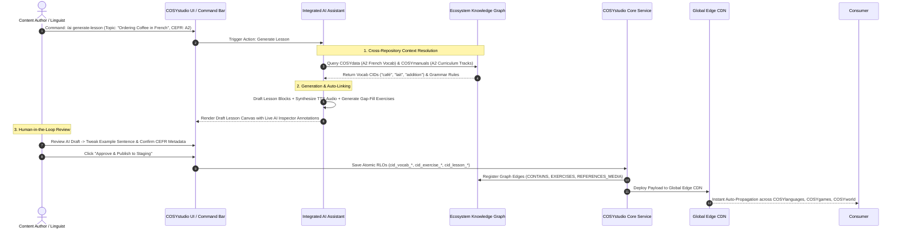
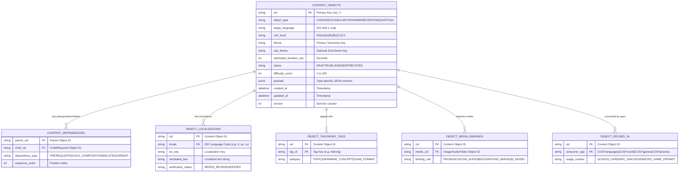

# COSYstudio Architecture Specification: Database-First Content Operating System (COS)

## Executive Summary & Database-First Philosophy

**COSYstudio is NOT a Learning Management System (LMS).**

It is the **Central Content Operating System (COS)** that powers the entire **COSYlanguages** ecosystem across all 11 organization repositories (`cosylanguages/*`). An LMS or platform service (`COSYplatform`) manages student logins, classroom hubs, teacher-student sessions, user accounts, and paid course subscriptions. In contrast, **COSYstudio** serves as the single source of truth (SSOT) for creating, localizing, versioning, orchestrating, and distributing thousands of **Reusable Learning Objects (RLOs)**.

### Core Architectural Paradigm: Database-First & Folderless Architecture
Traditional content management systems rely on hierarchical nested folders (`/es/b1/grammar/verbs/unit1/`). This creates content duplication, broken links, and rigid navigation silos.

**COSYstudio eliminates nested folders entirely.**

Instead, COSYstudio implements a **Database-First Content Architecture**:
1. **Everything is a Content Object (`ContentObject`)**: Every piece of content—a lesson, word, audio clip, quest dialogue, or quiz—is an atomic row in a flat, indexed content database with an immutable Content ID (`cid_*`).
2. **Metadata-Driven Organization**: Dynamic filtering, grouping, and relational querying replace folder navigation.
3. **Airtable / Notion Database UI**: Authors interact with content via customizable database views (Grid, Kanban Board, Gallery, Calendar, Node Graph Canvas) and instant multi-dimensional filters.

---

## 1. Integrated AI Assistant Architecture & Ecosystem Intelligence

COSYstudio features a native **Integrated AI Assistant** that acts as an intelligent co-creator for instructional designers, linguists, and authors.

### 1.1 Deep Cross-Repository Context Understanding

The AI Assistant does not generate text in isolation. It maintains full real-time context awareness of the entire 11-repository Knowledge Graph:

* **`COSYdata`**: Reads master vocabulary definitions, IPA transcriptions with regional variants (`uk`, `us`, `ca`, `au`, `nz`), and `schemas/themes.json` taxonomy.
* **`COSYmanuals`**: Understands CEFR level curriculum roadmaps (`curriculums/<iso>/<track>/<LEVEL>.json`), CCQ check requirements, and grammar manual structures.
* **`COSYpractice`**: Analyzes student exercise failure rates and weak-spot telemetry to generate targeted remediation drills.
* **`COSYworld`**: Understands COSY Town RPG quest constraints, character profiles (James York, Ella Bronx, Anna), and district coordinates.
* **`COSYmagazine`**: Understands editorial article formats, flipbook layouts, and podcast script requirements.
* **`COSYevents`**: Generates speaking-club prompt decks and masterclass discussion outlines.
* **`COSYtools`**: Leverages verb conjugation and noun declension rules for morphologically accurate distractors.

```
+---------------------------------------------------------------------------------------------------------+
|                                  COSYstudio INTEGRATED AI ASSISTANT                                     |
+---------------------------------------------------------------------------------------------------------+
|                                    CONTEXT-AWARE KNOWLEDGE GRAPH                                        |
|  * COSYdata Lexicon  * COSYmanuals Curriculums  * COSYpractice Weak Spots  * COSYworld RPG Quests     |
+---------------------------------------------------------------------------------------------------------+
|                                        21 AI ASSISTANT ACTIONS                                          |
|  [1] Generate Lesson      [2] Improve Lesson      [3] Simplify            [4] Increase CEFR             |
|  [5] Translate            [6] Generate Vocab      [7] Generate Examples   [8] Generate IPA              |
|  [9] Generate Pronun.     [10] Generate Quiz      [11] Generate Discussion[12] Generate Homework        |
|  [13] Generate Article    [14] Generate Worksheet [15] Generate Listening [16] Generate TTS           |
|  [17] Generate Images     [18] Generate Dialogue  [19] Generate Roleplay  [20] Generate Cultural Notes  |
|  [21] Generate Metadata                                                                                 |
+---------------------------------------------------------------------------------------------------------+
```

---

### 1.2 Comprehensive 21 AI Assistant Actions

Below are the 21 native AI Assistant actions integrated into the COSYstudio command bar (`Cmd+K`) and block inspector drawers:

#### 1. Generate Lesson
* **Trigger**: `/ai generate-lesson` or `Cmd+K` -> "Generate Lesson on [Topic]".
* **Output**: Assembles a multi-block Notion-style lesson (`cid_lesson_*`) containing heading, rich text, vocabulary table, grammar explanation, gap-fill exercise, and teacher notes.
* **Context Binding**: Automatically queries `COSYmanuals` curriculum maps and `COSYdata` vocabulary pools for target CEFR level.

#### 2. Improve Lesson
* **Trigger**: Click "Improve Lesson" in Lesson Builder inspector drawer.
* **Output**: Scans current lesson blocks for pedagogical flow, suggests missing CCQ checks, replaces weak example sentences, and adds interactive exercise blocks.

#### 3. Simplify
* **Trigger**: Select text / block -> "Simplify to CEFR A2".
* **Output**: Rewrites text using vocabulary and grammar rules constrained strictly to the lower target CEFR level without losing core meaning.

#### 4. Increase CEFR
* **Trigger**: Select text / block -> "Increase CEFR to B2/C1".
* **Output**: Enhances vocabulary with idiomatic expressions, complex sentence structures, and advanced grammatical forms (e.g. subjunctive mood).

#### 5. Translate
* **Trigger**: `/ai translate` across multi-target language matrix.
* **Output**: Generates high-accuracy, context-aware translations across 14 ISO languages (`en`, `fr`, `it`, `ru`, `el`, `es`, `de`, `pt`, `hy`, `ka`, `ba`, `br`, `cv`, `tt`) while preserving localization keys (`titleLocKey`).

#### 6. Generate Vocabulary
* **Trigger**: Highlight text -> "Extract & Generate Vocabulary".
* **Output**: Creates canonical `Vocabulary` Content Objects (`cid_vocab_*`) with headword, part of speech, grammatical gender, definitions, and translations.

#### 7. Generate Examples
* **Trigger**: Select vocabulary item -> "Generate 3 Contextual Example Sentences".
* **Output**: Produces CEFR-aligned example sentences demonstrating correct usage in realistic scenarios.

#### 8. Generate IPA
* **Trigger**: Select term -> "Generate IPA Phonetics".
* **Output**: Generates primary IPA transcription and regional IPA variants (`uk`, `us`, `ca`, `au`, `nz`).

#### 9. Generate Pronunciation
* **Trigger**: Select IPA / sentence -> "Generate Pronunciation Drill".
* **Output**: Creates a `Pronunciation` block (`cid_drill_*`) with target audio waveform and expected speech-to-text transcript.

#### 10. Generate Quiz
* **Trigger**: Select lesson / vocabulary pool -> "Generate 5-Question Quiz".
* **Output**: Creates a `Quiz` Content Object (`cid_quiz_*`) containing multiple choice, gap-fill, and reordering questions with plausible distractors generated from `COSYtools` conjugation/declension tables.

#### 11. Generate Discussion
* **Trigger**: `/ai generate-discussion`.
* **Output**: Generates communicative speaking-club prompts, debate questions, and opinion triggers for `COSYevents`.

#### 12. Generate Homework
* **Trigger**: `/ai generate-homework`.
* **Output**: Produces a `Homework` assignment block with instructions, completion checklist, and linked review flashcards.

#### 13. Generate Article
* **Trigger**: `/ai generate-article`.
* **Output**: Drafts a short, cultural, speaking-first article formatted for `COSYmagazine` with embedded vocabulary popups and sentence frames.

#### 14. Generate Worksheet
* **Trigger**: `/ai generate-worksheet`.
* **Output**: Compiles a printable PDF reference worksheet layout (`cid_worksheet_*`) for `COSYmanuals` print booklets.

#### 15. Generate Listening
* **Trigger**: `/ai generate-listening`.
* **Output**: Drafts a listening comprehension script, attaches neural TTS audio (`cid_media_*`), and generates timestamped comprehension questions.

#### 16. Generate TTS
* **Trigger**: Select text -> "Generate High-Fidelity Neural TTS Audio".
* **Output**: Synthesizes native speaker neural audio, uploads to CDN, creates a `Media` object (`cid_media_*`), and attaches word-level force alignment JSON (`.vtt`).

#### 17. Generate Images
* **Trigger**: Select vocabulary / story -> "Generate Illustrative Image".
* **Output**: Invokes text-to-image AI pipeline to generate a clean, educational illustration (`cid_image_*`), sets localized alt text, and attaches to block.

#### 18. Generate Dialogue
* **Trigger**: `/ai generate-dialogue`.
* **Output**: Creates a multi-turn `Dialogue` block between two speakers with natural conversational turns and audio bindings.

#### 19. Generate Roleplay
* **Trigger**: `/ai generate-roleplay`.
* **Output**: Creates an interactive `AI Discussion` roleplay scenario (e.g. *Barista at COSY Cafe*, *Hotel Receptionist*) for `COSYworld` RPG quests.

#### 20. Generate Cultural Notes
* **Trigger**: Select topic -> "Generate Cultural & Pragmatic Notes".
* **Output**: Produces pragmatic usage callouts, cultural context notes, and etiquette warnings.

#### 21. Generate Metadata
* **Trigger**: `/ai generate-metadata`.
* **Output**: Analyzes any raw text/lesson, estimates difficulty score (1-100), assigns CEFR level (`A0`–`C2`), taxonomy theme/sub-theme, targeted skill tags, age groups, and Bloom taxonomy learning objectives.

---

### 1.3 End-to-End AI Generation & Human-in-the-Loop Workflow

The workflow below illustrates how the AI Assistant collaborates with authors to generate, review, auto-link, and publish content objects:



---

## 2. Educational Content Knowledge Graph & Non-Duplication Architecture

In COSYstudio, lessons, games, articles, and assessments **never duplicate information**. Every composite entity is a node in a **Directed Educational Knowledge Graph** that references canonical atomic objects by Content Identifiers (`cid_*`).

### 2.1 Knowledge Graph Node Hierarchy

```
                          [ LESSON CONTAINER ]
                                    |
              +---------------------+---------------------+
              |                                           |
     [ VOCABULARY NODE ]                         [ GRAMMAR RULE NODE ]
              |                                           |
      +-------+-------+                           +-------+-------+
      |               |                           |               |
[ ARTICLE NODE ] [ GAME BUNDLE ]             [ QUEST SCRIPT ] [ EXERCISE BLOCK ]
      |               |                           |               |
      +-------+-------+                           +-------+-------+
              |                                           |
       [ MEDIA ASSET ]                             [ ASSESSMENT QUIZ ]
              |                                           |
     [ FLASHCARD CARD ]                          [ PRONUNCIATION DRILL ]
```

### 2.2 Knowledge Graph Relationship Types

| Relationship Type | Direction | Description & Example |
| :--- | :--- | :--- |
| **`CONTAINS`** | Composite -> Child | Lesson contains Vocabulary: `cid_lesson_402 CONTAINS cid_vocab_9021` |
| **`EXPLAINS`** | Grammar -> Vocabulary | Grammar rule explains verb usage: `cid_gram_104 EXPLAINS cid_vocab_8921` |
| **`EXERCISES`** | Exercise -> Vocab/Grammar | Gap-fill tests vocabulary item: `cid_exercise_101 EXERCISES cid_vocab_9021` |
| **`PREREQUISITE_FOR`**| Node -> Node | A1 Vocabulary is prerequisite for B1 Lesson: `cid_vocab_101 PREREQUISITE_FOR cid_lesson_402` |
| **`TRANSFORMS_TO`** | Vocab -> Flashcard/Game | Vocabulary transforms into Flashcard: `cid_vocab_9021 TRANSFORMS_TO cid_card_9021` |
| **`REFERENCES_MEDIA`**| Node -> Media | Vocabulary references pronunciation audio: `cid_vocab_9021 REFERENCES_MEDIA cid_media_801` |
| **`EVALUATES`** | Assessment -> Node | Quiz evaluates Grammar rule mastery: `cid_quiz_301 EVALUATES cid_gram_104` |
| **`VARIANT_OF`** | Node -> Node | Dialect variant relation: `cid_vocab_9021_us VARIANT_OF cid_vocab_9021_uk` |

---

## 3. Automatic Update Propagation Engine

Because downstream applications (`COSYlanguages`, `COSYgames`, `COSYworld`, `COSYpractice`, `COSYmagazine`) reference canonical `cid_*` keys rather than embedding copies, **updating a single canonical object automatically updates every downstream consumer.**

### Example: Updating a Vocabulary Word ("El Cubierto")

Suppose an editor updates the canonical vocabulary node `cid_vocab_9021` ("El Cubierto"):
1. Updates definition text or attaches a higher-quality native audio recording (`cid_media_801`).
2. The COSYstudio core publishes a `content.updated` event to the NATS / Kafka Event Bus.
3. The event bus notifies Edge API nodes and triggers instant CDN cache invalidation.
4. **Instant Downstream Propagation**:
   * **Lessons** in `COSYlanguages` automatically show the new audio and definition.
   * **Micro-games** in `COSYgames` play the new audio snippet during matching games.
   * **Articles** in `COSYmagazine` update inline vocabulary popup cards.
   * **3D Quests** in `COSYworld` update NPC dialogue audio prompts.
   * **Worksheets & Print Booklets** in `COSYmanuals` re-render with corrected translation keys.
   * **Flashcards & Drills** in `COSYpractice` update speech evaluation targets.

---

## 4. Versioning & Dependency Governance Strategy

### 4.1 Versioning Contracts: Immutable Versions vs Dynamic Aliasing

* **Immutable Version Identifiers (`cid@version`)**: Every version of a content object is immutable (e.g. `cid_vocab_9021@1.0.0`, `cid_vocab_9021@1.1.0`).
* **Dynamic Pointer Aliases (`@latest`, `@staging`, `@production`)**: Downstream applications query dynamic aliases (e.g. `cid_vocab_9021@production`).
* **SemVer Propagation Rules**:
  * **PATCH (`1.0.0` -> `1.0.1`)**: Typo fixes, definition refinement. **Auto-propagates instantly** to `@production` alias.
  * **MINOR (`1.0.0` -> `1.1.0`)**: Additive non-breaking changes (new example sentence, regional IPA variant). **Auto-propagates instantly** to `@production` alias.
  * **MAJOR (`1.0.0` -> `2.0.0`)**: Structural breaking changes. **Does NOT auto-propagate to `@production`**. Creates a new major version pointer, requiring author review and migration approval in downstream lessons.

---

## 5. High-Level Ecosystem Architecture Diagram

```
+--------------------------------------------------------------------------------------------------------+
|                                           COSYplatform                                                 |
|               (Central Auth SSO, User Accounts, Subscriptions, Billing, Global API Gateway)            |
+---------------------------------------------------+----------------------------------------------------+
                                                    |
                                                    v
+--------------------------------------------------------------------------------------------------------+
|                                           COSYstudio (COS)                                             |
|  +--------------------+   +-----------------------+   +-----------------------+   +------------------+  |
|  | Authoring & CMS    |   | Localization Manager  |   | Asset Pipeline (Media)|   | AI Assistant     |  |
|  +--------------------+   +-----------------------+   +-----------------------+   +------------------+  |
|  |  Content Graph SSOT: Vocabulary, Grammar, Exercises, Quests, Drills, Manuals, Articles, Events   |  |
|  +--------------------------------------------------------------------------------------------------+  |
|  | Exposed: GraphQL API / gRPC Edge / Global CDN / Event Stream (Kafka / NATS)                      |  |
+---------------------------------------------------+----------------------------------------------------+
                                                    |
                    +-------------------------------+-------------------------------+
                    |                               |                               |
          (Fetch Content Nodes)            (Fetch Media Assets)            (Event Stream Sub)
                    |                               |                               |
        +-----------v-----------+       +-----------v-----------+       +-----------v-----------+
        |     COSYlanguages     |       |     COSYpractice      |       |       COSYdata        |
        |  (Main Learning App)  |       |  (Interactive Drills) |       | (Analytics / Telemetry|
        | Owns: SRS State,      |       | Owns: Practice Runs,  |       | Owns: Telemetry Logs, |
        | Course Progress       |       | User Voice Recordings |       | Data Lake, ML Models  |
        +-----------------------+       +-----------------------+       +-----------------------+
                    |                               |                               |
    +---------------+---------------+---------------+---------------+---------------+---------------+
    |                               |                               |                               |
+---v-------------------+   +-------v---------------+   +-----------v-----------+   +---------------v-------+
|       COSYworld       |   |       COSYgames       |   |       COSYtools       |   |     COSYmagazine      |
| (3D Spatial Language) |   | (Micro-games Arcade)  |   |  (Dictionaries & Ext) |   | (Digital Magazine)    |
| Owns: 3D Session,     |   | Owns: Game Sessions,  |   | Owns: Tool Search     |   | Owns: Comments,       |
| Avatar Customization  |   | Leaderboards, Badges  |   | Cache, Extension Prefs|   | Reading Bookmarks     |
+-----------------------+   +-----------------------+   +-----------------------+   +-----------------------+
    |                               |                               |                               |
    +-------------------------------+---------------+---------------+-------------------------------+
                                                    |
                                    +---------------+---------------+
                                    |                               |
                        +-----------v-----------+       +-----------v-----------+
                        |      COSYevents       |       |      COSYmanuals      |
                        | (Webinars & Meetups)  |       | (Docs & Help Center)  |
                        | Owns: Event Tickets,  |       | Owns: Support Tickets,|
                        | Registrations, WebRTC |       | Vote Ratings          |
                        +-----------------------+       +-----------------------+
```

---

## 6. Notion-Style Visual Lesson Builder & JSON Block Engine

COSYstudio features a modern, drag-and-drop **Visual Lesson Builder** operating on 100% native JSON document trees (**Zero XML**).

* **24 Draggable Blocks**: Heading, Rich text, Image, Gallery, Video, Audio, Dialogue, Vocabulary Table, Grammar Table, Timeline, Matching, Sorting, Gap Fill, Flashcards, Pronunciation, Speaking, AI Discussion, Quiz, Poll, Reflection, Homework, Teacher Notes, Assessment, Custom Extension.
* **7 Lifecycle Contracts per Block**: Schema, Properties, Validation, Preview, Serialization, Rendering, Future Extensibility.
* **Real-Time Collaboration**: Yjs/CRDT WebSocket relay for multiplayer live co-authoring.
* **Undo/Redo Engine**: Non-blocking time-travel history stack (`Cmd+Z` / `Cmd+Shift+Z`).
* **Reusable Templates**: Save and instantiate block sequences as reusable templates (`cid_template_*`).

---

## 7. Unified Content Object Model & Metadata Schema

Every entity in COSYstudio inherits from the base `ContentObject` schema.

```typescript
export type CEFRLevel = 'A0' | 'A1' | 'A2' | 'B1' | 'B2' | 'C1' | 'C2';

export type LanguageCode = 'en' | 'fr' | 'it' | 'ru' | 'el' | 'es' | 'de' | 'pt' | 'hy' | 'ka' | 'ba' | 'br' | 'cv' | 'tt';

export interface ContentObjectMetadata {
  cid: string; // "cid_vocab_01H8X..."
  objectType: 'LESSON' | 'DIALOGUE' | 'VOCABULARY' | 'GRAMMAR' | 'EXERCISE' | 'QUIZ' | 'IMAGE' | 'VIDEO' | 'AUDIO' | 'PROMPT' | 'WORKSHEET' | 'ARTICLE' | 'QUEST' | 'GAME';
  targetLanguage: LanguageCode;
  cefrLevel: CEFRLevel;
  theme: string;
  subTheme?: string;
  grammarRuleCids: string[];
  skills: ('READING' | 'WRITING' | 'LISTENING' | 'SPEAKING' | 'PRONUNCIATION' | 'GRAMMAR' | 'VOCABULARY')[];
  ageGroups: ('CHILDREN' | 'KIDS' | 'TEENS' | 'ADULTS' | 'BUSINESS')[];
  targetAudiences: ('GENERAL' | 'SPOKEN' | 'EXAM' | 'PROFESSIONAL' | 'TRAVEL' | 'RELOCATION')[];
  estimatedDurationSeconds: number;
  learningObjectives: string[];
  status: 'DRAFT' | 'REVIEW' | 'STAGING' | 'PUBLISHED' | 'ARCHIVED' | 'DEPRECATED';
  tags: string[];
  difficultyScore: number;
  dependencies: {
    prerequisiteCids: string[];
    childCids: string[];
    relatedCids: string[];
    variantCids: string[];
  };
  createdBy: string;
  createdAt: string;
  updatedAt: string;
  version: number;
}
```

---

## 8. Entity Relationship Diagrams (ERDs)



---

## 9. Data Ownership Matrix (11 Ecosystem Repositories)

| Data Entity / Domain | studio | platform | languages | world | games | tools | data | magazine | events | manuals | practice |
| :--- | :---: | :---: | :---: | :---: | :---: | :---: | :---: | :---: | :---: | :---: | :---: |
| **Canonical Vocabulary & Dictionary** | **OWNER** | Forbidden | Read-Only | Read-Only | Read-Only | Read-Only | Read-Only | Read-Only | Read-Only | Read-Only | Read-Only |
| **Grammar Rules & Explanations** | **OWNER** | Forbidden | Read-Only | Read-Only | Read-Only | Read-Only | Read-Only | Read-Only | Read-Only | Read-Only | Read-Only |
| **Media Assets (Audio, Video, 3D)** | **OWNER** | Read-Only | Read-Only | Read-Only | Read-Only | Read-Only | Read-Only | Read-Only | Read-Only | Read-Only | Read-Only |
| **Localization Master Keys & Translations** | **OWNER** | Read-Only | Read-Only | Read-Only | Read-Only | Read-Only | Read-Only | Read-Only | Read-Only | Read-Only | Read-Only |
| **Quest Scenarios & Dialogue Trees** | **OWNER** | Forbidden | Read-Only | Read-Only | Forbidden | Forbidden | Read-Only | Read-Only | Forbidden | Forbidden | Read-Only |
| **Drill Masters & Exercise Rubrics** | **OWNER** | Forbidden | Read-Only | Read-Only | Read-Only | Forbidden | Read-Only | Forbidden | Forbidden | Forbidden | Read-Only |
| **Documentation Articles (Manuals)** | **OWNER** | Read-Only | Read-Only | Forbidden | Forbidden | Read-Only | Read-Only | Forbidden | Forbidden | Read-Only | Forbidden |
| **User Identity, Auth & Billing** | Forbidden | **OWNER** | Read-Only | Read-Only | Read-Only | Read-Only | Read-Only | Read-Only | Read-Only | Read-Only | Read-Only |
| **User Progress & SRS Card State** | Forbidden | Forbidden | **OWNER** | Read-Only | Read-Only | Forbidden | Read-Only | Forbidden | Forbidden | Forbidden | Read-Only |
| **3D World Session & Avatar Cosmetics**| Forbidden | Forbidden | Forbidden | **OWNER** | Forbidden | Forbidden | Read-Only | Forbidden | Forbidden | Forbidden | Forbidden |
| **Game Match Sessions & High Scores** | Forbidden | Forbidden | Read-Only | Forbidden | **OWNER** | Forbidden | Read-Only | Forbidden | Forbidden | Forbidden | Forbidden |
| **Tool Search Cache & Local Prefs** | Forbidden | Forbidden | Forbidden | Forbidden | Forbidden | **OWNER** | Read-Only | Forbidden | Forbidden | Forbidden | Forbidden |
| **Telemetry, Analytics & AI Models** | Forbidden | Read-Only | Read-Only | Read-Only | Read-Only | Read-Only | **OWNER** | Read-Only | Read-Only | Read-Only | Read-Only |
| **Magazine Comments & Bookmarks** | Forbidden | Forbidden | Forbidden | Forbidden | Forbidden | Forbidden | Read-Only | **OWNER** | Forbidden | Forbidden | Forbidden |
| **Event Registrations & Tickets** | Forbidden | Read-Only | Forbidden | Forbidden | Forbidden | Forbidden | Read-Only | Forbidden | **OWNER** | Forbidden | Forbidden |
| **Help Tickets & User Vote Ratings** | Forbidden | Read-Only | Forbidden | Forbidden | Forbidden | Forbidden | Read-Only | Forbidden | Forbidden | **OWNER** | Forbidden |
| **Practice Audio Recordings & Runs**| Forbidden | Forbidden | Read-Only | Forbidden | Forbidden | Forbidden | Read-Only | Forbidden | Forbidden | Forbidden | **OWNER** |

---

## 10. Verified Repository Boundary Analysis (11 Repositories)

Below is the definitive boundary analysis for all 11 repositories in the `cosylanguages/` organization answering all 5 core questions per repository.

### 10.1 COSYstudio (`cosylanguages/COSYstudio`)
* **Responsibility**: Central Content Operating System (COS). Single source of truth for authoring, versioning, localization, asset transcoding, and edge RLO distribution.
* **Data Owned**: Canonical Content Objects (`cid_*`), Media Manifests, Localization Master Keys, Taxonomy Trees, Version History Logs.
* **Data It Must NEVER Own**: Student Enrollments, Paid Classroom Sessions, Private Student Data, SRS States, Event Registrations.
* **Exposed APIs**: `Content Query API` (GraphQL/gRPC/REST), `Content Authoring API`, `Search & Taxonomy Index API`, `Content Event Stream` (Kafka/NATS).
* **Consumed APIs from COSYstudio**: N/A (Core Provider).

### 10.2 COSYdata (`cosylanguages/COSYdata`)
* **Responsibility**: Canonical machine-readable data repository and vocabulary hub serving dictionary datasets (`vocabulary/<lang>/`) and taxonomy schemas (`schemas/themes.json`) across 14 ISO languages.
* **Data Owned**: Standardized Vocabulary JSON Entries (`A0`–`C2`), IPA Transcriptions, Dialect Variants, `schemas/themes.json`, Index Artifacts (`index.json`, `flat-index.json`).
* **Data It Must NEVER Own**: Student SRS Intervals, User Credentials, Quiz Performance Scores.
* **Exposed APIs**: Static CDN REST Endpoints (`vocabulary/<lang>/<level>/<theme>.json`), `vocab-resolver.js`, `cosy-word-popup.js`.
* **Consumed APIs from COSYstudio**: Ingests published vocabulary RLOs, IPA definitions, and taxonomy trees from `content.published` event stream.

### 10.3 COSYplatform (`cosylanguages/COSYplatform`)
* **Responsibility**: Web application for students, teachers, and founder providing authentication, student hub, paid course execution, and online virtual classroom.
* **Data Owned**: User Accounts, Auth Credentials, OAuth Tokens, Classroom State, Paid Course Enrollments, Private Student Progress (Supabase).
* **Data It Must NEVER Own**: Public Vocabulary Master Data, Dictionaries, Offline Booklet Reference Materials.
* **Exposed APIs**: `Classroom Service API`, `Student Progress API`.
* **Consumed APIs from COSYstudio**: Fetches structured lesson block templates and RLO schemas by `cid` for live classroom rendering.

### 10.4 COSYlanguages (`cosylanguages/COSYlanguages`)
* **Responsibility**: Free public front door, landing portal, language hubs, course catalogue, placement quiz, price calculator, and hybrid community pages.
* **Owned Data**: Portal Page UI State, Interface Translations (`data/ui/<lang>.json`), `config.js` Registry, Placement Quiz Logic.
* **Data It Must NEVER Own**: Master Vocabulary Datasets, User Auth Credentials, Private Classrooms.
* **Exposed APIs**: Static Web Portal Pages & Client Navigation Engine.
* **Consumed APIs from COSYstudio**: Fetches course catalog metadata, localized UI descriptors, and placement quiz RLOs.

### 10.5 COSYpractice (`cosylanguages/COSYpractice`)
* **Responsibility**: Free interactive practice exercise engine for vocabulary, grammar, and speaking (`en`, `fr`, `it`, `ru`, `el`) with SRS reviews and daily challenges.
* **Owned Data**: Browser LocalStorage SRS Memory State, Practice Session Scores, Weak Spot Indicators, Progress Dashboard Metrics.
* **Data It Must NEVER Own**: Master Vocabulary JSON Files, Master Grammar Explanations, CCQ Rule Documents.
* **Exposed APIs**: Client-side practice engine (`_engine/`) and progress dashboard (`progress-dashboard.html`).
* **Consumed APIs from COSYstudio**: Dynamically fetches vocabulary RLOs, grammar exercise blocks, and CCQ prompts by `cid`.

### 10.6 COSYtools (`cosylanguages/COSYtools`)
* **Responsibility**: Offline-first, client-side language reference suite (verb conjugators, noun gender/case declension, case matrices) across 14 languages.
* **Owned Data**: Tool Datasets (`tools/<lang>/<tool>/data/`), Sharded Dictionaries, `catalog.json` Inventory.
* **Data It Must NEVER Own**: Student Course Enrollments, Classroom Telemetry, User Auth Tokens.
* **Exposed APIs**: Deep-Linking Query Interfaces (`?verb=<lemma>`, `?noun=<word>`, `?q=<keyword>`).
* **Consumed APIs from COSYstudio**: Reads canonical headwords, conjugation tables, and grammatical rules.

### 10.7 COSYgames (`cosylanguages/COSYgames`)
* **Responsibility**: Suite of 20 interactive standalone language games for communicative fluency and vocabulary practice.
* **Owned Data**: Game Match State, Active Session Scores, Local High Score History.
* **Data It Must NEVER Own**: Master Dictionaries, User Accounts, Pedagogical Progress Tracking.
* **Exposed APIs**: Client-side game runners (HTML5 / ES6 Modules).
* **Consumed APIs from COSYstudio**: Fetches mini-game content bundles (`cid_gamepack_*`).

### 10.8 COSYevents (`cosylanguages/COSYevents`)
* **Responsibility**: Public calendar directory and session material repository (speaking club decks, cinema guides, masterclasses).
* **Owned Data**: Event Definitions (`events/<slug>/event.json`), Session JSONs (`events/<slug>/sessions/<slug>.json`), Calendar Index (`public-events.json`).
* **Data It Must NEVER Own**: Private Classroom Sessions, User Auth Secrets, Paid Course Enrollments.
* **Exposed APIs**: Static Calendar Directory (`index.html`, `public-events.json`).
* **Consumed APIs from COSYstudio**: Fetches session prompt decks (`cid_eventpack_*`), event descriptions, and media assets.

### 10.9 COSYmanuals (`cosylanguages/COSYmanuals`)
* **Responsibility**: Public catalog and gated learning portal holding manuals, teacher guides, student workbooks, and print booklets across 13 ISO languages + Chuvash.
* **Owned Data**: Public Manual Catalog Metadata (`catalog/*.json`), Curriculum Maps (`curriculums/<iso>/<track>/<LEVEL>.json`), Gated Body Text (Supabase), Printable Booklet Layouts.
* **Data It Must NEVER Own**: Master Vocabulary Datasets, Live Classroom Session State.
* **Exposed APIs**: Public Catalog Manifest (`catalog/manifest.json`), Manual Viewers.
* **Consumed APIs from COSYstudio**: Fetches documentation nodes (`cid_manual_*`), grammar rule explanations, and vocabulary sets.

### 10.10 COSYmagazine (`cosylanguages/COSYmagazine`)
* **Responsibility**: Short speaking-first digital publication (articles, sentence frames, podcasts) with flipbook and stage presentation modes (`?stage=1`, `?script=1`).
* **Owned Data**: Editorial Article JSON Posts (`posts/*.json`), Podcast Feed (`podcast.xml`), Generated Static HTML Pages, Newsstand Index (`posts.json`).
* **Data It Must NEVER Own**: Embedded Master Dictionary Definitions.
* **Exposed APIs**: Newsstand Interface (`index.html`), RSS Podcast Feed (`podcast.xml`).
* **Consumed APIs from COSYstudio**: Fetches article content nodes (`cid_article_*`), inline vocabulary popups, and podcast audio assets.

### 10.11 COSYworld (`cosylanguages/COSYworld`)
* **Responsibility**: Standalone open-world RPG for direct language immersion in COSY Town across 14 target languages (character selection: James York, Ella Bronx, Anna).
* **Owned Data**: COSY Town Hotspots, RPG Instance State, Player Citizen Level, XP, COSY Passport Progress Saves (LocalStorage / JSON).
* **Data It Must NEVER Own**: Master Dictionary & Grammar Rules.
* **Exposed APIs**: Standalone RPG Web App & COSY Passport Export/Import Engine.
* **Consumed APIs from COSYstudio**: Fetches NPC dialogue trees (`cid_dialogue_*`), quest script nodes (`cid_quest_*`), and localized object names.

---

## 11. Shared Packages (`@cosy/*`) & Governance

To guarantee type safety, consistent content referencing, and schema validation across all 11 repositories, shared packages are maintained in the `@cosy/` registry.

```
@cosy/
├── schema-content/       # Canonical TypeScript & JSON Schemas for Content Objects
├── schema-events/        # Event payload schemas for NATS / Kafka event bus
├── sdk-client/           # Multi-platform Client SDK (TypeScript / Rust / C# Unity)
├── ui-tokens/            # Shared design system tokens, typography, iconography
└── core-utils/           # CID generators, CEFR helpers, language code parsers
```

### Governance Rules
1. **Zero Runtime Side-Effects**: Shared packages contain **only types, schemas, validation utilities, and client contracts**.
2. **Semantic Versioning (SemVer)**: Major for breaking schema changes, Minor for additive changes, Patch for bug fixes.
3. **Automated Schema Codegen**: Protobuf / JSON Schemas generate TypeScript, Rust, and C# code.

---

## 12. Migration Strategy

Migrating existing applications across all 11 repositories to the strict COSYstudio COS architecture follows a 5-phase zero-downtime plan.

1. **Phase 1: Foundation Setup & Package Publishing (`@cosy/*`)**: Deploy edge CDN, NATS event bus, and shared packages.
2. **Phase 2: Extraction & Deduplication into COSYstudio SSOT**: Extract raw content tables from consumer repos (`COSYdata`, `COSYevents`, `COSYmanuals`, `COSYmagazine`) and deduplicate into canonical `ContentNode` graphs with `cid_*`.
3. **Phase 3: Dual-Read & Translation Shim Deployment**: Enable consumer services to fetch content via `cid` while maintaining legacy fallback.
4. **Phase 4: Full Read-Switch & Consumer DB Content Purge**: Route 100% of content reads to COSYstudio Edge APIs and purge raw content tables from consumer DBs.
5. **Phase 5: Automated CI/CD Guardrails**: Enforce linter rules preventing raw content/translation tables from being introduced into consumer apps.

---

## Conclusion

By combining an Integrated AI Assistant with 21 native actions, a Notion-style Visual Lesson Builder, 24 extensible block primitives, 100% JSON internal contracts (zero XML), real-time collaboration (Yjs CRDTs), an Educational Content Knowledge Graph, and a database-first folderless Content Operating System:
* **Context-Aware AI Creator**: 21 actions aware of the entire 11-repository Knowledge Graph.
* **Zero XML & 100% JSON Engine**: Fast, clean, type-safe block serialization.
* **Knowledge Graph Non-Duplication**: Content exists once in `COSYstudio` and is referenced via `cid`.
* **Automatic Update Propagation**: Updating one canonical object automatically updates every downstream lesson, game, article, and quest in real-time.
* **Domain Ownership**: Clean isolation across all 11 `cosylanguages/` repositories.
