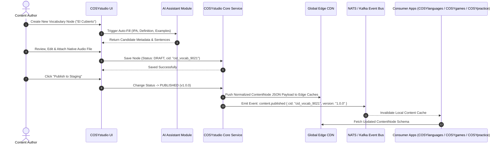
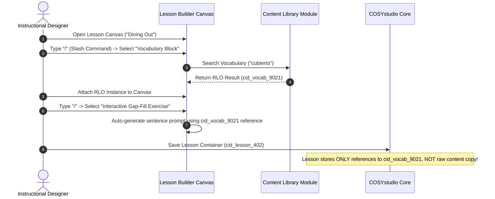

# COSYstudio Architecture Specification: Central Content Operating System (COS)

## Executive Summary & Design Philosophy

**COSYstudio is NOT a Learning Management System (LMS).**

It is the **Central Content Operating System (COS)** that powers the entire **COSYlanguages** ecosystem across all 11 organization repositories (`cosylanguages/*`). An LMS or platform service (`COSYplatform`) manages student logins, classroom hubs, teacher-student sessions, user accounts, and paid course subscriptions. In contrast, **COSYstudio** serves as the single source of truth (SSOT) for creating, localizing, versioning, orchestrating, and distributing thousands of **Reusable Learning Objects (RLOs)**.

### Product Inspirations & Modern Experience
Instead of bloated legacy interfaces (e.g., Skyeng), **COSYstudio** is designed as a modern, high-velocity, block-based Content Operating System inspired by the best developer and creator tools:
* **Notion**: Block-based content composition (`/` slash commands, drag-and-drop hierarchy, nested property views).
* **Linear**: Ultra-fast keyboard-first navigation (`Cmd+K` command palette, instant search, keyboard shortcuts, deterministic states, high performance).
* **Figma**: Visual canvas composition, node-based content graph linking, multiplayer live collaboration, real-time presence indicators, reusable component instances.
* **ProgressMe & Edvibe**: Specialized interactive language learning block primitives (gap-fill, audio alignment, interactive dialogue cards, exercise transformers).

---

## 1. Verified Repository Boundary Analysis (11 Repositories)

Below is the definitive analysis for all 11 repositories in the `cosylanguages/` organization based on direct verification of their source trees, schemas, and live documentation.

### 1.1 COSYstudio (`cosylanguages/COSYstudio`)
* **Responsibility**: Central Content Operating System (COS). Authoring, versioning, publishing workflows, asset ingestion/pipeline (transcoding, audio alignment, 3D model processing), taxonomy tree management (`schemas/themes.json`), localization master translation, edge content distribution, and content graph relations.
* **Owned Data**:
  * Canonical Content Nodes / Reusable Learning Objects (Vocabulary, Grammar, Exercises, Articles, Quest Scenarios, Drills, Manual Articles).
  * Asset Metadata & Binary Manifests (CDN URLs, audio timestamps, transcriptions, video renditions, 3D models).
  * Localization Master Keys & Multi-language Translations.
  * Taxonomy Trees, Categories, Tags, and CEFR Alignment Maps (`A0`–`C2`).
  * Content Version History, Revisions & Audit Logs.
* **Data It Must NEVER Own**:
  * Student Enrollments, Paid Classroom Sessions, or Private Student Data (Owned by `COSYplatform`).
  * Practice Session Execution State, Local Storage Timers & Audio Submissions (Owned by `COSYpractice`).
  * Event RSVPs, Attendee Registrations & WebRTC Tokens (Owned by `COSYevents`).
  * RPG Player Local Storage Saves & COSY Passport Files (Owned by `COSYworld`).
  * Raw Analytics Event Logs & Warehouse Processing (Owned by `COSYdata`).
* **Exposed APIs**:
  * `Content Query API` (GraphQL / gRPC / REST) for fetching published content nodes and media manifests.
  * `Content Authoring API` (gRPC / GraphQL) for CMS editors and automated ingestion pipelines.
  * `Search & Taxonomy Index API` for vector and keyword search across canonical content.
  * `Content Event Stream` (Kafka / NATS Event Bus) emitting `content.published`, `content.updated`, `content.deprecated`.
* **Consumed APIs from COSYstudio**: N/A (Core Provider).

---

### 1.2 COSYlanguages (`cosylanguages/COSYlanguages`)
* **Responsibility**: The free public front door to the ecosystem. Serves as the landing portal, language hubs (English, French, Italian, Russian, Greek, etc.), course catalogue, placement quiz, price calculator, and "Hybrid & Community" pages.
* **Owned Data**:
  * Public Portal Page UI State & Static Interface Translations (`data/ui/<lang>.json`).
  * Ecosystem URL Configuration Registry (`js/core/config.js`).
  * Placement Quiz Logic & Course Price Calculation State.
* **Data It Must NEVER Own**:
  * Master Vocabulary & Grammar Datasets (Read-only mirror from `COSYdata` / `COSYstudio`).
  * User Auth Passwords & Student Classrooms (Delegates to `COSYplatform` on `login.html`).
* **Exposed APIs**:
  * Static Web Portal Pages & Client Navigation Engine.
* **Consumed APIs from COSYstudio**:
  * Fetches course catalog metadata, localized UI descriptors, and placement quiz content nodes by `cid`.

---

### 1.3 COSYdata (`cosylanguages/COSYdata`)
* **Responsibility**: The canonical, machine-readable data repository and vocabulary hub for the ecosystem. Serves standardized dictionary entries (`vocabulary/<lang>/`), functional phrases, curriculum competencies, and taxonomy schemas (`schemas/themes.json`) across 14 ISO languages via GitHub Pages.
* **Owned Data**:
  * Standardized Vocabulary JSON Entries across 14 ISO languages (`en`, `fr`, `it`, `ru`, `el`, `es`, `de`, `pt`, `hy`, `ka`, `ba`, `br`, `cv`, `tt`) spanning CEFR levels `A0`–`C2`.
  * Canonical Taxonomy Schema (`schemas/themes.json`) containing 46 primary themes & sub-themes.
  * Functional Phrase Datasets & IPA Phonetic Transcriptions with Regional IPA Variants (`uk`, `us`, `ca`, `au`, `nz`).
  * Dictionary Index Artifacts (`index.json`, `flat-index.json`, `search-index.json`, `themes-index.json`).
* **Data It Must NEVER Own**:
  * Student Progress, SRS Card State, or Quiz Answers.
  * Private User Profiles or Authentication Secrets.
* **Exposed APIs**:
  * REST / Static CDN Data Endpoints (`vocabulary/<lang>/<level>/<theme>.json`).
  * Client Utilities (`vocab-resolver.js`, `cosy-word-popup.js`, `dictionary-ui.js`).
* **Consumed APIs from COSYstudio**:
  * Subscribes to `content.published` to ingest updated vocabulary definitions, IPA transcriptions, and taxonomy schemas into static CDN artifacts.

---

### 1.4 COSYplatform (`cosylanguages/COSYplatform`)
* **Responsibility**: Web application for COSY Languages students, teachers, and the founder. Provides authentication (`login.html`), student hub, paid course execution, interactive lessons, and online virtual classroom.
* **Owned Data**:
  * User Accounts, Auth Credentials, OAuth Tokens, and Student/Teacher Roles.
  * Student Course Enrollments, Paid Lesson Access Rights, and Classroom State.
  * Private Lesson Execution History & Gated Course Content (stored in private Supabase DB with RLS policies).
* **Data It Must NEVER Own**:
  * Canonical Vocabulary Master Data & Public Dictionaries (Owned by `COSYdata` / `COSYstudio`).
  * Offline Manual Booklets or Public Help Guides (Owned by `COSYmanuals`).
* **Exposed APIs**:
  * `Classroom Service API` (`GET /v1/classroom/session`)
  * `Student Progress API` (`GET /v1/student/progress`)
* **Consumed APIs from COSYstudio**:
  * Queries `ContentNode` schemas by `cid` to render structured lesson templates in the live classroom player.

---

### 1.5 COSYpractice (`cosylanguages/COSYpractice`)
* **Responsibility**: Free interactive practice exercise engine for vocabulary, grammar, and speaking across 5 languages (`en`, `fr`, `it`, `ru`, `el`). Features daily challenges, SRS memory reviews, weak spot practice, a fortune wheel, and projector presentation mode.
* **Owned Data**:
  * Local Storage SRS Memory State & Review Intervals.
  * Practice Session Scores, Weak Spot Indicators, and Progress Dashboard Metrics (stored locally in browser).
* **Data It Must NEVER Own**:
  * Master Vocabulary JSON Files (Dynamically fetches from `COSYdata` and `COSYtools`).
  * Master Grammar Explanations or CCQ Checks (Loads CCQ files from `COSYmanuals`).
* **Exposed APIs**:
  * Client-side practice engine (`_engine/`) and progress dashboard (`progress-dashboard.html`).
* **Consumed APIs from COSYstudio**:
  * Dynamically fetches vocabulary RLOs, grammar exercise blocks, and CCQ prompts from COSYstudio / COSYdata.

---

### 1.6 COSYtools (`cosylanguages/COSYtools`)
* **Responsibility**: Offline-first, 100% client-side language reference suite featuring verb conjugators, noun gender/case declension checkers, case matrices, prepositional regime lookup, and grammar practice drills across 14 languages.
* **Owned Data**:
  * Tool-Specific Datasets (`tools/<lang>/<tool>/data/`) for verb conjugation, case tables, and syntax.
  * Letter-Sharded Supplemental Lexicon Shards (`tools/<lang>/data/shards/`).
  * Central Tool Inventory (`catalog.json`).
* **Data It Must NEVER Own**:
  * Master Course Curriculums or Lesson Execution Logs.
  * User Accounts or Student Classrooms.
* **Exposed APIs**:
  * Deep-Linking URL Query Interfaces (`?verb=<lemma>`, `?noun=<word>`, `?q=<keyword>`).
* **Consumed APIs from COSYstudio**:
  * Reads canonical headword definitions, grammatical properties, and conjugation tables published by COSYstudio.

---

### 1.7 COSYgames (`cosylanguages/COSYgames`)
* **Responsibility**: Open-source suite of 20 interactive, standalone language-learning games for communicative fluency, vocabulary practice, speaking drills, and classroom activities across multiple CEFR levels without requiring registration.
* **Owned Data**:
  * Game Match State, Session Scores, and Local High Score History.
* **Data It Must NEVER Own**:
  * Master Vocabulary Lists or Dictionaries (Pulls word lists from `COSYdata`).
  * User Accounts or Course Enrollments.
* **Exposed APIs**:
  * Standalone client-side game runners (HTML5 / ES6 Modules).
* **Consumed APIs from COSYstudio**:
  * Fetches mini-game content bundles (`cid_gamepack_*`) containing prompt words, distractor items, and media assets.

---

### 1.8 COSYevents (`cosylanguages/COSYevents`)
* **Responsibility**: Public calendar, event directory, and complete session-material repository. Hosts speaking-club prompt decks, cinema immersion guides, teacher-led masterclasses, multimedia nights, and session archives.
* **Owned Data**:
  * Event Definitions (`events/<slug>/event.json`) and Session Material JSON Files (`events/<slug>/sessions/<slug>.json`).
  * Calendar Discovery Index (`public-events.json`).
* **Data It Must NEVER Own**:
  * Private Student Classrooms or Billing Records (Delegates to `COSYplatform`).
* **Exposed APIs**:
  * Static Calendar Directory (`index.html`, `public-events.json`).
* **Consumed APIs from COSYstudio**:
  * Fetches session prompt decks (`cid_eventpack_*`), localized event titles, and supporting media assets.

---

### 1.9 COSYmanuals (`cosylanguages/COSYmanuals`)
* **Responsibility**: Public catalog and gated learning portal holding grammar, vocabulary, communication manuals, teacher guides, student workbooks, and printable offline reference booklets across 13 active ISO languages + Chuvash.
* **Owned Data**:
  * Public Manual Catalog Metadata (`catalog/*.json`) and Course Curriculum Maps (`curriculums/<iso>/<track>/<LEVEL>.json`).
  * Gated Manual Body Text (Stored in Supabase `manual_content` table with RLS policies).
  * Printable Offline Booklet Layouts (`manuals/<iso>/print/`).
* **Data It Must NEVER Own**:
  * Vocabulary Datasets (Mirrors `COSYdata` / `COSYlanguages` as read-only).
  * Live Classroom Telemetry (Owned by `COSYplatform`).
* **Exposed APIs**:
  * Public Catalog Index (`catalog/manifest.json`) and Manual Viewers.
* **Consumed APIs from COSYstudio**:
  * Fetches canonical manual documentation nodes (`cid_manual_*`), grammar rule definitions, and vocabulary sets.

---

### 1.10 COSYmagazine (`cosylanguages/COSYmagazine`)
* **Responsibility**: Short, speaking-first digital publication (articles, sentence frames, podcasts, cultural reads) in English, French, Italian, Russian, and Greek, featuring flipbook and stage/teleprompter reading modes (`?stage=1`, `?script=1`).
* **Owned Data**:
  * Editorial Article JSON Files (`posts/*.json`) and Podcast Feed (`podcast.xml`).
  * Generated Static Post HTML Pages and Newsstand Index (`posts.json`).
* **Data It Must NEVER Own**:
  * Embedded Master Dictionary Definitions (References `COSYdata` popup terms).
* **Exposed APIs**:
  * Newsstand Interface (`index.html`), RSS Podcast Feed (`podcast.xml`).
* **Consumed APIs from COSYstudio**:
  * Fetches magazine article content nodes (`cid_article_*`), inline vocabulary popups (`cid_vocab_*`), and podcast audio assets.

---

### 1.11 COSYworld (`cosylanguages/COSYworld`)
* **Responsibility**: Standalone open-world RPG for direct language immersion in COSY Town across 14 target languages. Features character selection (James York, Ella Bronx, Anna), district exploration (Residential, Commercial, Cultural), and quest dialogues.
* **Owned Data**:
  * COSY Town Map Hotspots, RPG Instance State, and NPC Positions.
  * Character Citizen Level, XP, and COSY Passport Progress Save Schema (LocalStorage / JSON export).
* **Data It Must NEVER Own**:
  * Master Dictionary & Grammar Rules (Links to `COSYtools` & `COSYgames`).
* **Exposed APIs**:
  * Standalone Web App & COSY Passport Export/Import Engine.
* **Consumed APIs from COSYstudio**:
  * Fetches NPC dialogue trees (`cid_dialogue_*`), quest script nodes (`cid_quest_*`), and localized object names (`cid_loc_*`).

---

## 2. Navigation Architecture & Workspace Layout

COSYstudio provides a unified, keyboard-first, distraction-free environment.

```
+-------------------------------------------------------------------------------------------------------+
|  [COSYstudio]  Workspace: English (EN-US)  |  Search/Command Bar (Cmd+K)  |  [AI Assistant] [Publish]|
+-------------------+---------------------------------------------------------------+-------------------+
|                   |                                                               |                   |
|  NAVIGATION SIDEBAR|  MAIN WORKSPACE CANVAS                                        | INSPECTOR PANEL   |
|                   |                                                               |                   |
|  * Dashboard      |  +---------------------------------------------------------+  | Node ID:          |
|  * Content Library|  | Lesson Canvas: "Dining Out - Ordering in Spanish"       |  | cid_vocab_9021    |
|  * Curriculum     |  +---------------------------------------------------------+  |                   |
|  * Lesson Builder |  |  [/] Slash Command to insert block                      |  | CEFR: B1          |
|  * Vocabulary     |  |                                                         |  | Type: VOCAB_CARD  |
|  * Grammar        |  |  +---------------------------------------------------+  |  | Tag: #dining      |
|  * Media Library  |  |  | Vocabulary Block: "El Cubierto"                   |  |  | Audio: Attached   |
|  * Assessments    |  |  | [Audio: es_cubierto.mp3]  [CEFR: B1]              |  |  | Relations:        |
|  * Publishing     |  |  +---------------------------------------------------+  |  | - cid_gram_104    |
|  * Analytics      |  |                                                         |  |                   |
|  * AI Assistant   |  |  +---------------------------------------------------+  |  | Reused in:        |
|  * Settings       |  |  | Interactive Gap-fill Exercise                     |  |  | - 14 Lessons      |
|                   |  |  | "Por favor, tráigame un ______."                  |  |  | - 3 Micro-games   |
|                   |  +---------------------------------------------------------+  | - 2 Quests        |
|                   |                                                               |                   |
+-------------------+---------------------------------------------------------------+-------------------+
|  System Status: Edge Synced (15ms)  |  Live Collaborators: 3 Authors  |  Schema Version: v1.4.0         |
+-------------------------------------------------------------------------------------------------------+
```

### 2.1 Key Navigation Elements
* **Command Bar (`Cmd+K` / `Ctrl+K`)**: Instant fuzzy search across all RLOs, quick actions, jump to module, switch target language context, and trigger AI generators.
* **Collapsible Left Navigation Sidebar**: Clean grouping of core modules with active indicators, workspace switchers, and content filter presets.
* **Main Workspace Canvas**: Flexible view switching between Notion-style block editor, Linear-style list/table views, and Figma-style visual graph node editor.
* **Right Inspector Panel**: Context-aware panel showing RLO properties, Content ID (`cid`), CEFR metadata, localization status, media bindings, and downstream usage impact graphs.

---

## 3. Detailed Application Modules

COSYstudio is structured into **12 dedicated modules**, each engineered to handle Reusable Learning Objects (RLOs) at scale.

```
┌─────────────────────────────────────────────────────────────────────────────────┐
│                                COSYstudio Modules                               │
└─────────────────────────────────────────────────────────────────────────────────┘
 ├── 1. Dashboard               (Ecosystem Health, Content Velocity, Activity Feed)
 ├── 2. Content Library          (Global RLO Search, Filtering, Versioning & Tags)
 ├── 3. Curriculum               (Pedagogical Structures, CEFR Scope & Sequence)
 ├── 4. Lesson Builder          (Notion-Block Editor, Interactive Card Composers)
 ├── 5. Vocabulary Database      (Lexical Database, Phonetics, Etymology, Examples)
 ├── 6. Grammar Database         (Grammatical Patterns, Explanations & Structural Rules)
 ├── 7. Media Library            (Audio Auto-aligner, Video Transcoder, 3D Assets)
 ├── 8. Assessment Builder       (Exercise Transformers, Rubrics & Adaptive Testing)
 ├── 9. Publishing               (Global CDN Edge Pipeline, Staging, Rollbacks)
 ├── 10. Analytics               (RLO Performance Index, Retention & Effectiveness)
 ├── 11. AI Assistant            (Auto-Generator, CEFR Estimator, Alignment Engine)
 └── 12. Settings                (Permissions, Localization Locales, Webhooks & Schemas)
```

---

### 3.1 Dashboard
* **Why It Exists**: Authors, instructional designers, and content leads need a high-level command center to track content production velocity, pending translations, edge sync status, and system health across all 10 downstream applications.
* **Core Capabilities**:
  * Real-time content creation activity stream (who published what RLO).
  * Content health indicators (missing audio, unverified translations, deprecated nodes).
  * System-wide edge deployment status across global CDN points of presence.
  * Rapid creation shortcuts (`Cmd+N` -> New Vocab, New Lesson, New Grammar Rule).

---

### 3.2 Content Library
* **Why It Exists**: To eliminate duplicate content creation across the enterprise by serving as the central searchable repository of all Reusable Learning Objects (RLOs).
* **Core Capabilities**:
  * Unified search index across all content types (Vocabulary, Grammar, Exercises, Quests, Drills, Manuals).
  * Linear-style instant filtering by target language, CEFR level (`A0`–`C2`), taxonomy tag, status (`DRAFT`, `PUBLISHED`, `DEPRECATED`), and content owner.
  * "Reused In" impact analyzer showing which downstream apps (`COSYlanguages`, `COSYworld`, `COSYgames`, `COSYpractice`, `COSYmanuals`) consume a specific `cid`.
  * Batch tag management and version history inspect/rollback.

---

### 3.3 Curriculum
* **Why It Exists**: Language learning requires coherent pedagogical structures. The Curriculum module defines how RLOs are mapped into learning paths, CEFR tracks (`general`, `spoken`, `exam`, `professional`, `travelling`, `relocation`), skill modules, and topic units without copying content nodes.
* **Core Capabilities**:
  * Scope & Sequence visual tree builder matching `COSYmanuals` curriculum schemas.
  * Drag-and-drop ordering of lesson containers (`cid_lesson_*`) and topic modules.
  * CEFR difficulty progression validator (flags abrupt difficulty spikes).
  * Multi-track curriculum mapping across 14 target languages.

---

### 3.4 Lesson Builder
* **Why It Exists**: Authors need a flexible, fluid canvas to assemble individual RLOs into engaging, interactive lesson flows without touching code.
* **Core Capabilities**:
  * **Notion-Style Block Composer**: Slash command (`/`) interface to insert text, audio, video, vocabulary cards, grammar rules, gap-fills, and speech drills.
  * **Edvibe / ProgressMe Style Interactive Block Primitives**:
    * Gap-fill transformers, multiple choice, sentence reordering, matching pairs, dialogue prompt cards.
  * **Figma-Style Canvas & Node Linking**: Visual graph mode for branchable dialogue trees (`COSYworld` quests) and adaptive remediation paths.
  * Live preview across target client viewports (Mobile App, Web, 3D Spatial HUD, Micro-game overlay).

---

### 3.5 Vocabulary Database
* **Why It Exists**: Words are foundational language objects. This module manages the master lexicon for target languages, enforcing `schemas/vocabulary.schema.json` standards for pronunciation, etymology, definition, and translation consistency.
* **Core Capabilities**:
  * Structural definition fields: Headword, IPA phonetics with regional variants (`uk`, `us`, `ca`, `au`, `nz`), part of speech, grammatical gender, CEFR tier (`A0`–`C2`).
  * Multi-target translation matrix across 14 ISO languages.
  * Audio snippet binding (native speaker audio recordings or high-fidelity neural TTS).
  * Sentence example linker (associates `cid_vocab` with verified contextual example sentences).

---

### 3.6 Grammar Database
* **Why It Exists**: Grammar explanations are frequently duplicated or inconsistently explained across courses. This module establishes canonical, reusable grammar rules and CCQ checks.
* **Core Capabilities**:
  * Form-meaning-use structural breakdown blocks.
  * Interactive pattern formula visualizer (e.g., `[Subject] + [Conjugated Verb] + [Direct Object]`).
  * Contrastive grammar notes (explaining nuances based on student native language).
  * Automated linking between grammar rules and practice exercises in `COSYpractice` and `COSYtools`.

---

### 3.7 Media Library
* **Why It Exists**: Audio, video, and 3D assets power immersive language experiences but require heavy processing, transcoding, and transcript alignment.
* **Core Capabilities**:
  * Automated audio-text force alignment (generates word-level timestamps `.vtt` / `.json` for interactive audio reading).
  * Multi-bitrate video transcoding & streaming manifest generation (HLS / DASH).
  * 3D Asset ingestion pipeline for `COSYworld` (GLTF / USDZ validation, texture optimization, spatial audio anchor mapping).
  * Asset CDN distribution manager with automated WebP/Opus/AAC format negotiation.

---

### 3.8 Assessment Builder
* **Why It Exists**: Testing must accurately measure proficiency without manually creating tests from scratch for every course.
* **Core Capabilities**:
  * Dynamic quiz & test generator that pulls RLOs automatically based on target CEFR tags and learning objectives.
  * Question variant transformer (automatically creates distractor options and alternative question formulations).
  * Speech & essay rubric designer for `COSYpractice` speech evaluation engines.
  * Item Response Theory (IRT) difficulty calibrator based on anonymized telemetry feeds from `COSYdata`.

---

### 3.9 Publishing
* **Why It Exists**: Authors need safe, controlled mechanisms to deploy content updates globally without breaking active student sessions in consumer apps.
* **Core Capabilities**:
  * Multi-environment release pipelines (`DRAFT` -> `STAGING` -> `PRODUCTION`).
  * Global Edge CDN invalidation engine (populates read-through Redis caches in <15ms worldwide).
  * Differential payload builder (compiles lightweight delta bundles for offline client syncing).
  * Emergency release rollback button (instantly points `cid` aliases back to previous version).

---

### 3.10 Analytics
* **Why It Exists**: Content creators need data-driven feedback to continuously refine exercise clarity, vocabulary difficulty, and learner engagement.
* **Core Capabilities**:
  * RLO Performance Index: Evaluates failure rates, hint usage, and skip rates per exercise node.
  * Engagement heatmap showing drop-off points within lesson flows.
  * Content freshness and usage tracking (highlights unused or outdated content nodes).
  * Integration with `COSYdata` warehouse for deep pedagogical effectiveness correlation.

---

### 3.11 AI Assistant
* **Why It Exists**: To accelerate content authoring velocity by 10x while maintaining strict human-in-the-loop editorial quality control.
* **Core Capabilities**:
  * **Auto-Generator**: Generates contextual sentences, distractors, exercise prompts, and dialogue scripts.
  * **CEFR Level Estimator**: Analyzes text readability and assigns CEFR difficulty tags (`A0`–`C2`).
  * **Automated Translator**: Produces candidate translations across target language matrices.
  * **Pedagogical Alignment Engine**: Scans lessons for missing prerequisite concepts and recommends relevant grammar/vocabulary RLOs.

---

### 3.12 Settings
* **Why It Exists**: To manage system governance, user permissions, localization locales, API keys, and schema contracts across the enterprise.
* **Core Capabilities**:
  * Role-Based Access Control (RBAC): Author, Translator, Editor, Pedagogical Lead, Admin.
  * Supported target and native language locale toggles across 14 ISO languages.
  * Webhooks & NATS/Kafka event stream configuration.
  * Schema version compatibility viewer (`@cosy/schema-content`).

---

## 4. Key Authoring & Content Workflows

### 4.1 Authoring a Reusable Learning Object (RLO) & Publishing Flow



### 4.2 Notion-Style Block Assembly in Lesson Builder Flow



---

## 5. High-Level Architecture Diagram

```
+--------------------------------------------------------------------------------------------------------+
|                                           COSYplatform                                                 |
|               (Central Auth SSO, User Accounts, Subscriptions, Billing, Global API Gateway)            |
+---------------------------------------------------+----------------------------------------------------+
                                                    |
                                                    v
+--------------------------------------------------------------------------------------------------------+
|                                           COSYstudio (COS)                                             |
|  +--------------------+   +-----------------------+   +-----------------------+   +------------------+  |
|  | Authoring & CMS    |   | Localization Manager  |   | Asset Pipeline (Media)|   | AI Assistant     |  |
|  +--------------------+   +-----------------------+   +-----------------------+   +------------------+  |
|  |  Content Graph SSOT: Vocabulary, Grammar, Exercises, Quests, Drills, Manuals, Articles, Events   |  |
|  +--------------------------------------------------------------------------------------------------+  |
|  | Exposed: GraphQL API / gRPC Edge / Global CDN / Event Stream (Kafka / NATS)                      |  |
+---------------------------------------------------+----------------------------------------------------+
                                                    |
                    +-------------------------------+-------------------------------+
                    |                               |                               |
          (Fetch Content Nodes)            (Fetch Media Assets)            (Event Stream Sub)
                    |                               |                               |
        +-----------v-----------+       +-----------v-----------+       +-----------v-----------+
        |     COSYlanguages     |       |     COSYpractice      |       |       COSYdata        |
        |  (Main Learning App)  |       |  (Interactive Drills) |       | (Analytics / Telemetry|
        | Owns: SRS State,      |       | Owns: Practice Runs,  |       | Owns: Telemetry Logs, |
        | Course Progress       |       | User Voice Recordings |       | Data Lake, ML Models  |
        +-----------------------+       +-----------------------+       +-----------------------+
                    |                               |                               |
    +---------------+---------------+---------------+---------------+---------------+---------------+
    |                               |                               |                               |
+---v-------------------+   +-------v---------------+   +-----------v-----------+   +---------------v-------+
|       COSYworld       |   |       COSYgames       |   |       COSYtools       |   |     COSYmagazine      |
| (3D Spatial Language) |   | (Micro-games Arcade)  |   |  (Dictionaries & Ext) |   | (Digital Magazine)    |
| Owns: 3D Session,     |   | Owns: Game Sessions,  |   | Owns: Tool Search     |   | Owns: Comments,       |
| Avatar Customization  |   | Leaderboards, Badges  |   | Cache, Extension Prefs|   | Reading Bookmarks     |
+-----------------------+   +-----------------------+   +-----------------------+   +-----------------------+
    |                               |                               |                               |
    +-------------------------------+---------------+---------------+-------------------------------+
                                                    |
                                    +---------------+---------------+
                                    |                               |
                        +-----------v-----------+       +-----------v-----------+
                        |      COSYevents       |       |      COSYmanuals      |
                        | (Webinars & Meetups)  |       | (Docs & Help Center)  |
                        | Owns: Event Tickets,  |       | Owns: Support Tickets,|
                        | Registrations, WebRTC |       | Vote Ratings          |
                        +-----------------------+       +-----------------------+
```

---

## 6. Data Ownership Matrix (11 Ecosystem Repositories)

| Data Entity / Domain | studio | platform | languages | world | games | tools | data | magazine | events | manuals | practice |
| :--- | :---: | :---: | :---: | :---: | :---: | :---: | :---: | :---: | :---: | :---: | :---: |
| **Canonical Vocabulary & Dictionary** | **OWNER** | Forbidden | Read-Only | Read-Only | Read-Only | Read-Only | Read-Only | Read-Only | Read-Only | Read-Only | Read-Only |
| **Grammar Rules & Explanations** | **OWNER** | Forbidden | Read-Only | Read-Only | Read-Only | Read-Only | Read-Only | Read-Only | Read-Only | Read-Only | Read-Only |
| **Media Assets (Audio, Video, 3D)** | **OWNER** | Read-Only | Read-Only | Read-Only | Read-Only | Read-Only | Read-Only | Read-Only | Read-Only | Read-Only | Read-Only |
| **Localization Master Keys & Translations** | **OWNER** | Read-Only | Read-Only | Read-Only | Read-Only | Read-Only | Read-Only | Read-Only | Read-Only | Read-Only | Read-Only |
| **Quest Scenarios & Dialogue Trees** | **OWNER** | Forbidden | Read-Only | Read-Only | Forbidden | Forbidden | Read-Only | Read-Only | Forbidden | Forbidden | Read-Only |
| **Drill Masters & Exercise Rubrics** | **OWNER** | Forbidden | Read-Only | Read-Only | Read-Only | Forbidden | Read-Only | Forbidden | Forbidden | Forbidden | Read-Only |
| **Documentation Articles (Manuals)** | **OWNER** | Read-Only | Read-Only | Forbidden | Forbidden | Read-Only | Read-Only | Forbidden | Forbidden | Read-Only | Forbidden |
| **User Identity, Auth & Billing** | Forbidden | **OWNER** | Read-Only | Read-Only | Read-Only | Read-Only | Read-Only | Read-Only | Read-Only | Read-Only | Read-Only |
| **User Progress & SRS Card State** | Forbidden | Forbidden | **OWNER** | Read-Only | Read-Only | Forbidden | Read-Only | Forbidden | Forbidden | Forbidden | Read-Only |
| **3D World Session & Avatar Cosmetics**| Forbidden | Forbidden | Forbidden | **OWNER** | Forbidden | Forbidden | Read-Only | Forbidden | Forbidden | Forbidden | Forbidden |
| **Game Match Sessions & High Scores** | Forbidden | Forbidden | Read-Only | Forbidden | **OWNER** | Forbidden | Read-Only | Forbidden | Forbidden | Forbidden | Forbidden |
| **Tool Search Cache & Local Prefs** | Forbidden | Forbidden | Forbidden | Forbidden | Forbidden | **OWNER** | Read-Only | Forbidden | Forbidden | Forbidden | Forbidden |
| **Telemetry, Analytics & AI Models** | Forbidden | Read-Only | Read-Only | Read-Only | Read-Only | Read-Only | **OWNER** | Read-Only | Read-Only | Read-Only | Read-Only |
| **Magazine Comments & Bookmarks** | Forbidden | Forbidden | Forbidden | Forbidden | Forbidden | Forbidden | Read-Only | **OWNER** | Forbidden | Forbidden | Forbidden |
| **Event Registrations & Tickets** | Forbidden | Read-Only | Forbidden | Forbidden | Forbidden | Forbidden | Read-Only | Forbidden | **OWNER** | Forbidden | Forbidden |
| **Help Tickets & User Vote Ratings** | Forbidden | Read-Only | Forbidden | Forbidden | Forbidden | Forbidden | Read-Only | Forbidden | Forbidden | **OWNER** | Forbidden |
| **Practice Audio Recordings & Runs**| Forbidden | Forbidden | Read-Only | Forbidden | Forbidden | Forbidden | Read-Only | Forbidden | Forbidden | Forbidden | **OWNER** |

---

## 7. Shared Packages & Governance

To guarantee type safety, consistent content referencing, and schema validation across all 11 repositories, shared packages are maintained in the `@cosy/` registry.

### 7.1 Package Directory Structure
```
@cosy/
├── schema-content/       # Canonical TypeScript & JSON Schemas for Content Nodes
├── schema-events/        # Event payload schemas for NATS / Kafka event bus
├── sdk-client/           # Multi-platform Client SDK (TypeScript / Rust / C# Unity)
├── ui-tokens/            # Shared design system tokens, typography, iconography
└── core-utils/           # CID generators, CEFR helpers, language code parsers
```

### 7.2 Governance Rules
1. **Zero Runtime Side-Effects**: Shared packages contain **only types, schemas, validation utilities, and client contracts**.
2. **Semantic Versioning (SemVer)**: Major for breaking schema changes, Minor for additive changes, Patch for bug fixes.
3. **Automated Schema Codegen**: Protobuf / JSON Schemas generate TypeScript, Rust, and C# code.

---

## 8. Shared Schemas

All ecosystem entities MUST conform to these canonical contracts.

```typescript
export type ContentType =
  | 'VOCABULARY'
  | 'GRAMMAR'
  | 'EXERCISE'
  | 'DRILL'
  | 'ARTICLE'
  | 'QUEST_DIALOGUE'
  | 'EVENT_MATERIAL'
  | 'MANUAL_DOC';

export type CEFRLevel = 'A0' | 'A1' | 'A2' | 'B1' | 'B2' | 'C1' | 'C2';

export interface TaxonomyTag {
  id: string; // e.g., "housing.furniture.chair"
  theme: string; // e.g., "housing"
  subTheme?: string; // e.g., "furniture"
  category: string;
  labelKey: string;
}

export interface MediaReference {
  mediaId: string; // e.g., "cid_media_908"
  type: 'AUDIO' | 'VIDEO' | 'IMAGE' | 'MODEL_3D';
  url: string;
  durationMs?: number;
  transcription?: string;
  mimeType: string;
}

export interface ContentNode {
  /** Unique Content Identifier - Primary Key across ecosystem */
  cid: string; // e.g., "cid_vocab_01H8X..."

  /** Entity Schema Version */
  schemaVersion: string; // "1.0.0"

  /** Content Type Classification */
  type: ContentType;

  /** Target Language Identifier (ISO 639-1) */
  targetLanguage: string; // e.g., "en", "fr", "it", "ru", "el", "de", "es", etc.

  /** CEFR Difficulty Rating */
  cefrLevel: CEFRLevel;

  /** Localization Master Key for Headings/Title */
  titleLocKey: string;

  /** Content Payload / Body matching schemas/vocabulary.schema.json standards */
  payload: {
    text?: string;
    phoneticSpelling?: string; // Primary IPA
    phoneticVariants?: Record<string, string>; // Regional IPA variants (uk, us, ca, au, nz)
    partOfSpeech?: 'noun' | 'verb' | 'adjective' | 'adverb' | 'preposition' | 'pronoun' | 'determiner' | 'number' | 'phrase' | 'idiom';
    grammaticalGender?: 'MASCULINE' | 'FEMININE' | 'NEUTER';
    translations: Record<string, string>; // Map language code -> localized translation
    examples?: Array<{
      sentence: string;
      translationLocKey: string;
      audioMediaId?: string;
    }>;
    drillConfig?: {
      promptLocKey: string;
      expectedSpeechTranscript?: string;
      rubricCids: string[];
      sampleAudioMediaId?: string;
    };
  };

  /** Associated Media Assets */
  media: MediaReference[];

  /** Content Taxonomy & Metadata Tags */
  tags: TaxonomyTag[];

  /** Graph Relations: Dependent Content Node IDs */
  prerequisiteCids: string[];
  relatedCids: string[];

  /** Audit & Publishing Metadata */
  status: 'DRAFT' | 'REVIEW' | 'PUBLISHED' | 'ARCHIVED';
  publishedAt?: string; // ISO 8601 Timestamp
  updatedAt: string;
  version: number;
}
```

---

## 9. Migration Strategy

Migrating existing applications across all 11 repositories to the strict COSYstudio COS architecture follows a 5-phase zero-downtime plan.

1. **Phase 1: Foundation Setup & Package Publishing (`@cosy/*`)**: Deploy edge CDN, NATS event bus, and shared packages.
2. **Phase 2: Extraction & Deduplication into COSYstudio SSOT**: Extract raw content tables from consumer repos (`COSYdata`, `COSYevents`, `COSYmanuals`, `COSYmagazine`) and deduplicate into canonical `ContentNode` graphs with `cid_*`.
3. **Phase 3: Dual-Read & Translation Shim Deployment**: Enable consumer services to fetch content via `cid` while maintaining legacy fallback.
4. **Phase 4: Full Read-Switch & Consumer DB Content Purge**: Route 100% of content reads to COSYstudio Edge APIs and purge raw content tables from consumer DBs.
5. **Phase 5: Automated CI/CD Guardrails**: Enforce linter rules preventing raw content/translation tables from being introduced into consumer apps.

---

## Conclusion

By combining modern creator UI paradigms (Notion blocks, Linear speed, Figma node visualizers) with a central Content Operating System architecture verified against all 11 `cosylanguages/*` repositories:
* **Zero Content Duplication**: Every piece of content exists exactly once in `COSYstudio` and is referenced via `cid`.
* **High Scale Capability**: Designed to support tens of thousands of Reusable Learning Objects (RLOs) seamlessly.
* **Domain Ownership**: Clean isolation across all 11 `cosylanguages/` repositories.
