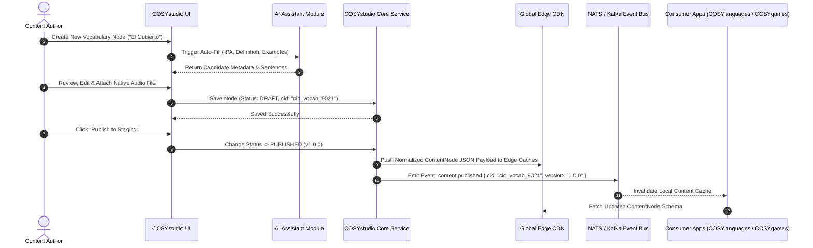
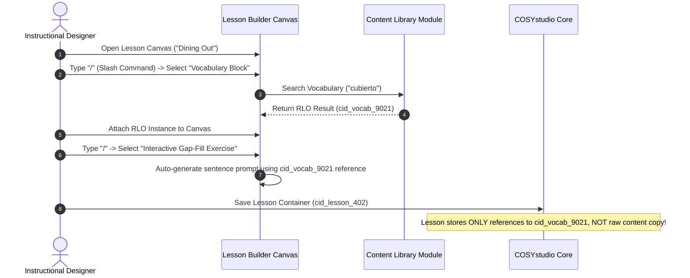

# COSYstudio Architecture & Product Specification: Central Content Operating System (COS)

## Executive Summary & Design Philosophy

**COSYstudio is NOT a Learning Management System (LMS).**

It is the **Central Content Operating System (COS)** that powers the entire **COSYlanguages** ecosystem. An LMS or platform service manages user accounts, student enrollments, course completions, class rosters, event ticketing, and active subscriptions. In contrast, **COSYstudio** serves exclusively as the single source of truth (SSOT) for creating, localizing, versioning, orchestrating, and distributing thousands of **Reusable Learning Objects (RLOs)**.

### Product Inspirations & Modern Experience
Instead of bloated legacy interfaces (e.g., Skyeng), **COSYstudio** is designed as a modern, high-velocity, block-based Content Operating System inspired by the best developer and creator tools:
* **Notion**: Block-based content composition (`/` slash commands, drag-and-drop hierarchy, nested property views).
* **Linear**: Ultra-fast keyboard-first navigation (`Cmd+K` command palette, instant search, keyboard shortcuts, deterministic states, high performance).
* **Figma**: Visual canvas composition, node-based content graph linking, multiplayer live collaboration, real-time presence indicators, reusable component instances.
* **ProgressMe & Edvibe**: Specialized interactive language learning block primitives (gap-fill, audio alignment, interactive dialogue cards, exercise transformers).

---

## 1. Ecosystem Repository Boundaries (11 Repositories)

Below is the definitive boundary analysis for all 11 repositories in the `cosylanguages/` organization.

### 1.1 COSYstudio (`cosylanguages/COSYstudio`)
* **Responsibility**: Authoring, versioning, publishing workflows, asset ingestion/pipeline (transcoding, audio alignment, 3D model processing), taxonomy tree management, localization master translation, edge content distribution, and content graph relations.
* **Owned Data**:
  * Canonical Content Nodes / Reusable Learning Objects (Vocabulary, Grammar, Exercises, Articles, Quest Scenarios, Drills, Manual Articles).
  * Asset Metadata & Binary Manifests (CDN URLs, audio timestamps, transcriptions, video renditions, 3D models).
  * Localization Master Keys & Multi-language Translations.
  * Taxonomy Trees, Categories, Tags, and CEFR Alignment Maps.
  * Content Version History, Revisions & Audit Logs.
* **Data It Must NEVER Own**:
  * User Profiles, Credentials, Authentication Tokens, or Billing/Subscription Records (Owned by `COSYplatform`).
  * Student Enrollments, Course Progress, Quiz Scores, and SRS States (Owned by `COSYlanguages`).
  * Practice Session History & Audio Recordings (Owned by `COSYpractice`).
  * Event Tickets, Attendee Registrations & RSVPs (Owned by `COSYevents`).
  * Gameplay States, Real-Time Multiplayer Session Data, Leaderboards (Owned by `COSYgames`).
  * Telemetry Logs & Analytics (Owned by `COSYdata`).
* **Exposed APIs**:
  * `Content Query API` (GraphQL / gRPC / REST) for fetching published content nodes and media manifests.
  * `Content Authoring API` (gRPC / GraphQL) for CMS editors and automated ingestion pipelines.
  * `Search & Taxonomy Index API` for vector and keyword search across canonical content.
  * `Content Event Stream` (Kafka / NATS Event Bus) emitting `content.published`, `content.updated`, `content.deprecated`.
* **Consumed APIs from COSYstudio**: N/A (Core Provider).

---

### 1.2 COSYlanguages (`cosylanguages/COSYlanguages`)
* **Responsibility**: Primary language learning application, study path orchestration, adaptive learning algorithms (SRS scheduling), course curriculum navigation, student streak tracking, lesson completion logic, and tutor/student study interactions.
* **Owned Data**:
  * User Learning Profiles & Curriculum Preferences.
  * Spaced Repetition (SRS) Card States (e.g., SM-2 / Leitner intervals, ease factors, next review dates).
  * Course Completion Records, Mastery Levels, Study Streaks, Quiz Results.
  * Teacher-Student Class Rosters & Assignments.
* **Data It Must NEVER Own**:
  * Raw Vocabulary Definitions, Etymology, and Translations.
  * Canonical Grammar Rule Definitions.
  * Audio/Video Raw Source Files or Asset Transcode Pipelines.
  * User Auth Passwords & Payment Methods (Delegates to `COSYplatform`).
* **Exposed APIs**:
  * `User Progress API` (`GET /v1/users/{id}/progress`)
  * `SRS Queue Service` (`GET /v1/users/{id}/srs/next`)
  * `Mastery Evaluation API` (`POST /v1/users/{id}/evaluate`)
* **Consumed APIs from COSYstudio**:
  * Fetches `ContentNode` schemas by `cid` for lessons, vocabulary, and grammar rules.
  * Fetches localized UI strings.
  * Subscribes to `content.published` event stream to refresh cached curriculum nodes.

---

### 1.3 COSYworld (`cosylanguages/COSYworld`)
* **Responsibility**: Immersive 3D spatial rendering, virtual environment engine, avatar movement, spatial audio, real-time NPC interactions, location-based language quests, multiplayer spatial instances.
* **Owned Data**: 3D Instance Session State, Player Coordinates, Avatar Customization, Cosmetic Inventories, NPC Runtime Interaction State.
* **Data It Must NEVER Own**: Canonical NPC Dialogue Scripts, Quest Descriptions, Translations, Dictionary Definitions, Grammar Knowledge Nodes.
* **Exposed APIs**: `Spatial World Gateway API` (WebSocket / gRPC), `NPC Session Service`.
* **Consumed APIs from COSYstudio**: Fetches `cid_dialogue_*` trees, `cid_quest_*` nodes, localized object names (`cid_loc_*`), and spatial audio asset URLs (`cid_audio_*`).

---

### 1.4 COSYgames (`cosylanguages/COSYgames`)
* **Responsibility**: Arcade micro-games, time-attack challenges, multiplayer competitive word games, global leaderboards, matchmaking, achievement unlock logic.
* **Owned Data**: Micro-game Match Sessions, High Score Tables, Leaderboard Rankings, Badges, Virtual Currency.
* **Data It Must NEVER Own**: Master Word Lists, Distractors, Translation Dictionaries, Pedagogical Rules, CEFR Mapping.
* **Exposed APIs**: `Matchmaking API`, `Leaderboard Service`, `Game Score Submission API`.
* **Consumed APIs from COSYstudio**: Fetches mini-game content bundles (`cid_gamepack_*`) containing targeted prompt words, media assets, and distractors.

---

### 1.5 COSYtools (`cosylanguages/COSYtools`)
* **Responsibility**: Utility suite and productivity tools: instant popup dictionary lookup, verb conjugation engines, text readability/CEFR difficulty analyzers, browser reading extensions, mobile companion widgets.
* **Owned Data**: Tool-Specific User Preferences, Analysis History Cache, Browser Extension Settings.
* **Data It Must NEVER Own**: Master Dictionary Definitions, Conjugation Source Tables, User Learning Progress, Subscription Accounts.
* **Exposed APIs**: `Text Readability & CEFR Analyzer API`, `Conjugation Helper Endpoint`.
* **Consumed APIs from COSYstudio**: Queries COSYstudio Content & Search API directly for instant dictionary definitions (`cid_vocab_*`), grammatical conjugations (`cid_grammar_*`), and reference examples.

---

### 1.6 COSYdata (`cosylanguages/COSYdata`)
* **Responsibility**: Ecosystem-wide telemetry ingestion, data lakehouse, cross-app user journey analytics, business intelligence dashboards, AI/ML model training (speech evaluation models, recommendation engines).
* **Owned Data**: Anonymized Behavioral Telemetry Logs, Data Warehouse Tables, ML Models & Weights, BI Reports.
* **Data It Must NEVER Own**: Live Transactional Content Source, User Auth Credentials.
* **Exposed APIs**: `Telemetry Ingest API`, `ML Recommendation Inference API`, `BI Analytics Query API`.
* **Consumed APIs from COSYstudio**: Subscribes to `content.*` streams to index metadata into data lakehouse for behavioral cross-referencing.

---

### 1.7 COSYmagazine (`cosylanguages/COSYmagazine`)
* **Responsibility**: Editorial publishing & digital cultural publication: cultural articles, audio podcasts, interviews, literary breakdowns, reader discussion forums, issue curation.
* **Owned Data**: Article Comments, Reaction Counts, Reading Bookmarks, Issue Layout Configurations.
* **Data It Must NEVER Own**: Article Master Copy & Source Markdown/RichText, Embedded Vocabulary/Grammar Nodes, Binary Audio/Video Files.
* **Exposed APIs**: `Article Comments API`, `Reader Bookmark Service`.
* **Consumed APIs from COSYstudio**: Fetches magazine articles (`cid_article_*`), inline vocabulary popups (`cid_vocab_*`), podcasts (`cid_media_*`), and magazine issue indexes.

---

### 1.8 COSYevents (`cosylanguages/COSYevents`)
* **Responsibility**: Live community events, webinars, speaking workshops, language exchange meetups, event scheduling, host streaming links, attendee ticketing, WebRTC room orchestration.
* **Owned Data**: Event Schedules, Session Timings, Speaker Bios, Registrations, RSVPs, Ticket Purchases, WebRTC Room IDs.
* **Data It Must NEVER Own**: Master Educational Handouts or Presentation Content Nodes, Core Identity/Payments, SRS Mastery Records.
* **Exposed APIs**: `Event Schedule API`, `Ticket Registration API`, `Live Stream Gateway Service`.
* **Consumed APIs from COSYstudio**: Fetches event learning material bundles (`cid_eventpack_*`), localized titles/descriptions, and media.

---

### 1.9 COSYplatform (`cosylanguages/COSYplatform`)
* **Responsibility**: Ecosystem core platform infrastructure, Identity Provider (IdP), central single sign-on (SSO), user profile management, tenancy, subscription & payment billing engine, global API gateway & rate limiting.
* **Owned Data**: User Accounts, Credentials, OAuth Tokens, MFA Keys, Subscription Plans, Billing History, Institutional Hierarchies.
* **Data It Must NEVER Own**: Course Pedagogy, SRS Card States, Educational Content, Media, Telemetry Analytics.
* **Exposed APIs**: `Central Authentication Service`, `User Profile Service`, `Subscription & Billing API`, `Global Gateway`.
* **Consumed APIs from COSYstudio**: Queries localized legal strings (Terms of Service, Privacy Policy) and localized subscription tier descriptors by `cid_loc_*`.

---

### 1.10 COSYmanuals (`cosylanguages/COSYmanuals`)
* **Responsibility**: User documentation, platform user guides, app manuals, FAQ help desk, feature onboarding walkthroughs, API developer documentation.
* **Owned Data**: User Help Ticket Submissions, Manual Search Index Cache, Article Vote Metrics.
* **Data It Must NEVER Own**: Raw Documentation Article Master Copy & Localization (`cid_manual_*`), User Auth Credentials.
* **Exposed APIs**: `Help Center Query API`, `User Feedback Endpoint`.
* **Consumed APIs from COSYstudio**: Fetches documentation content nodes (`cid_manual_*`), localized UI help tooltips, and diagram/media assets.

---

### 1.11 COSYpractice (`cosylanguages/COSYpractice`)
* **Responsibility**: Specialized interactive drill execution engine, active output practice, pronunciation/speech evaluation, speed flashcard runner, writing/essay grading execution.
* **Owned Data**: Practice Session Execution State, User Voice Recording Submissions & Transcripts, Session Analytics.
* **Data It Must NEVER Own**: Master Drill Content Items, Target Sentences, Audio Prompts, Rubrics (`cid_drill_*`), SRS Intervals.
* **Exposed APIs**: `Practice Session Runner API`, `Speech Evaluation Service`, `Session Submission API`.
* **Consumed APIs from COSYstudio**: Fetches drill definitions (`cid_drill_*`), target audio prompts (`cid_audio_*`), and evaluation rubrics (`cid_rubric_*`).

---

## 2. Navigation Architecture & Workspace Layout

COSYstudio provides a unified, keyboard-first, distraction-free environment.

```
+-------------------------------------------------------------------------------------------------------+
|  [COSYstudio]  Workspace: English (EN-US)  |  Search/Command Bar (Cmd+K)  |  [AI Assistant] [Publish]|
+-------------------+---------------------------------------------------------------+-------------------+
|                   |                                                               |                   |
|  NAVIGATION SIDEBAR|  MAIN WORKSPACE CANVAS                                        | INSPECTOR PANEL   |
|                   |                                                               |                   |
|  * Dashboard      |  +---------------------------------------------------------+  | Node ID:          |
|  * Content Library|  | Lesson Canvas: "Dining Out - Ordering in Spanish"       |  | cid_vocab_9021    |
|  * Curriculum     |  +---------------------------------------------------------+  |                   |
|  * Lesson Builder |  |  [/] Slash Command to insert block                      |  | CEFR: B1          |
|  * Vocabulary     |  |                                                         |  | Type: VOCAB_CARD  |
|  * Grammar        |  |  +---------------------------------------------------+  |  | Tag: #dining      |
|  * Media Library  |  |  | Vocabulary Block: "El Cubierto"                   |  |  | Audio: Attached   |
|  * Assessments    |  |  | [Audio: es_cubierto.mp3]  [CEFR: B1]              |  |  | Relations:        |
|  * Publishing     |  |  +---------------------------------------------------+  |  | - cid_gram_104    |
|  * Analytics      |  |                                                         |  |                   |
|  * AI Assistant   |  |  +---------------------------------------------------+  |  | Reused in:        |
|  * Settings       |  |  | Interactive Gap-fill Exercise                     |  |  | - 14 Lessons      |
|                   |  |  | "Por favor, tráigame un ______."                  |  |  | - 3 Micro-games   |
|                   |  |  +---------------------------------------------------+  |  | - 2 Quests        |
|                   |  +---------------------------------------------------------+  |                   |
+-------------------+---------------------------------------------------------------+-------------------+
|  System Status: Edge Synced (15ms)  |  Live Collaborators: 3 Authors  |  Schema Version: v1.4.0         |
+-------------------------------------------------------------------------------------------------------+
```

### 2.1 Key Navigation Elements
* **Command Bar (`Cmd+K` / `Ctrl+K`)**: Instant fuzzy search across all RLOs, quick actions, jump to module, switch target language context, and trigger AI generators.
* **Collapsible Left Navigation Sidebar**: Clean grouping of core modules with active indicators, workspace switchers, and content filter presets.
* **Main Workspace Canvas**: Flexible view switching between Notion-style block editor, Linear-style list/table views, and Figma-style visual graph node editor.
* **Right Inspector Panel**: Context-aware panel showing RLO properties, Content ID (`cid`), CEFR metadata, localization status, media bindings, and downstream usage impact graphs.

---

## 3. Detailed Application Modules

COSYstudio is structured into **12 dedicated modules**, each engineered to handle Reusable Learning Objects (RLOs) at scale.

```
┌─────────────────────────────────────────────────────────────────────────────────┐
│                                COSYstudio Modules                               │
└─────────────────────────────────────────────────────────────────────────────────┘
 ├── 1. Dashboard               (Ecosystem Health, Content Velocity, Activity Feed)
 ├── 2. Content Library          (Global RLO Search, Filtering, Versioning & Tags)
 ├── 3. Curriculum               (Pedagogical Structures, CEFR Scope & Sequence)
 ├── 4. Lesson Builder          (Notion-Block Editor, Interactive Card Composers)
 ├── 5. Vocabulary Database      (Lexical Database, Phonetics, Etymology, Examples)
 ├── 6. Grammar Database         (Grammatical Patterns, Explanations & Structural Rules)
 ├── 7. Media Library            (Audio Auto-aligner, Video Transcoder, 3D Assets)
 ├── 8. Assessment Builder       (Exercise Transformers, Rubrics & Adaptive Testing)
 ├── 9. Publishing               (Global CDN Edge Pipeline, Staging, Rollbacks)
 ├── 10. Analytics               (RLO Performance Index, Retention & Effectiveness)
 ├── 11. AI Assistant            (Auto-Generator, CEFR Estimator, Alignment Engine)
 └── 12. Settings                (Permissions, Localization Locales, Webhooks & Schemas)
```

---

### 3.1 Dashboard
* **Why It Exists**: Authors, instructional designers, and content leads need a high-level command center to track content production velocity, pending translations, edge sync status, and system health.
* **Core Capabilities**:
  * Real-time content creation activity stream (who published what RLO).
  * Content health indicators (missing audio, unverified translations, deprecated nodes).
  * System-wide edge deployment status across global CDN points of presence.
  * Rapid creation shortcuts (`Cmd+N` -> New Vocab, New Lesson, New Grammar Rule).

---

### 3.2 Content Library
* **Why It Exists**: To eliminate duplicate content creation across the enterprise by serving as the central searchable repository of all Reusable Learning Objects (RLOs).
* **Core Capabilities**:
  * Unified search index across all content types (Vocabulary, Grammar, Exercises, Quests, Drills, Manuals).
  * Linear-style instant filtering by target language, CEFR level (`A1`–`C2`), tag taxonomy, status (`DRAFT`, `PUBLISHED`, `DEPRECATED`), and content owner.
  * "Reused In" impact analyzer showing which downstream apps (`COSYlanguages`, `COSYworld`, `COSYgames`) consume a specific `cid`.
  * Batch tag management and version history inspect/rollback.

---

### 3.3 Curriculum
* **Why It Exists**: Language learning requires coherent pedagogical structures. The Curriculum module defines how RLOs are mapped into learning paths, CEFR tracks, skill modules, and topic units without copying content nodes.
* **Core Capabilities**:
  * Scope & Sequence visual tree builder.
  * Drag-and-drop ordering of lesson containers (`cid_lesson_*`) and topic modules.
  * CEFR difficulty progression validator (flags abrupt difficulty spikes).
  * Multi-track curriculum mapping (e.g., General Spanish, Business German, Kids French).

---

### 3.4 Lesson Builder
* **Why It Exists**: Authors need a flexible, fluid canvas to assemble individual RLOs into engaging, interactive lesson flows without touching code.
* **Core Capabilities**:
  * **Notion-Style Block Composer**: Slash command (`/`) interface to insert text, audio, video, vocabulary cards, grammar rules, gap-fills, and speech drills.
  * **Edvibe / ProgressMe Style Interactive Block Primitives**:
    * Gap-fill transformers, multiple choice, sentence reordering, matching pairs, dialogue prompt cards.
  * **Figma-Style Canvas & Node Linking**: Visual graph mode for branchable dialogue trees (`COSYworld` quests) and adaptive remediation paths.
  * Live preview across target client viewports (Mobile App, Web, 3D Spatial HUD, Micro-game overlay).

---

### 3.5 Vocabulary Database
* **Why It Exists**: Words are foundational language objects. This module manages the master lexicon for target languages, ensuring pronunciation, etymology, definition, and translation consistency.
* **Core Capabilities**:
  * Structural definition fields: Headword, IPA phonetics, part of speech, grammatical gender, CEFR tier.
  * Multi-target translation matrix (e.g., Spanish word translated into English, German, Japanese, Arabic).
  * Audio snippet binding (native speaker audio recordings or high-fidelity neural TTS).
  * Sentence example linker (associates `cid_vocab` with verified contextual example sentences).

---

### 3.6 Grammar Database
* **Why It Exists**: Grammar explanations are frequently duplicated or inconsistently explained across courses. This module establishes canonical, reusable grammar rules.
* **Core Capabilities**:
  * Form-meaning-use structural breakdown blocks.
  * Interactive pattern formula visualizer (e.g., `[Subject] + [Conjugated Verb] + [Direct Object]`).
  * Contrastive grammar notes (explaining nuances based on student native language).
  * Automated linking between grammar rules and practice exercises.

---

### 3.7 Media Library
* **Why It Exists**: Audio, video, and 3D assets power immersive language experiences but require heavy processing, transcoding, and transcript alignment.
* **Core Capabilities**:
  * Automated audio-text force alignment (generates word-level timestamps `.vtt` / `.json` for interactive audio reading).
  * Multi-bitrate video transcoding & streaming manifest generation (HLS / DASH).
  * 3D Asset ingestion pipeline for `COSYworld` (GLTF / USDZ validation, texture optimization, spatial audio anchor mapping).
  * Asset CDN CDN distribution manager with automated WebP/Opus/AAC format negotiation.

---

### 3.8 Assessment Builder
* **Why It Exists**: Testing must accurately measure proficiency without manually creating tests from scratch for every course.
* **Core Capabilities**:
  * Dynamic quiz & test generator that pulls RLOs automatically based on target CEFR tags and learning objectives.
  * Question variant transformer (automatically creates distractor options and alternative question formulations).
  * Speech & essay rubric designer for `COSYpractice` speech evaluation engines.
  * Item Response Theory (IRT) difficulty calibrator based on anonymized telemetry feeds from `COSYdata`.

---

### 3.9 Publishing
* **Why It Exists**: Authors need safe, controlled mechanisms to deploy content updates globally without breaking active student sessions in consumer apps.
* **Core Capabilities**:
  * Multi-environment release pipelines (`DRAFT` -> `STAGING` -> `PRODUCTION`).
  * Global Edge CDN invalidation engine (populates read-through Redis caches in <15ms worldwide).
  * Differential payload builder (compiles lightweight delta bundles for offline client syncing).
  * Emergency release rollback button (instantly points `cid` aliases back to previous version).

---

### 3.10 Analytics
* **Why It Exists**: Content creators need data-driven feedback to continuously refine exercise clarity, vocabulary difficulty, and learner engagement.
* **Core Capabilities**:
  * RLO Performance Index: Evaluates failure rates, hint usage, and skip rates per exercise node.
  * Engagement heatmap showing drop-off points within lesson flows.
  * Content freshness and usage tracking (highlights unused or outdated content nodes).
  * Integration with `COSYdata` warehouse for deep pedagogical effectiveness correlation.

---

### 3.11 AI Assistant
* **Why It Exists**: To accelerate content authoring velocity by 10x while maintaining strict human-in-the-loop editorial quality control.
* **Core Capabilities**:
  * **Auto-Generator**: Generates contextual sentences, distractors, exercise prompts, and dialogue scripts.
  * **CEFR Level Estimator**: Analyzes text readability and assigns CEFR difficulty tags (`A1`–`C2`).
  * **Automated Translator**: Produces candidate translations across target language matrices.
  * **Pedagogical Alignment Engine**: Scans lessons for missing prerequisite concepts and recommends relevant grammar/vocabulary RLOs.

---

### 3.12 Settings
* **Why It Exists**: To manage system governance, user permissions, localization locales, API keys, and schema contracts across the enterprise.
* **Core Capabilities**:
  * Role-Based Access Control (RBAC): Author, Translator, Editor, Pedagogical Lead, Admin.
  * Supported target and native language locale toggles.
  * Webhooks & NATS/Kafka event stream configuration.
  * Schema version compatibility viewer (`@cosy/schema-content`).

---

## 4. Key Authoring & Content Workflows

### 4.1 Authoring a Reusable Learning Object (RLO) & Publishing Flow



### 4.2 Notion-Style Block Assembly in Lesson Builder Flow



---

## 5. High-Level Architecture Diagram

```
+--------------------------------------------------------------------------------------------------------+
|                                           COSYplatform                                                 |
|               (Central Auth SSO, User Accounts, Subscriptions, Billing, Global API Gateway)            |
+---------------------------------------------------+----------------------------------------------------+
                                                    |
                                                    v
+--------------------------------------------------------------------------------------------------------+
|                                           COSYstudio (COS)                                             |
|  +--------------------+   +-----------------------+   +-----------------------+   +------------------+  |
|  | Authoring & CMS    |   | Localization Manager  |   | Asset Pipeline (Media)|   | AI Assistant     |  |
|  +--------------------+   +-----------------------+   +-----------------------+   +------------------+  |
|  |  Content Graph SSOT: Vocabulary, Grammar, Exercises, Quests, Drills, Manuals, Articles, Events   |  |
|  +--------------------------------------------------------------------------------------------------+  |
|  | Exposed: GraphQL API / gRPC Edge / Global CDN / Event Stream (Kafka / NATS)                      |  |
+---------------------------------------------------+----------------------------------------------------+
                                                    |
                    +-------------------------------+-------------------------------+
                    |                               |                               |
          (Fetch Content Nodes)            (Fetch Media Assets)            (Event Stream Sub)
                    |                               |                               |
        +-----------v-----------+       +-----------v-----------+       +-----------v-----------+
        |     COSYlanguages     |       |     COSYpractice      |       |       COSYdata        |
        |  (Main Learning App)  |       |  (Interactive Drills) |       | (Analytics / Telemetry|
        | Owns: SRS State,      |       | Owns: Practice Runs,  |       | Owns: Telemetry Logs, |
        | Course Progress       |       | User Voice Recordings |       | Data Lake, ML Models  |
        +-----------------------+       +-----------------------+       +-----------------------+
                    |                               |                               |
    +---------------+---------------+---------------+---------------+---------------+---------------+
    |                               |                               |                               |
+---v-------------------+   +-------v---------------+   +-----------v-----------+   +---------------v-------+
|       COSYworld       |   |       COSYgames       |   |       COSYtools       |   |     COSYmagazine      |
| (3D Spatial Language) |   | (Micro-games Arcade)  |   |  (Dictionaries & Ext) |   | (Digital Magazine)    |
| Owns: 3D Session,     |   | Owns: Game Sessions,  |   | Owns: Tool Search     |   | Owns: Comments,       |
| Avatar Customization  |   | Leaderboards, Badges  |   | Cache, Extension Prefs|   | Reading Bookmarks     |
+-----------------------+   +-----------------------+   +-----------------------+   +-----------------------+
    |                               |                               |                               |
    +-------------------------------+---------------+---------------+-------------------------------+
                                                    |
                                    +---------------+---------------+
                                    |                               |
                        +-----------v-----------+       +-----------v-----------+
                        |      COSYevents       |       |      COSYmanuals      |
                        | (Webinars & Meetups)  |       | (Docs & Help Center)  |
                        | Owns: Event Tickets,  |       | Owns: Support Tickets,|
                        | Registrations, WebRTC |       | Vote Ratings          |
                        +-----------------------+       +-----------------------+
```

---

## 6. Data Ownership Matrix (11 Ecosystem Repositories)

| Data Entity / Domain | studio | platform | languages | world | games | tools | data | magazine | events | manuals | practice |
| :--- | :---: | :---: | :---: | :---: | :---: | :---: | :---: | :---: | :---: | :---: | :---: |
| **Canonical Vocabulary & Dictionary** | **OWNER** | Forbidden | Read-Only | Read-Only | Read-Only | Read-Only | Read-Only | Read-Only | Read-Only | Read-Only | Read-Only |
| **Grammar Rules & Explanations** | **OWNER** | Forbidden | Read-Only | Read-Only | Read-Only | Read-Only | Read-Only | Read-Only | Read-Only | Read-Only | Read-Only |
| **Media Assets (Audio, Video, 3D)** | **OWNER** | Read-Only | Read-Only | Read-Only | Read-Only | Read-Only | Read-Only | Read-Only | Read-Only | Read-Only | Read-Only |
| **Localization Master Keys & Translations** | **OWNER** | Read-Only | Read-Only | Read-Only | Read-Only | Read-Only | Read-Only | Read-Only | Read-Only | Read-Only | Read-Only |
| **Quest Scenarios & Dialogue Trees** | **OWNER** | Forbidden | Read-Only | Read-Only | Forbidden | Forbidden | Read-Only | Read-Only | Forbidden | Forbidden | Read-Only |
| **Drill Masters & Exercise Rubrics** | **OWNER** | Forbidden | Read-Only | Read-Only | Read-Only | Forbidden | Read-Only | Forbidden | Forbidden | Forbidden | Read-Only |
| **Documentation Articles (Manuals)** | **OWNER** | Read-Only | Read-Only | Forbidden | Forbidden | Read-Only | Read-Only | Forbidden | Forbidden | Read-Only | Forbidden |
| **User Identity, Auth & Billing** | Forbidden | **OWNER** | Read-Only | Read-Only | Read-Only | Read-Only | Read-Only | Read-Only | Read-Only | Read-Only | Read-Only |
| **User Progress & SRS Card State** | Forbidden | Forbidden | **OWNER** | Read-Only | Read-Only | Forbidden | Read-Only | Forbidden | Forbidden | Forbidden | Read-Only |
| **3D World Session & Avatar Cosmetics**| Forbidden | Forbidden | Forbidden | **OWNER** | Forbidden | Forbidden | Read-Only | Forbidden | Forbidden | Forbidden | Forbidden |
| **Game Match Sessions & High Scores** | Forbidden | Forbidden | Read-Only | Forbidden | **OWNER** | Forbidden | Read-Only | Forbidden | Forbidden | Forbidden | Forbidden |
| **Tool Search Cache & Local Prefs** | Forbidden | Forbidden | Forbidden | Forbidden | Forbidden | **OWNER** | Read-Only | Forbidden | Forbidden | Forbidden | Forbidden |
| **Telemetry, Analytics & AI Models** | Forbidden | Read-Only | Read-Only | Read-Only | Read-Only | Read-Only | **OWNER** | Read-Only | Read-Only | Read-Only | Read-Only |
| **Magazine Comments & Bookmarks** | Forbidden | Forbidden | Forbidden | Forbidden | Forbidden | Forbidden | Read-Only | **OWNER** | Forbidden | Forbidden | Forbidden |
| **Event Registrations & Tickets** | Forbidden | Read-Only | Forbidden | Forbidden | Forbidden | Forbidden | Read-Only | Forbidden | **OWNER** | Forbidden | Forbidden |
| **Help Tickets & User Vote Ratings** | Forbidden | Read-Only | Forbidden | Forbidden | Forbidden | Forbidden | Read-Only | Forbidden | Forbidden | **OWNER** | Forbidden |
| **Practice Audio Recordings & Runs**| Forbidden | Forbidden | Read-Only | Forbidden | Forbidden | Forbidden | Read-Only | Forbidden | Forbidden | Forbidden | **OWNER** |

---

## 7. Shared Packages & Governance

To guarantee type safety, consistent content referencing, and schema validation across all 11 repositories, shared packages are maintained in the `@cosy/` registry.

### 7.1 Package Directory Structure
```
@cosy/
├── schema-content/       # Canonical TypeScript & JSON Schemas for Content Nodes
├── schema-events/        # Event payload schemas for NATS / Kafka event bus
├── sdk-client/           # Multi-platform Client SDK (TypeScript / Rust / C# Unity)
├── ui-tokens/            # Shared design system tokens, typography, iconography
└── core-utils/           # CID generators, CEFR helpers, language code parsers
```

### 7.2 Governance Rules
1. **Zero Runtime Side-Effects**: Shared packages contain **only types, schemas, validation utilities, and client contracts**.
2. **Semantic Versioning (SemVer)**: Major for breaking schema changes, Minor for additive changes, Patch for bug fixes.
3. **Automated Schema Codegen**: Protobuf / JSON Schemas generate TypeScript, Rust, and C# code.

---

## 8. Shared Schemas

All ecosystem entities MUST conform to these canonical contracts.

```typescript
export type ContentType =
  | 'VOCABULARY'
  | 'GRAMMAR'
  | 'EXERCISE'
  | 'DRILL'
  | 'ARTICLE'
  | 'QUEST_DIALOGUE'
  | 'EVENT_MATERIAL'
  | 'MANUAL_DOC';

export type CEFRLevel = 'A1' | 'A2' | 'B1' | 'B2' | 'C1' | 'C2';

export interface TaxonomyTag {
  id: string; // e.g., "tag_food_and_dining"
  category: string; // e.g., "topic"
  labelKey: string; // e.g., "loc_tag_food"
}

export interface MediaReference {
  mediaId: string; // e.g., "cid_media_908"
  type: 'AUDIO' | 'VIDEO' | 'IMAGE' | 'MODEL_3D';
  url: string;
  durationMs?: number;
  transcription?: string;
  mimeType: string;
}

export interface ContentNode {
  /** Unique Content Identifier - Primary Key across ecosystem */
  cid: string; // e.g., "cid_vocab_01H8X..."

  /** Entity Schema Version */
  schemaVersion: string; // "1.0.0"

  /** Content Type Classification */
  type: ContentType;

  /** Target Language Identifier (ISO 639-1) */
  targetLanguage: string; // e.g., "es", "ja", "de"

  /** CEFR Difficulty Rating */
  cefrLevel: CEFRLevel;

  /** Localization Master Key for Headings/Title */
  titleLocKey: string;

  /** Content Payload / Body */
  payload: {
    text?: string;
    phoneticSpelling?: string;
    partOfSpeech?: 'NOUN' | 'VERB' | 'ADJECTIVE' | 'ADVERB' | 'PHRASE';
    grammaticalGender?: 'MASCULINE' | 'FEMININE' | 'NEUTER';
    translations: Record<string, string>; // Map language code -> localized translation
    examples?: Array<{
      sentence: string;
      translationLocKey: string;
      audioMediaId?: string;
    }>;
    drillConfig?: {
      promptLocKey: string;
      expectedSpeechTranscript?: string;
      rubricCids: string[];
      sampleAudioMediaId?: string;
    };
  };

  /** Associated Media Assets */
  media: MediaReference[];

  /** Content Taxonomy & Metadata Tags */
  tags: TaxonomyTag[];

  /** Graph Relations: Dependent Content Node IDs */
  prerequisiteCids: string[];
  relatedCids: string[];

  /** Audit & Publishing Metadata */
  status: 'DRAFT' | 'REVIEW' | 'PUBLISHED' | 'ARCHIVED';
  publishedAt?: string; // ISO 8601 Timestamp
  updatedAt: string;
  version: number;
}
```

---

## 9. Migration Strategy

Migrating existing applications across all 11 repositories to the strict COSYstudio COS architecture follows a 5-phase zero-downtime plan.

1. **Phase 1: Foundation Setup & Package Publishing (`@cosy/*`)**: Deploy edge CDN, NATS event bus, and shared packages.
2. **Phase 2: Extraction & Deduplication into COSYstudio SSOT**: Extract raw content tables from consumer repos and deduplicate into canonical `ContentNode` graphs with `cid_*`.
3. **Phase 3: Dual-Read & Translation Shim Deployment**: Enable consumer services to fetch content via `cid` while maintaining legacy fallback.
4. **Phase 4: Full Read-Switch & Consumer DB Content Purge**: Route 100% of content reads to COSYstudio Edge APIs and purge raw content tables from consumer DBs.
5. **Phase 5: Automated CI/CD Guardrails**: Enforce linter rules preventing raw content/translation tables from being introduced into consumer apps.

---

## Conclusion

By combining modern creator UI paradigms (Notion blocks, Linear speed, Figma node visualizers) with a central Content Operating System architecture:
* **Zero Content Duplication**: Every piece of content exists exactly once in `COSYstudio` and is referenced via `cid`.
* **High Scale Capability**: Designed to support tens of thousands of Reusable Learning Objects (RLOs) seamlessly.
* **Domain Ownership**: Clean isolation across all 11 `cosylanguages/` repositories.
