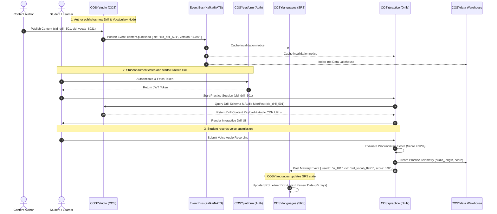

# COSYstudio Architecture Specification: Central Content Operating System (COS)

## Executive Summary & Core Architectural Philosophy

**COSYstudio is NOT a Learning Management System (LMS).**

It is the **Central Content Operating System (COS)** that powers the entire **COSYlanguages** ecosystem. An LMS or platform service manages user accounts, subscriptions, class rosters, event registrations, and study progress. In contrast, **COSYstudio** serves exclusively as the single source of truth for all canonical content creation, localization management, content graph orchestration, asset transformation pipelines, taxonomy tagging, and edge content distribution across all 11 ecosystem repositories.

### Key Architectural Axioms:
1. **Single Source of Truth (SSOT)**: Every piece of canonical content—vocabulary items, grammar explanations, audio snippets, video lessons, 3D world dialogues, micro-game prompt packs, magazine articles, practice drills, user manuals, and event materials—exists **exactly once** within COSYstudio.
2. **Strict Decoupling via Content IDs (`cid`)**: External consumer applications (e.g., `COSYlanguages`, `COSYworld`, `COSYgames`, `COSYpractice`, `COSYmanuals`, `COSYevents`) **never** duplicate, re-author, or embed raw content into their own databases. They store only immutable Content Identifiers (`cid_*`) and fetch or stream resolved content schemas via high-performance edge APIs or global CDN caches.
3. **Domain Ownership Isolation**: Repositories maintain strict boundaries. Data belonging to identity/billing (`COSYplatform`), user progress (`COSYlanguages`), spatial rendering (`COSYworld`), practice execution (`COSYpractice`), event ticketing (`COSYevents`), or analytics (`COSYdata`) is isolated within its respective domain and communicates via explicit, versioned APIs.

---

## 1. Repository Boundary Analysis (11 Repositories)

Below is the definitive analysis for all 11 repositories in the `cosylanguages/` organization.

### 1.1 COSYstudio (`cosylanguages/COSYstudio`)
* **Responsibility**: Authoring, versioning, publishing workflows, asset ingestion/pipeline (transcoding, audio alignment, 3D model processing), taxonomy tree management, localization master translation, edge content distribution, and content graph relations.
* **Owned Data**:
  * Canonical Content Nodes (Vocabulary, Grammar, Sentences, Exercises, Articles, Quest Scenarios, Drills, Manual Articles).
  * Asset Metadata & Binary Manifests (CDN URLs, audio timestamps, transcriptions, video renditions, 3D models).
  * Localization Master Keys & Multi-language Translations.
  * Taxonomy Trees, Categories, Tags, and CEFR Alignment Maps.
  * Content Version History, Revisions & Audit Logs.
* **Data It Must NEVER Own**:
  * User Profiles, Credentials, Authentication Tokens, or Billing/Subscription Records (Owned by `COSYplatform`).
  * Student Enrollments, Course Progress, Quiz Scores, and SRS States (Owned by `COSYlanguages`).
  * Practice Session History & Audio Recordings (Owned by `COSYpractice`).
  * Event Tickets, Attendee Registrations & RSVPs (Owned by `COSYevents`).
  * Gameplay States, Real-Time Multiplayer Session Data, Leaderboards (Owned by `COSYgames`).
  * Telemetry Logs & Analytics (Owned by `COSYdata`).
* **Exposed APIs**:
  * `Content Query API` (GraphQL / gRPC / REST) for fetching published content nodes and media manifests.
  * `Content Authoring API` (gRPC / GraphQL) for CMS editors and automated ingestion pipelines.
  * `Search & Taxonomy Index API` for vector and keyword search across canonical content.
  * `Content Event Stream` (Kafka / NATS Event Bus) emitting `content.published`, `content.updated`, `content.deprecated`.
* **Consumed APIs from COSYstudio**: N/A (Core Provider).

---

### 1.2 COSYlanguages (`cosylanguages/COSYlanguages`)
* **Responsibility**: Primary learning experience platform, study path orchestration, adaptive learning algorithms (SRS scheduling), course curriculum navigation, student streak tracking, lesson completion logic, and tutor/student study interactions.
* **Owned Data**:
  * User Learning Profiles & Curriculum Preferences.
  * Spaced Repetition (SRS) Card States (e.g., SM-2 / Leitner intervals, ease factors, next review dates).
  * Course Completion Records, Mastery Levels, Study Streaks, Quiz Results.
  * Teacher-Student Class Rosters & Assignments.
* **Data It Must NEVER Own**:
  * Raw Vocabulary Definitions, Etymology, and Translations.
  * Canonical Grammar Rule Definitions.
  * Audio/Video Raw Source Files or Asset Transcode Pipelines.
  * User Auth Passwords & Payment Methods (Delegates to `COSYplatform`).
* **Exposed APIs**:
  * `User Progress API` (`GET /v1/users/{id}/progress`)
  * `SRS Queue Service` (`GET /v1/users/{id}/srs/next`)
  * `Mastery Evaluation API` (`POST /v1/users/{id}/evaluate`)
* **Consumed APIs from COSYstudio**:
  * Fetches `ContentNode` schemas by `cid` for lessons, vocabulary, and grammar rules.
  * Fetches localized UI strings.
  * Subscribes to `content.published` event stream to refresh cached curriculum nodes.

---

### 1.3 COSYworld (`cosylanguages/COSYworld`)
* **Responsibility**: 3D spatial rendering, avatar movement, spatial audio, real-time NPC interactions, location-based language quests, multiplayer spatial instances.
* **Owned Data**:
  * 3D Instance Session State & Player Coordinates.
  * Avatar Customization State & Cosmetic Inventories.
  * NPC Runtime Interaction State (e.g., current quest step state per player session).
  * Spatial Instance Telemetry & Player Proximity Logs.
* **Data It Must NEVER Own**:
  * Canonical NPC Dialogue Scripts, Quest Descriptions, and Translations.
  * Dictionary Definitions and Grammar Knowledge Nodes.
  * Player Global Learning Curriculum / SRS State.
* **Exposed APIs**:
  * `Spatial World Gateway API` (WebSocket / gRPC) for player instance connection.
  * `NPC Session Service` (`POST /v1/spatial/npc/interact`).
* **Consumed APIs from COSYstudio**:
  * Fetches `cid_dialogue_*` trees, `cid_quest_*` nodes, localized object names (`cid_loc_*`), and spatial audio asset URLs (`cid_audio_*`).

---

### 1.4 COSYgames (`cosylanguages/COSYgames`)
* **Responsibility**: Arcade micro-games, time-attack challenges, multiplayer competitive word games, global leaderboards, achievement unlock logic.
* **Owned Data**:
  * Micro-game Match Sessions & Real-time Game State.
  * High Score Tables & Leaderboard Rankings.
  * Game Achievements & Badge Unlocks.
  * In-Game Virtual Currency & Item Inventories.
* **Data It Must NEVER Own**:
  * Master Word Lists, Distractors, and Translation Dictionaries.
  * Pedagogical Rules & CEFR Difficulty Mapping (Reads CEFR tag attached to `cid`).
  * User Academic Course Progress.
* **Exposed APIs**:
  * `Matchmaking API` (`POST /v1/matchmaking/join`)
  * `Leaderboard Service` (`GET /v1/leaderboards/{game_id}`)
  * `Game Score Submission API` (`POST /v1/games/scores`)
* **Consumed APIs from COSYstudio**:
  * Fetches mini-game content bundles (`cid_gamepack_*`) containing targeted prompt words, media assets, and distractors.

---

### 1.5 COSYtools (`cosylanguages/COSYtools`)
* **Responsibility**: Utility and productivity tooling: instant dictionary lookup, verb conjugation engines, text readability/CEFR analyzers, browser reading extensions, mobile companion widgets.
* **Owned Data**:
  * Tool-Specific User Preferences & Quick-Bookmark Lists.
  * Analysis History Cache (e.g., user-submitted text analysis results).
  * Browser Extension Settings & Offline Lookup Caches.
* **Data It Must NEVER Own**:
  * Master Dictionary Definitions & Conjugation Source Tables.
  * User Learning Progress & Subscription Account Records.
* **Exposed APIs**:
  * `Text Readability & CEFR Analyzer API` (`POST /v1/tools/analyze-text`)
  * `Conjugation Helper Endpoint` (`GET /v1/tools/conjugate/{verb_id}`)
* **Consumed APIs from COSYstudio**:
  * Queries COSYstudio Content & Search API directly for instant dictionary definitions (`cid_vocab_*`), grammatical conjugations (`cid_grammar_*`), and reference examples.

---

### 1.6 COSYdata (`cosylanguages/COSYdata`)
* **Responsibility**: Ecosystem-wide telemetry ingestion, data lakehouse, cross-app user journey analytics, business intelligence dashboards, AI/ML model training (speech evaluation models, recommendation engines).
* **Owned Data**:
  * Anonymized Behavioral Telemetry Logs.
  * Processed Data Warehouse Tables (ClickHouse / BigQuery).
  * Machine Learning Models & Trained Weights.
  * Aggregate Ecosystem Metrics & Business Intelligence Reports.
* **Data It Must NEVER Own**:
  * Live Transactional Content Source (Reads content metadata from COSYstudio).
  * User Auth Credentials / Secret Keys.
* **Exposed APIs**:
  * `Telemetry Ingest API` (`POST /v1/telemetry/events`)
  * `ML Recommendation Inference API` (`POST /v1/ml/recommend-content`)
  * `BI Analytics Query API` (`GET /v1/analytics/dashboards`)
* **Consumed APIs from COSYstudio**:
  * Subscribes to `content.*` streams to index metadata (tags, CEFR level, content type) into the data warehouse for cross-referencing user behavior with content attributes.

---

### 1.7 COSYmagazine (`cosylanguages/COSYmagazine`)
* **Responsibility**: Digital publishing of cultural articles, podcasts, interviews, literary breakdowns, reader comments, issue curation.
* **Owned Data**:
  * Article Reader Comments & Reaction Counts.
  * Reader Article Bookmarks & Reading Position (Scroll % / Last Read Node).
  * Issue Layout & Feature Banner Configurations.
* **Data It Must NEVER Own**:
  * Article Master Copy & Source Markdown/RichText (Owned by COSYstudio).
  * Embedded Vocabulary/Grammar Explanations (Owned by COSYstudio).
  * Binary Audio / Video Files (Owned by COSYstudio Media Pipeline).
* **Exposed APIs**:
  * `Article Comments API` (`GET/POST /v1/magazine/articles/{id}/comments`)
  * `Reader Bookmark Service` (`GET/POST /v1/magazine/bookmarks`)
* **Consumed APIs from COSYstudio**:
  * Fetches magazine articles (`cid_article_*`), inline vocabulary popups (`cid_vocab_*`), podcasts (`cid_media_*`), and magazine issue indexes.

---

### 1.8 COSYevents (`cosylanguages/COSYevents`)
* **Responsibility**: Management and delivery of live community events, webinars, speaking workshops, language exchange meetups, event scheduling, host streaming links, attendee ticketing.
* **Owned Data**:
  * Event Schedules, Session Timings & Speaker Bios.
  * Event Registrations, RSVPs, Ticket Purchases & Attendance Logs.
  * Live Stream Room IDs & WebRTC Connection Tokens.
  * Event Participant Feedback & Q&A Submissions.
* **Data It Must NEVER Own**:
  * Master Educational Handouts or Presentation Content Nodes (Owned by COSYstudio via `cid`).
  * Core User Identity and Payment Gateways (Delegates to `COSYplatform`).
  * Long-term SRS Mastery Records (Owned by `COSYlanguages`).
* **Exposed APIs**:
  * `Event Schedule API` (`GET /v1/events/upcoming`)
  * `Ticket Registration API` (`POST /v1/events/{id}/register`)
  * `Live Stream Gateway Service` (`GET /v1/events/{id}/stream-access`)
* **Consumed APIs from COSYstudio**:
  * Fetches event learning material bundles (`cid_eventpack_*`), localized event titles/descriptions, and supporting media assets.

---

### 1.9 COSYplatform (`cosylanguages/COSYplatform`)
* **Responsibility**: Core identity provider (IdP), central single sign-on (SSO), user profile management, tenancy, subscription & payment billing engine, global API gateway & rate limiting.
* **Owned Data**:
  * User Accounts, Auth Credentials, OAuth Tokens, MFA Keys.
  * Subscription Plans, Billing History, Payment Gateways (Stripe/Apple/Google).
  * Organization / Team / Institutional Hierarchy Records.
  * Central API Gateway Access Control & Rate-Limit Rules.
* **Data It Must NEVER Own**:
  * Course Pedagogy or SRS Card States (Owned by `COSYlanguages`).
  * Educational Content, Translations or Media (Owned by `COSYstudio`).
  * Telemetry Event Analytics (Owned by `COSYdata`).
* **Exposed APIs**:
  * `Central Authentication Service` (`POST /v1/auth/token`, `POST /v1/auth/login`)
  * `User Account & Profile Service` (`GET/PATCH /v1/users/me`)
  * `Subscription & Billing API` (`GET/POST /v1/billing/subscriptions`)
  * `Global Gateway / Router`
* **Consumed APIs from COSYstudio**:
  * Queries localized legal strings (Terms of Service, Privacy Policy) and localized subscription tier descriptors by `cid_loc_*`.

---

### 1.10 COSYmanuals (`cosylanguages/COSYmanuals`)
* **Responsibility**: User documentation, platform user guides, app manuals, FAQ help desk, feature onboarding walkthroughs, API developer documentation.
* **Owned Data**:
  * User Help Ticket Submissions & Feedback.
  * Manual Search Index Cache & Documentation Navigation Tree.
  * User Helpful/Unhelpful Vote Metrics on Articles.
* **Data It Must NEVER Own**:
  * Raw Documentation Article Master Copy & Localization (Owned by COSYstudio as `cid_manual_*`).
  * User Account Credentials (Delegates to `COSYplatform`).
* **Exposed APIs**:
  * `Help Center Query API` (`GET /v1/manuals/search`)
  * `User Feedback Endpoint` (`POST /v1/manuals/feedback`)
* **Consumed APIs from COSYstudio**:
  * Fetches documentation content nodes (`cid_manual_*`), localized UI help tooltips, and diagram/media assets.

---

### 1.11 COSYpractice (`cosylanguages/COSYpractice`)
* **Responsibility**: Specialized interactive drill execution engine, pronunciation/speech practice, audio recording evaluation, speed flashcard runner, automated essay/writing grading.
* **Owned Data**:
  * Practice Session Execution State (Current drill index, timer, temporary session score).
  * User Voice Recording Submissions & Speech-to-Text Transcripts.
  * Practice Performance Analytics per Session.
* **Data It Must NEVER Own**:
  * Master Drill Content Items, Target Sentences, Audio Prompts, or Rubrics (Owned by COSYstudio via `cid_drill_*`).
  * Cumulative User SRS SRS Intervals (Communicates results to `COSYlanguages`).
  * User Billing or Subscription Access Rights (Verified via `COSYplatform`).
* **Exposed APIs**:
  * `Practice Session Runner API` (`POST /v1/practice/sessions/start`)
  * `Speech Evaluation Service` (`POST /v1/practice/audio/evaluate`)
  * `Session Submission API` (`POST /v1/practice/sessions/submit`)
* **Consumed APIs from COSYstudio**:
  * Fetches drill definitions (`cid_drill_*`), target audio prompts (`cid_audio_*`), and evaluation rubrics (`cid_rubric_*`).
* **Outputs To Other Services**:
  * Sends practice score & mastery signals to `COSYlanguages` to update overall student SRS state.

---

## 2. High-Level Architecture Diagram

```
+--------------------------------------------------------------------------------------------------------+
|                                           COSYplatform                                                 |
|               (Central Auth SSO, User Accounts, Subscriptions, Billing, Global API Gateway)            |
+---------------------------------------------------+----------------------------------------------------+
                                                    |
                                                    v
+--------------------------------------------------------------------------------------------------------+
|                                           COSYstudio (COS)                                             |
|  +--------------------+   +-----------------------+   +-----------------------+   +------------------+  |
|  | Authoring & CMS    |   | Localization Manager  |   | Asset Pipeline (Media)|   | Taxonomy & CEFR  |  |
|  +--------------------+   +-----------------------+   +-----------------------+   +------------------+  |
|  |  Content Graph SSOT: Vocabulary, Grammar, Exercises, Quests, Drills, Manuals, Articles, Events   |  |
|  +--------------------------------------------------------------------------------------------------+  |
|  | Exposed: GraphQL API / gRPC Edge / Global CDN / Event Stream (Kafka / NATS)                      |  |
+---------------------------------------------------+----------------------------------------------------+
                                                    |
                    +-------------------------------+-------------------------------+
                    |                               |                               |
          (Fetch Content Nodes)            (Fetch Media Assets)            (Event Stream Sub)
                    |                               |                               |
        +-----------v-----------+       +-----------v-----------+       +-----------v-----------+
        |     COSYlanguages     |       |     COSYpractice      |       |       COSYdata        |
        |  (LMS / SRS Engine)   |       |  (Interactive Drills) |       | (Analytics / Telemetry|
        | Owns: SRS State,      |       | Owns: Practice Runs,  |       | Owns: Telemetry Logs, |
        | Course Progress       |       | User Voice Recordings |       | Data Lake, ML Models  |
        +-----------------------+       +-----------------------+       +-----------------------+
                    |                               |                               |
    +---------------+---------------+---------------+---------------+---------------+---------------+
    |                               |                               |                               |
+---v-------------------+   +-------v---------------+   +-----------v-----------+   +---------------v-------+
|       COSYworld       |   |       COSYgames       |   |       COSYtools       |   |     COSYmagazine      |
| (3D Spatial Language) |   | (Micro-games Arcade)  |   |  (Dictionaries & Ext) |   | (Digital Magazine)    |
| Owns: 3D Session,     |   | Owns: Game Sessions,  |   | Owns: Tool Search     |   | Owns: Comments,       |
| Avatar Customization  |   | Leaderboards, Badges  |   | Cache, Extension Prefs|   | Reading Bookmarks     |
+-----------------------+   +-----------------------+   +-----------------------+   +-----------------------+
    |                               |                               |                               |
    +-------------------------------+---------------+---------------+-------------------------------+
                                                    |
                                    +---------------+---------------+
                                    |                               |
                        +-----------v-----------+       +-----------v-----------+
                        |      COSYevents       |       |      COSYmanuals      |
                        | (Webinars & Meetups)  |       | (Docs & Help Center)  |
                        | Owns: Event Tickets,  |       | Owns: Support Tickets,|
                        | Registrations, WebRTC |       | Vote Ratings          |
                        +-----------------------+       +-----------------------+
```

---

## 3. Data Ownership Matrix (11 Ecosystem Repositories)

| Data Entity / Domain | studio | platform | languages | world | games | tools | data | magazine | events | manuals | practice |
| :--- | :---: | :---: | :---: | :---: | :---: | :---: | :---: | :---: | :---: | :---: | :---: |
| **Canonical Vocabulary & Dictionary** | **OWNER** | Forbidden | Read-Only | Read-Only | Read-Only | Read-Only | Read-Only | Read-Only | Read-Only | Read-Only | Read-Only |
| **Grammar Rules & Explanations** | **OWNER** | Forbidden | Read-Only | Read-Only | Read-Only | Read-Only | Read-Only | Read-Only | Read-Only | Read-Only | Read-Only |
| **Media Assets (Audio, Video, 3D)** | **OWNER** | Read-Only | Read-Only | Read-Only | Read-Only | Read-Only | Read-Only | Read-Only | Read-Only | Read-Only | Read-Only |
| **Localization Master Keys & Translations** | **OWNER** | Read-Only | Read-Only | Read-Only | Read-Only | Read-Only | Read-Only | Read-Only | Read-Only | Read-Only | Read-Only |
| **Quest Scenarios & Dialogue Trees** | **OWNER** | Forbidden | Read-Only | Read-Only | Forbidden | Forbidden | Read-Only | Read-Only | Forbidden | Forbidden | Read-Only |
| **Drill Masters & Exercise Rubrics** | **OWNER** | Forbidden | Read-Only | Read-Only | Read-Only | Forbidden | Read-Only | Forbidden | Forbidden | Forbidden | Read-Only |
| **Documentation Articles (Manuals)** | **OWNER** | Read-Only | Read-Only | Forbidden | Forbidden | Read-Only | Read-Only | Forbidden | Forbidden | Read-Only | Forbidden |
| **User Identity, Auth & Billing** | Forbidden | **OWNER** | Read-Only | Read-Only | Read-Only | Read-Only | Read-Only | Read-Only | Read-Only | Read-Only | Read-Only |
| **User Progress & SRS Card State** | Forbidden | Forbidden | **OWNER** | Read-Only | Read-Only | Forbidden | Read-Only | Forbidden | Forbidden | Forbidden | Read-Only |
| **3D World Session & Avatar Cosmetics**| Forbidden | Forbidden | Forbidden | **OWNER** | Forbidden | Forbidden | Read-Only | Forbidden | Forbidden | Forbidden | Forbidden |
| **Game Match Sessions & High Scores** | Forbidden | Forbidden | Read-Only | Forbidden | **OWNER** | Forbidden | Read-Only | Forbidden | Forbidden | Forbidden | Forbidden |
| **Tool Search Cache & Local Prefs** | Forbidden | Forbidden | Forbidden | Forbidden | Forbidden | **OWNER** | Read-Only | Forbidden | Forbidden | Forbidden | Forbidden |
| **Telemetry, Analytics & AI Models** | Forbidden | Read-Only | Read-Only | Read-Only | Read-Only | Read-Only | **OWNER** | Read-Only | Read-Only | Read-Only | Read-Only |
| **Magazine Comments & Bookmarks** | Forbidden | Forbidden | Forbidden | Forbidden | Forbidden | Forbidden | Read-Only | **OWNER** | Forbidden | Forbidden | Forbidden |
| **Event Registrations & Tickets** | Forbidden | Read-Only | Forbidden | Forbidden | Forbidden | Forbidden | Read-Only | Forbidden | **OWNER** | Forbidden | Forbidden |
| **Help Tickets & User Vote Ratings** | Forbidden | Read-Only | Forbidden | Forbidden | Forbidden | Forbidden | Read-Only | Forbidden | Forbidden | **OWNER** | Forbidden |
| **Practice Audio Recordings & Runs**| Forbidden | Forbidden | Read-Only | Forbidden | Forbidden | Forbidden | Read-Only | Forbidden | Forbidden | Forbidden | **OWNER** |

---

## 4. Repository Interaction Diagram

The sequence below details how multiple ecosystem repositories interact with `COSYstudio`, `COSYplatform`, and each other during content publishing, practice execution, and SRS updates.



---

## 5. Shared Packages & Governance

To guarantee type safety, consistent content referencing, and schema validation across all 11 repositories, shared packages are maintained in the `@cosy/` registry.

### 5.1 Package Directory Structure
```
@cosy/
├── schema-content/       # Canonical TypeScript & JSON Schemas for Content Nodes
├── schema-events/        # Event payload schemas for NATS / Kafka event bus
├── sdk-client/           # Multi-platform Client SDK (TypeScript / Rust / C# Unity)
├── ui-tokens/            # Shared design system tokens, typography, iconography
└── core-utils/           # CID generators, CEFR helpers, language code parsers
```

### 5.2 Governance Rules
1. **Zero Runtime Side-Effects**: Shared packages contain **only types, schemas, validation utilities, and client contracts**. No direct database connection or business logic.
2. **Semantic Versioning (SemVer)**:
   * **MAJOR**: Breaking schema changes (e.g. field deletion).
   * **MINOR**: Non-breaking additive changes (e.g. new optional tag).
   * **PATCH**: Documentation or validation fix.
3. **Automated Schema Codegen**: Protocol Buffers / JSON Schemas generate TypeScript interfaces, Rust structs, and C# classes for Unity (`COSYworld`).

---

## 6. Shared Schemas

All ecosystem entities MUST conform to these canonical contracts.

### 6.1 `ContentNode` Schema (TypeScript)

```typescript
export type ContentType =
  | 'VOCABULARY'
  | 'GRAMMAR'
  | 'EXERCISE'
  | 'DRILL'
  | 'ARTICLE'
  | 'QUEST_DIALOGUE'
  | 'EVENT_MATERIAL'
  | 'MANUAL_DOC';

export type CEFRLevel = 'A1' | 'A2' | 'B1' | 'B2' | 'C1' | 'C2';

export interface TaxonomyTag {
  id: string; // e.g., "tag_food_and_dining"
  category: string; // e.g., "topic"
  labelKey: string; // e.g., "loc_tag_food"
}

export interface MediaReference {
  mediaId: string; // e.g., "cid_media_908"
  type: 'AUDIO' | 'VIDEO' | 'IMAGE' | 'MODEL_3D';
  url: string;
  durationMs?: number;
  transcription?: string;
  mimeType: string;
}

export interface ContentNode {
  /** Unique Content Identifier - Primary Key across ecosystem */
  cid: string; // e.g., "cid_vocab_01H8X..."

  /** Entity Schema Version */
  schemaVersion: string; // "1.0.0"

  /** Content Type Classification */
  type: ContentType;

  /** Target Language Identifier (ISO 639-1) */
  targetLanguage: string; // e.g., "es", "ja", "de"

  /** CEFR Difficulty Rating */
  cefrLevel: CEFRLevel;

  /** Localization Master Key for Headings/Title */
  titleLocKey: string;

  /** Content Payload / Body */
  payload: {
    text?: string;
    phoneticSpelling?: string;
    partOfSpeech?: 'NOUN' | 'VERB' | 'ADJECTIVE' | 'ADVERB' | 'PHRASE';
    grammaticalGender?: 'MASCULINE' | 'FEMININE' | 'NEUTER';
    translations: Record<string, string>; // Map language code -> localized translation
    examples?: Array<{
      sentence: string;
      translationLocKey: string;
      audioMediaId?: string;
    }>;
    drillConfig?: {
      promptLocKey: string;
      expectedSpeechTranscript?: string;
      rubricCids: string[];
      sampleAudioMediaId?: string;
    };
  };

  /** Associated Media Assets */
  media: MediaReference[];

  /** Content Taxonomy & Metadata Tags */
  tags: TaxonomyTag[];

  /** Graph Relations: Dependent Content Node IDs */
  prerequisiteCids: string[];
  relatedCids: string[];

  /** Audit & Publishing Metadata */
  status: 'DRAFT' | 'REVIEW' | 'PUBLISHED' | 'ARCHIVED';
  publishedAt?: string; // ISO 8601 Timestamp
  updatedAt: string;
  version: number;
}
```

### 6.2 `UserProgressReference` Schema (Used by Consumer Apps)

```typescript
export interface UserProgressReference {
  userId: string;
  /** References canonical content in COSYstudio by cid */
  contentCid: string;

  /** Consumer-owned metric states */
  masteryScore: number; // 0.0 to 1.0
  srsIntervalDays: number;
  lastReviewedAt: string;
  nextReviewDueAt: string;
  totalAttempts: number;
  successfulAttempts: number;
}
```

---

## 7. Migration Strategy

Migrating existing applications across all 11 repositories to the strict COSYstudio COS architecture follows a 5-phase zero-downtime plan.

```
Phase 1: Foundation Setup & Package Publishing (@cosy/*)
   │
   ▼
Phase 2: Extraction & Deduplication into COSYstudio SSOT
   │
   ▼
Phase 3: Dual-Read & Translation Shim Deployment
   │
   ▼
Phase 4: Full Read-Switch & Consumer DB Content Purge
   │
   ▼
Phase 5: Automated CI/CD Architectural Boundary Guardrails
```

### Phase 1: Foundation Setup & Package Publishing (Weeks 1–4)
1. Publish `@cosy/schema-content`, `@cosy/schema-events`, and `@cosy/sdk-client`.
2. Deploy COSYstudio Edge API gateway and CDN distribution layers.
3. Establish NATS / Kafka event streaming infrastructure.

### Phase 2: Extraction & Deduplication into COSYstudio (Weeks 5–8)
1. Extract duplicate vocabulary, grammar, manuals, articles, and drill content from `COSYlanguages`, `COSYpractice`, `COSYmanuals`, `COSYgames`, and `COSYmagazine`.
2. Run deduplication engine and assign immutable `cid_*` identifiers.
3. Populate COSYstudio master database with normalized `ContentNode` graphs.

### Phase 3: Dual-Read & ID Mapping Deployment (Weeks 9–12)
1. Deploy ID mapping shims in consumer services (`COSYlanguages`, `COSYpractice`, `COSYevents`).
2. Enable dual-read: consumer apps fetch by `cid` from COSYstudio with fallback to legacy local databases.
3. Validate global latency (<15ms edge read) and caching behavior.

### Phase 4: Full Read-Switch & Legacy Content Purge (Weeks 13–16)
1. Route 100% of content reads across all 11 repos to COSYstudio Edge APIs.
2. Drop content tables (dictionary, grammar, manual text, article markdown) from consumer databases (`COSYlanguages`, `COSYgames`, `COSYpractice`, `COSYmagazine`).
3. Decommission legacy CMS interfaces in consumer repos.

### Phase 5: CI/CD Architectural Guardrails (Continuous)
1. Implement linters blocking new database tables storing content or translation strings in consumer repositories.
2. Automate breaking schema change detection in PR pipelines for `@cosy/schema-content`.

---

## Conclusion

By positioning **COSYstudio** as the central **Content Operating System** across all 11 repositories in the `cosylanguages/` organization:
* **Zero Content Duplication**: Content exists once in `COSYstudio` and is referenced by `cid`.
* **Explicit Boundary Ownership**: Platform auth (`COSYplatform`), SRS pedagogy (`COSYlanguages`), drills (`COSYpractice`), spatial rendering (`COSYworld`), events (`COSYevents`), manuals (`COSYmanuals`), and analytics (`COSYdata`) remain cleanly isolated.
* **Long-Term Scalability**: Content changes publish once and immediately propagate across web, mobile, 3D, micro-game, and help center applications.
