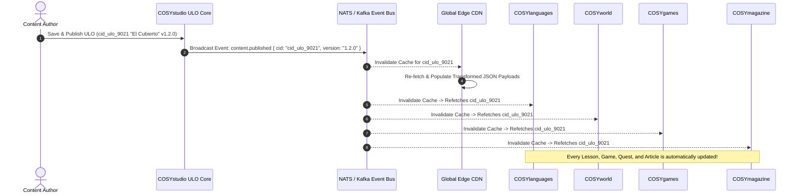
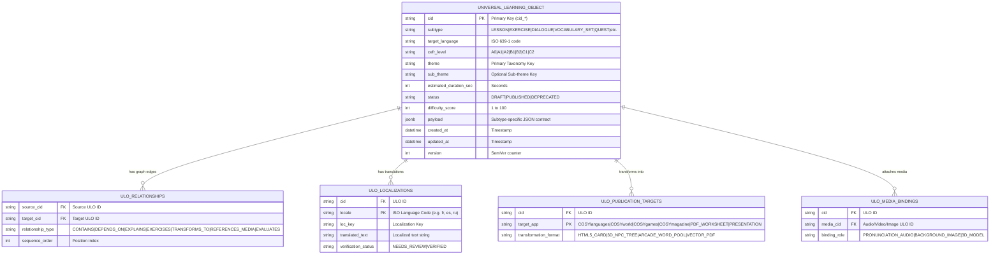

# COSYstudio Architecture Specification: Universal Learning Object (ULO) Content Operating System (COS)

## Executive Summary & Core Architectural Philosophy

**COSYstudio is NOT a Learning Management System (LMS).**

It is the **Central Content Operating System (COS)** that powers the entire **COSYlanguages** ecosystem across all 11 organization repositories (`cosylanguages/*`). An LMS or platform service (`COSYplatform`) manages student logins, classroom hubs, teacher-student sessions, user accounts, and paid course subscriptions.

### The Universal Learning Object (ULO) Paradigm Shift

Traditional systems (e.g. Skyeng, ProgressMe, Edvibe) manage "lessons in folders" or isolated exercise databases.

**COSYstudio does NOT "contain" lessons or siloed content types.**

Instead, COSYstudio operates entirely on a single underlying primitive: the **Universal Learning Object (ULO)**.

Every entity—whether a lesson, word set, grammar rule, 3D RPG quest script, magazine article, or audio clip—is an instance of the same underlying **ULO** primitive.

```
                         UNIVERSAL LEARNING OBJECT (ULO)
                                        │
    ├── Lesson                 ├── Grammar Topic          ├── Game Level
    ├── Exercise               ├── Article                ├── Worksheet
    ├── Dialogue               ├── Conversation Club      ├── Assessment
    ├── Vocabulary Set         ├── Quest                  ├── Audio / Video / Image
```

This fundamental paradigm shift—from "lessons in folders" to a graph of Universal Learning Objects—is what sets COSYstudio apart, combining creator UI concepts from Notion, Airtable, Linear, and Figma into a scalable educational Content Operating System.

---

## 1. Universal Learning Object (ULO) Architecture & 6 Core Dimensions

Every Universal Learning Object (ULO) in COSYstudio possesses **6 Fundamental Dimensions**:

```
+---------------------------------------------------------------------------------------------------------+
|                                    UNIVERSAL LEARNING OBJECT (ULO)                                      |
+---------------------------------------------------------------------------------------------------------+
|  Primary Key: cid (e.g. cid_ulo_8921, cid_ulo_104)                                                      |
|  Object Subtype: [ Lesson | Exercise | Dialogue | Vocabulary Set | Grammar Topic | Article               |
|                    | Conversation Club | Quest | Game Level | Worksheet | Assessment | Audio/Video/Image ]|
+---------------------------------------------------------------------------------------------------------+
|                                        THE 6 ULO DIMENSIONS                                             |
|                                                                                                         |
|  1. METADATA           Language, CEFR, Theme, Skills, Age, Target Audience, Duration,                 |
|                        Objectives, Status, Tags, IRT Difficulty Score                                  |
|                                                                                                         |
|  2. RELATIONSHIPS      Graph Edges: CONTAINS, DEPENDS_ON, EXPLAINS, EXERCISES,                        |
|                        TRANSFORMS_TO, REFERENCES_MEDIA, EVALUATES, VARIANT_OF                           |
|                                                                                                         |
|  3. VERSION HISTORY    Immutable SemVer Snapshots (v1.0.0) & Dynamic Aliasing (@production)              |
|                                                                                                         |
|  4. AI ACTIONS         21 Contextual Generation & Transformation Actions (Simplify, Translate, etc)     |
|                                                                                                         |
|  5. LOCALIZATION       Multi-Target Translation Matrix across 14 ISO Languages                          |
|                                                                                                         |
|  6. PUBLICATION        Target Transformation Engine (COSYlanguages, COSYworld, COSYgames,               |
|     TARGETS            COSYmagazine, PDF Worksheet, Classroom Presentation, Mobile App, API)            |
+---------------------------------------------------------------------------------------------------------+
```

---

### 1.1 The 14 ULO Object Subtypes

| ULO Subtype | Description & Primary Educational Role | Sample Payload / Contract |
| :--- | :--- | :--- |
| **Lesson** | Composition container ordering child ULO blocks into a structured study path | Array of child ULO `cid` references, block timing offsets |
| **Exercise** | Interactive practice block (gap-fill, multiple choice, sorting, matching) | Prompt key, correct answers, distractors, hint text |
| **Dialogue** | Multi-turn conversational script between characters/avatars | Character speakers, audio timestamps, localized lines |
| **Vocabulary Set** | Lexical headword cluster with IPA phonetics, definitions, and translations | Headword terms, IPA variants, parts of speech, gender |
| **Grammar Topic** | Structural rule explanation, pattern formula, and CCQ checks | Form-meaning-use blocks, formula visualizer, CCQs |
| **Article** | Cultural read, digital magazine post, or literary breakdown | RichText / Markdown blocks, podcast link, vocabulary popups |
| **Conversation Club**| Speaking-club prompt deck, webinar outline, or debate guide for `COSYevents` | Discussion triggers, debate questions, speaking rubrics |
| **Quest** | Open-world 3D RPG quest script for COSY Town in `COSYworld` | Quest steps, district coordinates, NPC dialogue trees |
| **Game Level** | Interactive micro-game bundle configuration for `COSYgames` | Word pool `cid` arrays, time limits, bonus rules |
| **Worksheet** | Printable PDF reference layout or offline workbook page for `COSYmanuals` | Layout template ID, print dimensions, vector assets |
| **Assessment** | Graded evaluation container or placement quiz item | Question ULO references, scoring weights, pass threshold |
| **Audio** | Native speaker voice track, audio prompt, or neural TTS snippet | CDN URL, duration, word-level force alignment JSON |
| **Video** | Video lesson clip, cultural recording, or grammar animation | Streaming HLS URL, subtitle `.vtt` tracks, chapters |
| **Image** | Visual asset with localized alt text, focal points, and hotspots | CDN URL, focal point coordinates, localized alt keys |

---

## 2. Publishing as Transformation (Zero Duplication)

In traditional CMS systems, publishing content to different channels requires copying and reformatting text.

**In COSYstudio, publishing is a Transformation, NOT Duplication.**

A single canonical Universal Learning Object (ULO) is edited once in COSYstudio. When published, the **Target Transformation Engine** dynamically compiles the ULO into target-specific schemas required by downstream consumer applications and media outputs.

```
                          UNIVERSAL LEARNING OBJECT (ULO)
                                 (Single Source of Truth)
                                            │
               ┌────────────────────────────┼────────────────────────────┐
               │                            │                            │
    [ TARGET TRANSFORMATION ]    [ TARGET TRANSFORMATION ]    [ TARGET TRANSFORMATION ]
               │                            │                            │
               ├── COSYlanguages            ├── COSYworld                ├── PDF Worksheet
               ├── COSYgames                ├── Classroom Presentation   ├── Mobile App
               └── COSYmagazine             └── COSYevents               └── REST / GraphQL API
```

### 2.1 Transformation Pipeline Examples

1. **ULO: Vocabulary Set ("El Cubierto")**
   * **Transforms for `COSYlanguages`**: Renders as an interactive vocabulary card with audio player and example sentence popup.
   * **Transforms for `COSYgames`**: Compiles into a lightweight word-matching pair array for a 60-second arcade game.
   * **Transforms for `COSYmagazine`**: Compiles into an inline hover dictionary tooltip for a magazine article.
   * **Transforms for `COSYworld`**: Compiles into an interactive commercial item in COSY Town's restaurant district.
   * **Transforms for PDF Worksheet**: Compiles into an A4 vector printable vocabulary reference list in `COSYmanuals`.

2. **ULO: Dialogue ("Ordering Coffee")**
   * **Transforms for Classroom Presentation**: Renders as a 16:9 split-screen slide presentation mode (`?stage=1`).
   * **Transforms for `COSYworld`**: Renders as an animated 3D NPC interaction tree with spatial audio anchors.
   * **Transforms for Mobile App**: Renders as a chat-bubble interactive dialogue runner with voice recording buttons.

---

## 3. Standardized ULO Metadata & TypeScript Schema

Every Universal Learning Object (ULO) conforms to the standardized TypeScript metadata contract:

```typescript
export type CEFRLevel = 'A0' | 'A1' | 'A2' | 'B1' | 'B2' | 'C1' | 'C2';

export type LanguageCode = 'en' | 'fr' | 'it' | 'ru' | 'el' | 'es' | 'de' | 'pt' | 'hy' | 'ka' | 'ba' | 'br' | 'cv' | 'tt';

export type ULOSubtype =
  | 'LESSON'
  | 'EXERCISE'
  | 'DIALOGUE'
  | 'VOCABULARY_SET'
  | 'GRAMMAR_TOPIC'
  | 'ARTICLE'
  | 'CONVERSATION_CLUB'
  | 'QUEST'
  | 'GAME_LEVEL'
  | 'WORKSHEET'
  | 'ASSESSMENT'
  | 'AUDIO'
  | 'VIDEO'
  | 'IMAGE';

export interface ULORelationships {
  containsCids: string[];        // Child ULO composition
  dependsOnCids: string[];       // Prerequisites required before this ULO
  explainsCids: string[];        // Grammar topics explaining vocabulary
  exercisesCids: string[];       // Practice exercises testing this ULO
  transformsToCids: string[];    // Target transformations (e.g. Flashcards)
  referencesMediaCids: string[]; // Associated Audio/Video/Images
  evaluatesCids: string[];       // Assessments testing this ULO
  variantCids: string[];          // Regional or difficulty variants
}

export interface UniversalLearningObject {
  /** Primary Key - Immutable Content ID */
  cid: string; // e.g. "cid_ulo_01H8X..."

  /** ULO Subtype Classification */
  subtype: ULOSubtype;

  /** Standardized Metadata Dimension */
  metadata: {
    targetLanguage: LanguageCode;
    cefrLevel: CEFRLevel;
    theme: string;       // e.g. "housing"
    subTheme?: string;   // e.g. "furniture"
    skills: ('READING' | 'WRITING' | 'LISTENING' | 'SPEAKING' | 'PRONUNCIATION' | 'GRAMMAR' | 'VOCABULARY')[];
    ageGroups: ('CHILDREN' | 'KIDS' | 'TEENS' | 'ADULTS' | 'BUSINESS')[];
    targetAudiences: ('GENERAL' | 'SPOKEN' | 'EXAM' | 'PROFESSIONAL' | 'TRAVEL' | 'RELOCATION')[];
    estimatedDurationSeconds: number;
    learningObjectives: string[]; // e.g. ["can_order_food"]
    status: 'DRAFT' | 'REVIEW' | 'STAGING' | 'PUBLISHED' | 'ARCHIVED' | 'DEPRECATED';
    tags: string[];
    difficultyScore: number; // 1 to 100
  };

  /** Graph Relationships Dimension */
  relationships: ULORelationships;

  /** Version History Dimension */
  versioning: {
    version: number;
    semver: string; // "1.2.0"
    activeAliases: string[]; // ["@latest", "@production"]
    historyLog: Array<{ version: string; updatedBy: string; timestamp: string; diffSummary: string }>;
  };

  /** Localization Dimension */
  localization: {
    titleLocKey: string;
    translations: Record<string, Record<string, string>>; // locale -> field -> translated text
  };

  /** Type-Specific Payload Contract */
  payload: Record<string, unknown>;

  /** Publication Targets Dimension */
  publicationTargets: Array<'COSYlanguages' | 'COSYworld' | 'COSYgames' | 'COSYmagazine' | 'COSYevents' | 'COSYmanuals' | 'PDF_WORKSHEET' | 'PRESENTATION' | 'MOBILE_APP' | 'REST_API'>;

  /** Audit Timestamps */
  createdBy: string;
  createdAt: string;
  updatedAt: string;
}
```

---

## 4. Integrated AI Assistant Architecture & Ecosystem Intelligence

COSYstudio features a native **Integrated AI Assistant** that acts as an intelligent co-creator across all ULO objects.

### 4.1 Deep Cross-Repository Context Understanding

The AI Assistant maintains real-time context awareness of the entire 11-repository Knowledge Graph:
* **`COSYdata`**: Reads master vocabulary definitions, IPA transcriptions with regional variants, and taxonomy schemas.
* **`COSYmanuals`**: Understands CEFR level curriculum roadmaps, CCQ check requirements, and printable booklet layouts.
* **`COSYpractice`**: Analyzes student exercise failure rates and weak-spot telemetry.
* **`COSYworld`**: Understands COSY Town RPG quest constraints, character profiles (James York, Ella Bronx, Anna), and district coordinates.
* **`COSYmagazine`**: Understands editorial article formats, flipbook layouts, and podcast script requirements.
* **`COSYevents`**: Generates speaking-club prompt decks and masterclass discussion outlines.
* **`COSYtools`**: Leverages verb conjugation and noun declension rules for morphologically accurate distractors.

### 4.2 Comprehensive 21 AI Assistant Actions

1. **Generate Lesson** | 2. **Improve Lesson** | 3. **Simplify** | 4. **Increase CEFR** | 5. **Translate** | 6. **Generate Vocabulary** | 7. **Generate Examples** | 8. **Generate IPA** | 9. **Generate Pronunciation** | 10. **Generate Quiz** | 11. **Generate Discussion** | 12. **Generate Homework** | 13. **Generate Article** | 14. **Generate Worksheet** | 15. **Generate Listening** | 16. **Generate TTS** | 17. **Generate Images** | 18. **Generate Dialogue** | 19. **Generate Roleplay** | 20. **Generate Cultural Notes** | 21. **Generate Metadata**.

---

## 5. High-Level Ecosystem Architecture Diagram

The diagram below illustrates how `COSYstudio` acts as the central Content Operating System delivering Universal Learning Objects (ULOs) and media manifests to all downstream consumer repositories and services.

```
+--------------------------------------------------------------------------------------------------------+
|                                           COSYplatform                                                 |
|               (Central Auth SSO, User Accounts, Subscriptions, Billing, Global API Gateway)            |
+---------------------------------------------------+----------------------------------------------------+
                                                    |
                                                    v
+--------------------------------------------------------------------------------------------------------+
|                                           COSYstudio (COS)                                             |
|  +--------------------+   +-----------------------+   +-----------------------+   +------------------+  |
|  | Authoring & CMS    |   | Localization Manager  |   | Asset Pipeline (Media)|   | AI Assistant     |  |
|  +--------------------+   +-----------------------+   +-----------------------+   +------------------+  |
|  |  Content Graph SSOT: Vocabulary, Grammar, Exercises, Quests, Drills, Manuals, Articles, Events   |  |
|  +--------------------------------------------------------------------------------------------------+  |
|  | Exposed: GraphQL API / gRPC Edge / Global CDN / Event Stream (Kafka / NATS)                      |  |
+---------------------------------------------------+----------------------------------------------------+
                                                    |
                    +-------------------------------+-------------------------------+
                    |                               |                               |
          (Fetch Content Nodes)            (Fetch Media Assets)            (Event Stream Sub)
                    |                               |                               |
        +-----------v-----------+       +-----------v-----------+       +-----------v-----------+
        |     COSYlanguages     |       |     COSYpractice      |       |       COSYdata        |
        |  (Main Learning App)  |       |  (Interactive Drills) |       | (Analytics / Telemetry|
        | Owns: SRS State,      |       | Owns: Practice Runs,  |       | Owns: Telemetry Logs, |
        | Course Progress       |       | User Voice Recordings |       | Data Lake, ML Models  |
        +-----------------------+       +-----------------------+       +-----------------------+
                    |                               |                               |
    +---------------+---------------+---------------+---------------+---------------+---------------+
    |                               |                               |                               |
+---v-------------------+   +-------v---------------+   +-----------v-----------+   +---------------v-------+
|       COSYworld       |   |       COSYgames       |   |       COSYtools       |   |     COSYmagazine      |
| (3D Spatial Language) |   | (Micro-games Arcade)  |   |  (Dictionaries & Ext) |   | (Digital Magazine)    |
| Owns: 3D Session,     |   | Owns: Game Sessions,  |   | Owns: Tool Search     |   | Owns: Comments,       |
| Avatar Customization  |   | Leaderboards, Badges  |   | Cache, Extension Prefs|   | Reading Bookmarks     |
+-----------------------+   +-----------------------+   +-----------------------+   +-----------------------+
    |                               |                               |                               |
    +-------------------------------+---------------+---------------+-------------------------------+
                                                    |
                                    +---------------+---------------+
                                    |                               |
                        +-----------v-----------+       +-----------v-----------+
                        |      COSYevents       |       |      COSYmanuals      |
                        | (Webinars & Meetups)  |       | (Docs & Help Center)  |
                        | Owns: Event Tickets,  |       | Owns: Support Tickets,|
                        | Registrations, WebRTC |       | Vote Ratings          |
                        +-----------------------+       +-----------------------+
```

---

## 6. Repository Interaction Diagram & Automatic Propagation

The sequence diagram below illustrates how an update to a canonical ULO automatically propagates across the ecosystem via the Event Bus and Edge CDN invalidation.



---

## 7. Notion-Style Visual Lesson Builder & JSON Block Engine

COSYstudio features a modern, drag-and-drop **Visual Lesson Builder** operating on 100% native JSON document trees (**Zero XML**).

* **24 Draggable Blocks**: Heading, Rich text, Image, Gallery, Video, Audio, Dialogue, Vocabulary Table, Grammar Table, Timeline, Matching, Sorting, Gap Fill, Flashcards, Pronunciation, Speaking, AI Discussion, Quiz, Poll, Reflection, Homework, Teacher Notes, Assessment, Custom Extension.
* **7 Lifecycle Contracts per Block**: Schema, Properties, Validation, Preview, Serialization, Rendering, Future Extensibility.
* **Real-Time Collaboration**: Yjs/CRDT WebSocket relay for multiplayer live co-authoring.
* **Undo/Redo Engine**: Non-blocking time-travel history stack (`Cmd+Z` / `Cmd+Shift+Z`).
* **Reusable Templates**: Save and instantiate block sequences as reusable templates (`cid_template_*`).

---

## 8. Entity Relationship Diagrams (ERDs)



---

## 9. Data Ownership Matrix (11 Ecosystem Repositories)

| Data Entity / Domain | studio | platform | languages | world | games | tools | data | magazine | events | manuals | practice |
| :--- | :---: | :---: | :---: | :---: | :---: | :---: | :---: | :---: | :---: | :---: | :---: |
| **Canonical Vocabulary & Dictionary** | **OWNER** | Forbidden | Read-Only | Read-Only | Read-Only | Read-Only | Read-Only | Read-Only | Read-Only | Read-Only | Read-Only |
| **Grammar Rules & Explanations** | **OWNER** | Forbidden | Read-Only | Read-Only | Read-Only | Read-Only | Read-Only | Read-Only | Read-Only | Read-Only | Read-Only |
| **Media Assets (Audio, Video, 3D)** | **OWNER** | Read-Only | Read-Only | Read-Only | Read-Only | Read-Only | Read-Only | Read-Only | Read-Only | Read-Only | Read-Only |
| **Localization Master Keys & Translations** | **OWNER** | Read-Only | Read-Only | Read-Only | Read-Only | Read-Only | Read-Only | Read-Only | Read-Only | Read-Only | Read-Only |
| **Quest Scenarios & Dialogue Trees** | **OWNER** | Forbidden | Read-Only | Read-Only | Forbidden | Forbidden | Read-Only | Read-Only | Forbidden | Forbidden | Read-Only |
| **Drill Masters & Exercise Rubrics** | **OWNER** | Forbidden | Read-Only | Read-Only | Read-Only | Forbidden | Read-Only | Forbidden | Forbidden | Forbidden | Read-Only |
| **Documentation Articles (Manuals)** | **OWNER** | Read-Only | Read-Only | Forbidden | Forbidden | Read-Only | Read-Only | Forbidden | Forbidden | Read-Only | Forbidden |
| **User Identity, Auth & Billing** | Forbidden | **OWNER** | Read-Only | Read-Only | Read-Only | Read-Only | Read-Only | Read-Only | Read-Only | Read-Only | Read-Only |
| **User Progress & SRS Card State** | Forbidden | Forbidden | **OWNER** | Read-Only | Read-Only | Forbidden | Read-Only | Forbidden | Forbidden | Forbidden | Read-Only |
| **3D World Session & Avatar Cosmetics**| Forbidden | Forbidden | Forbidden | **OWNER** | Forbidden | Forbidden | Read-Only | Forbidden | Forbidden | Forbidden | Forbidden |
| **Game Match Sessions & High Scores** | Forbidden | Forbidden | Read-Only | Forbidden | **OWNER** | Forbidden | Read-Only | Forbidden | Forbidden | Forbidden | Forbidden |
| **Tool Search Cache & Local Prefs** | Forbidden | Forbidden | Forbidden | Forbidden | Forbidden | **OWNER** | Read-Only | Forbidden | Forbidden | Forbidden | Forbidden |
| **Telemetry, Analytics & AI Models** | Forbidden | Read-Only | Read-Only | Read-Only | Read-Only | Read-Only | **OWNER** | Read-Only | Read-Only | Read-Only | Read-Only |
| **Magazine Comments & Bookmarks** | Forbidden | Forbidden | Forbidden | Forbidden | Forbidden | Forbidden | Read-Only | **OWNER** | Forbidden | Forbidden | Forbidden |
| **Event Registrations & Tickets** | Forbidden | Read-Only | Forbidden | Forbidden | Forbidden | Forbidden | Read-Only | Forbidden | **OWNER** | Forbidden | Forbidden |
| **Help Tickets & User Vote Ratings** | Forbidden | Read-Only | Forbidden | Forbidden | Forbidden | Forbidden | Read-Only | Forbidden | Forbidden | **OWNER** | Forbidden |
| **Practice Audio Recordings & Runs**| Forbidden | Forbidden | Read-Only | Forbidden | Forbidden | Forbidden | Read-Only | Forbidden | Forbidden | Forbidden | **OWNER** |

---

## 10. Verified Repository Boundary Analysis (11 Repositories)

Below is the definitive boundary analysis for all 11 repositories in the `cosylanguages/` organization answering all 5 core questions per repository.

### 10.1 COSYstudio (`cosylanguages/COSYstudio`)
* **Responsibility**: Central Content Operating System (COS). Single source of truth for authoring, editing, versioning, localizing, and publishing Universal Learning Objects (ULOs).
* **Data Owned**: Canonical Universal Learning Objects (`cid_*`), Media Manifests, Localization Master Keys, Taxonomy Trees, Version History Logs.
* **Data It Must NEVER Own**: Student Enrollments, Paid Classroom Sessions, Private Student Data, SRS States, Event Registrations.
* **Exposed APIs**: `Content Query API` (GraphQL/gRPC/REST), `Content Authoring API`, `Search & Taxonomy Index API`, `Content Event Stream` (Kafka/NATS).
* **Consumed APIs from COSYstudio**: N/A (Core Provider).

### 10.2 COSYdata (`cosylanguages/COSYdata`)
* **Responsibility**: Canonical machine-readable data repository and vocabulary hub serving dictionary datasets (`vocabulary/<lang>/`) and taxonomy schemas (`schemas/themes.json`) across 14 ISO languages.
* **Data Owned**: Standardized Vocabulary JSON Entries (`A0`–`C2`), IPA Transcriptions, Dialect Variants, `schemas/themes.json`, Index Artifacts (`index.json`, `flat-index.json`).
* **Data It Must NEVER Own**: Student SRS Intervals, User Credentials, Quiz Performance Scores.
* **Exposed APIs**: Static CDN REST Endpoints (`vocabulary/<lang>/<level>/<theme>.json`), `vocab-resolver.js`, `cosy-word-popup.js`.
* **Consumed APIs from COSYstudio**: Ingests published vocabulary ULOs, IPA definitions, and taxonomy trees from `content.published` event stream.

### 10.3 COSYplatform (`cosylanguages/COSYplatform`)
* **Responsibility**: Web application for students, teachers, and founder providing authentication, student hub, paid course execution, and online virtual classroom.
* **Data Owned**: User Accounts, Auth Credentials, OAuth Tokens, Classroom State, Paid Course Enrollments, Private Student Progress (Supabase).
* **Data It Must NEVER Own**: Public Vocabulary Master Data, Dictionaries, Offline Booklet Reference Materials.
* **Exposed APIs**: `Classroom Service API`, `Student Progress API`.
* **Consumed APIs from COSYstudio**: Fetches structured lesson block templates and ULO schemas by `cid` for live classroom rendering.

### 10.4 COSYlanguages (`cosylanguages/COSYlanguages`)
* **Responsibility**: Free public front door, landing portal, language hubs, course catalogue, placement quiz, price calculator, and hybrid community pages.
* **Owned Data**: Portal Page UI State, Interface Translations (`data/ui/<lang>.json`), `config.js` Registry, Placement Quiz Logic.
* **Data It Must NEVER Own**: Master Vocabulary Datasets, User Auth Credentials, Private Classrooms.
* **Exposed APIs**: Static Web Portal Pages & Client Navigation Engine.
* **Consumed APIs from COSYstudio**: Fetches course catalog metadata, localized UI descriptors, and placement quiz ULOs.

### 10.5 COSYpractice (`cosylanguages/COSYpractice`)
* **Responsibility**: Free interactive practice exercise engine for vocabulary, grammar, and speaking (`en`, `fr`, `it`, `ru`, `el`) with SRS reviews and daily challenges.
* **Owned Data**: Browser LocalStorage SRS Memory State, Practice Session Scores, Weak Spot Indicators, Progress Dashboard Metrics.
* **Data It Must NEVER Own**: Master Vocabulary JSON Files, Master Grammar Explanations, CCQ Rule Documents.
* **Exposed APIs**: Client-side practice engine (`_engine/`) and progress dashboard (`progress-dashboard.html`).
* **Consumed APIs from COSYstudio**: Dynamically fetches vocabulary ULOs, grammar exercise blocks, and CCQ prompts by `cid`.

### 10.6 COSYtools (`cosylanguages/COSYtools`)
* **Responsibility**: Offline-first, client-side language reference suite (verb conjugators, noun gender/case declension, case matrices) across 14 languages.
* **Owned Data**: Tool Datasets (`tools/<lang>/<tool>/data/`), Sharded Dictionaries, `catalog.json` Inventory.
* **Data It Must NEVER Own**: Student Course Enrollments, Classroom Telemetry, User Auth Tokens.
* **Exposed APIs**: Deep-Linking Query Interfaces (`?verb=<lemma>`, `?noun=<word>`, `?q=<keyword>`).
* **Consumed APIs from COSYstudio**: Reads canonical headwords, conjugation tables, and grammatical rules.

### 10.7 COSYgames (`cosylanguages/COSYgames`)
* **Responsibility**: Suite of 20 interactive standalone language games for communicative fluency and vocabulary practice.
* **Owned Data**: Game Match State, Active Session Scores, Local High Score History.
* **Data It Must NEVER Own**: Master Dictionaries, User Accounts, Pedagogical Progress Tracking.
* **Exposed APIs**: Client-side game runners (HTML5 / ES6 Modules).
* **Consumed APIs from COSYstudio**: Fetches mini-game content bundles (`cid_gamepack_*`).

### 10.8 COSYevents (`cosylanguages/COSYevents`)
* **Responsibility**: Public calendar directory and session material repository (speaking club decks, cinema guides, masterclasses).
* **Owned Data**: Event Definitions (`events/<slug>/event.json`), Session JSONs (`events/<slug>/sessions/<slug>.json`), Calendar Index (`public-events.json`).
* **Data It Must NEVER Own**: Private Classroom Sessions, User Auth Secrets, Paid Course Enrollments.
* **Exposed APIs**: Static Calendar Directory (`index.html`, `public-events.json`).
* **Consumed APIs from COSYstudio**: Fetches session prompt decks (`cid_eventpack_*`), event descriptions, and media assets.

### 10.9 COSYmanuals (`cosylanguages/COSYmanuals`)
* **Responsibility**: Public catalog and gated learning portal holding manuals, teacher guides, student workbooks, and print booklets across 13 ISO languages + Chuvash.
* **Owned Data**: Public Manual Catalog Metadata (`catalog/*.json`), Curriculum Maps (`curriculums/<iso>/<track>/<LEVEL>.json`), Gated Body Text (Supabase), Printable Booklet Layouts.
* **Data It Must NEVER Own**: Master Vocabulary Datasets, Live Classroom Session State.
* **Exposed APIs**: Public Catalog Manifest (`catalog/manifest.json`), Manual Viewers.
* **Consumed APIs from COSYstudio**: Fetches documentation nodes (`cid_manual_*`), grammar rule explanations, and vocabulary sets.

### 10.10 COSYmagazine (`cosylanguages/COSYmagazine`)
* **Responsibility**: Short speaking-first digital publication (articles, sentence frames, podcasts) with flipbook and stage presentation modes (`?stage=1`, `?script=1`).
* **Owned Data**: Editorial Article JSON Posts (`posts/*.json`), Podcast Feed (`podcast.xml`), Generated Static HTML Pages, Newsstand Index (`posts.json`).
* **Data It Must NEVER Own**: Embedded Master Dictionary Definitions.
* **Exposed APIs**: Newsstand Interface (`index.html`), RSS Podcast Feed (`podcast.xml`).
* **Consumed APIs from COSYstudio**: Fetches article content nodes (`cid_article_*`), inline vocabulary popups, and podcast audio assets.

### 10.11 COSYworld (`cosylanguages/COSYworld`)
* **Responsibility**: Standalone open-world RPG for direct language immersion in COSY Town across 14 target languages (character selection: James York, Ella Bronx, Anna).
* **Owned Data**: COSY Town Hotspots, RPG Instance State, Player Citizen Level, XP, COSY Passport Progress Saves (LocalStorage / JSON).
* **Data It Must NEVER Own**: Master Dictionary & Grammar Rules.
* **Exposed APIs**: Standalone RPG Web App & COSY Passport Export/Import Engine.
* **Consumed APIs from COSYstudio**: Fetches NPC dialogue trees (`cid_dialogue_*`), quest script nodes (`cid_quest_*`), and localized object names.

---

## 11. Shared Packages (`@cosy/*`) & Governance

To guarantee type safety, consistent content referencing, and schema validation across all 11 repositories, shared packages are maintained in the `@cosy/` registry.

```
@cosy/
├── schema-content/       # Canonical TypeScript & JSON Schemas for Content Objects
├── schema-events/        # Event payload schemas for NATS / Kafka event bus
├── sdk-client/           # Multi-platform Client SDK (TypeScript / Rust / C# Unity)
├── ui-tokens/            # Shared design system tokens, typography, iconography
└── core-utils/           # CID generators, CEFR helpers, language code parsers
```

### Governance Rules
1. **Zero Runtime Side-Effects**: Shared packages contain **only types, schemas, validation utilities, and client contracts**.
2. **Semantic Versioning (SemVer)**: Major for breaking schema changes, Minor for additive changes, Patch for bug fixes.
3. **Automated Schema Codegen**: Protobuf / JSON Schemas generate TypeScript, Rust, and C# code.

---

## 12. Migration Strategy

Migrating existing applications across all 11 repositories to the strict COSYstudio ULO COS architecture follows a 5-phase zero-downtime plan.

1. **Phase 1: Foundation Setup & Package Publishing (`@cosy/*`)**: Deploy edge CDN, NATS event bus, and shared packages.
2. **Phase 2: Extraction & Deduplication into COSYstudio SSOT**: Extract raw content tables from consumer repos (`COSYdata`, `COSYevents`, `COSYmanuals`, `COSYmagazine`) and deduplicate into canonical ULO graphs with `cid_*`.
3. **Phase 3: Dual-Read & Translation Shim Deployment**: Enable consumer services to fetch content via `cid` while maintaining legacy fallback.
4. **Phase 4: Full Read-Switch & Consumer DB Content Purge**: Route 100% of content reads to COSYstudio Edge APIs and purge raw content tables from consumer DBs.
5. **Phase 5: Automated CI/CD Guardrails**: Enforce linter rules preventing raw content/translation tables from being introduced into consumer apps.

---

## Conclusion

By shifting from "lessons in folders" to the **Universal Learning Object (ULO)** graph architecture:
* **Publishing as Transformation**: Every piece of content is edited once as a ULO and dynamically transformed for web, 3D RPG, micro-games, digital magazines, printable PDFs, and live classroom presentations without content duplication.
* **Context-Aware AI Creator**: 21 native AI actions aware of the entire 11-repository Knowledge Graph.
* **Zero XML & 100% JSON Engine**: Fast, clean, type-safe block serialization.
* **Domain Ownership**: Clean isolation across all 11 `cosylanguages/` repositories.
