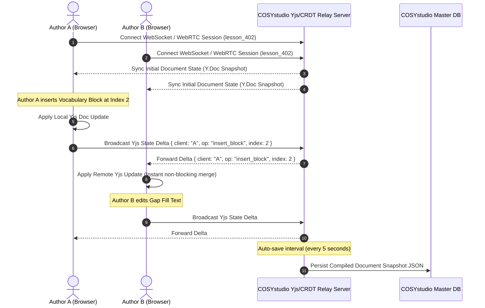

# COSYstudio Architecture Specification: Database-First Content Operating System (COS)

## Executive Summary & Database-First Philosophy

**COSYstudio is NOT a Learning Management System (LMS).**

It is the **Central Content Operating System (COS)** that powers the entire **COSYlanguages** ecosystem across all 11 organization repositories (`cosylanguages/*`). An LMS or platform service (`COSYplatform`) manages student logins, classroom hubs, teacher-student sessions, user accounts, and paid course subscriptions. In contrast, **COSYstudio** serves as the single source of truth (SSOT) for creating, localizing, versioning, orchestrating, and distributing thousands of **Reusable Learning Objects (RLOs)**.

### Core Architectural Paradigm: Database-First & Folderless Architecture
Traditional content management systems rely on hierarchical nested folders (`/es/b1/grammar/verbs/unit1/`). This creates content duplication, broken links, and rigid navigation silos.

**COSYstudio eliminates nested folders entirely.**

Instead, COSYstudio implements a **Database-First Content Architecture**:
1. **Everything is a Content Object (`ContentObject`)**: Every piece of content—a lesson, word, audio clip, quest dialogue, or quiz—is an atomic row in a flat, indexed content database with an immutable Content ID (`cid_*`).
2. **Metadata-Driven Organization**: Dynamic filtering, grouping, and relational querying replace folder navigation.
3. **Airtable / Notion Database UI**: Authors interact with content via customizable database views (Grid, Kanban Board, Gallery, Calendar, Node Graph Canvas) and instant multi-dimensional filters.

---

## 1. High-Level Ecosystem Architecture Diagram

The diagram below illustrates how `COSYstudio` acts as the central Content Operating System delivering RLOs and media manifests to all downstream consumer repositories and services.

```
+--------------------------------------------------------------------------------------------------------+
|                                           COSYplatform                                                 |
|               (Central Auth SSO, User Accounts, Subscriptions, Billing, Global API Gateway)            |
+---------------------------------------------------+----------------------------------------------------+
                                                    |
                                                    v
+--------------------------------------------------------------------------------------------------------+
|                                           COSYstudio (COS)                                             |
|  +--------------------+   +-----------------------+   +-----------------------+   +------------------+  |
|  | Authoring & CMS    |   | Localization Manager  |   | Asset Pipeline (Media)|   | AI Assistant     |  |
|  +--------------------+   +-----------------------+   +-----------------------+   +------------------+  |
|  |  Content Graph SSOT: Vocabulary, Grammar, Exercises, Quests, Drills, Manuals, Articles, Events   |  |
|  +--------------------------------------------------------------------------------------------------+  |
|  | Exposed: GraphQL API / gRPC Edge / Global CDN / Event Stream (Kafka / NATS)                      |  |
+---------------------------------------------------+----------------------------------------------------+
                                                    |
                    +-------------------------------+-------------------------------+
                    |                               |                               |
          (Fetch Content Nodes)            (Fetch Media Assets)            (Event Stream Sub)
                    |                               |                               |
        +-----------v-----------+       +-----------v-----------+       +-----------v-----------+
        |     COSYlanguages     |       |     COSYpractice      |       |       COSYdata        |
        |  (Main Learning App)  |       |  (Interactive Drills) |       | (Analytics / Telemetry|
        | Owns: SRS State,      |       | Owns: Practice Runs,  |       | Owns: Telemetry Logs, |
        | Course Progress       |       | User Voice Recordings |       | Data Lake, ML Models  |
        +-----------------------+       +-----------------------+       +-----------------------+
                    |                               |                               |
    +---------------+---------------+---------------+---------------+---------------+---------------+
    |                               |                               |                               |
+---v-------------------+   +-------v---------------+   +-----------v-----------+   +---------------v-------+
|       COSYworld       |   |       COSYgames       |   |       COSYtools       |   |     COSYmagazine      |
| (3D Spatial Language) |   | (Micro-games Arcade)  |   |  (Dictionaries & Ext) |   | (Digital Magazine)    |
| Owns: 3D Session,     |   | Owns: Game Sessions,  |   | Owns: Tool Search     |   | Owns: Comments,       |
| Avatar Customization  |   | Leaderboards, Badges  |   | Cache, Extension Prefs|   | Reading Bookmarks     |
+-----------------------+   +-----------------------+   +-----------------------+   +-----------------------+
    |                               |                               |                               |
    +-------------------------------+---------------+---------------+-------------------------------+
                                                    |
                                    +---------------+---------------+
                                    |                               |
                        +-----------v-----------+       +-----------v-----------+
                        |      COSYevents       |       |      COSYmanuals      |
                        | (Webinars & Meetups)  |       | (Docs & Help Center)  |
                        | Owns: Event Tickets,  |       | Owns: Support Tickets,|
                        | Registrations, WebRTC |       | Vote Ratings          |
                        +-----------------------+       +-----------------------+
```

---

## 2. Notion-Style Visual Lesson Builder & JSON Block Engine

COSYstudio features a modern, drag-and-drop **Visual Lesson Builder** inspired by Notion, ProgressMe, Edvibe, and Figma.

### Key Visual Builder Principles:
* **Zero XML**: COSYstudio NEVER exposes XML. XML is prone to parsing overhead, verbosity, and schema fragility.
* **100% JSON Internals**: Lessons are stored, edited, validated, and serialized natively as JSON document graphs.
* **Block-Based Composition**: Lessons consist of an ordered list of draggable, nestable content blocks (`LessonBlock`).
* **Slash Commands (`/`) & Drag Handles**: Type `/` to insert any block or drag the six-dot grip handle to reorder blocks.
* **Undo/Redo Engine**: Time-travel history stack implemented via Conflict-Free Replicated Data Types (CRDTs / Yjs / Automerge) supporting `Cmd+Z` and `Cmd+Shift+Z`.
* **Collaborative Live Editing**: Multiplayer real-time co-authoring with live avatar presence indicators, cursor position tracking, and block-level lock states via WebSockets/WebRTC.
* **Reusable Templates System**: Save any block sequence as a reusable template (`cid_template_*`) (e.g. *"A2 Vocabulary Warmup Template"*, *"B1 Debate Routine Template"*).

```
+---------------------------------------------------------------------------------------------------------+
|  [COSYstudio]  Visual Lesson Builder: "Dining Out - Ordering in Spanish"     [Undo Cmd+Z] [Redo] [Share]|
+---------------------------------------------------------------------------------------------------------+
|  (+) Add Block  |  [/] Type slash command  |  Collaborators: (A) Anna  (J) James  |  [Preview] [Publish]|
+---------------------------------------------------------------------------------------------------------+
|  [::]  # Dining Out: Ordering Food & Drinks                                            (Heading Block)   |
|  [::]  In this lesson, you will learn how to order food politely in Spanish.          (Rich Text Block) |
|                                                                                                         |
|  [::]  +----------------------------------------------------------------------------+                   |
|        | Vocabulary Table Block                                      [cid_vocab_9021]|                   |
|        | * El cubierto (noun) - Cutlery / Silverware                 [Audio: Play]   |                   |
|        | * La cuenta (noun)   - The bill / Check                     [Audio: Play]   |                   |
|        +----------------------------------------------------------------------------+                   |
|                                                                                                         |
|  [::]  +----------------------------------------------------------------------------+                   |
|        | Interactive Gap Fill Block                                                 |                   |
|        | "Por favor, tráigame la ____________ [cuenta]."                           |                   |
|        +----------------------------------------------------------------------------+                   |
|                                                                                                         |
|  [::]  +----------------------------------------------------------------------------+                   |
|        | AI Discussion Block (Interactive)                                          |                   |
|        | Scenario: Practice ordering coffee with AI Barista (Roleplay mode)         |                   |
|        +----------------------------------------------------------------------------+                   |
+---------------------------------------------------------------------------------------------------------+
```

---

## 3. Comprehensive 24 Lesson Builder Blocks & 7 Core Lifecycle Contracts

Every block in COSYstudio strictly defines 7 core lifecycle contracts:
1. **Schema**: JSON Schema definition validating block data integrity.
2. **Properties**: Configurable metadata properties edited via the Inspector Drawer.
3. **Validation**: Automated validation rules checking required fields, audio links, and CEFR parity.
4. **Preview**: WYSIWYG real-time rendering engine for teacher/student preview modes.
5. **Serialization**: JSON export/import and Edge CDN payload compilation contract.
6. **Rendering**: Client-side component renderer definition for Web, Mobile, and 3D HUD.
7. **Future Extensibility**: Plugin extension hooks (`onInit`, `onStateChange`, `customAction`) for custom third-party blocks.

Below are the 24 available blocks in COSYstudio:

### 3.1 Content & Layout Blocks
1. **Heading Block**: Level (H1-H3), text key, anchor ID.
2. **Rich Text Block**: ProseMirror JSON document tree, inline vocabulary annotations.
3. **Image Block**: Image object CID, localized alt text, caption, focal point.
4. **Gallery Block**: Array of image CIDs, layout mode (grid, carousel, masonry).
5. **Video Block**: Video CID, HLS manifest, word-level VTT subtitles.
6. **Audio Block**: Audio CID, waveform visualizer, timestamp alignment JSON.

### 3.2 Interactive & Language Blocks
7. **Dialogue Block**: Speaker turns array, avatar placements, speech audio CIDs.
8. **Vocabulary Table Block**: Array of `cid_vocab_*` references, customizable column view.
9. **Grammar Table Block**: References `cid_gram_*`, pattern formula visualizer, CCQ checks.
10. **Timeline Block**: Chronological event list, tense usage time-map.

### 3.3 Practice & Exercise Blocks
11. **Matching Block**: Left/right text/media pair contracts, drag-to-connect renderer.
12. **Sorting Block**: Categorized bucket sorting, gender/theme sorting rules.
13. **Gap Fill Block**: Sentence template with `[gap]` answer definitions, word bank pills.
14. **Flashcards Block**: Front/back card CIDs, 3D flip renderer, SRS queue binding.
15. **Pronunciation Block**: Target audio CID, phonetic IPA, speech evaluation score.
16. **Speaking Block**: Prompt key, max recording duration, rubric CID, submission booth.
17. **AI Discussion Block**: AI persona role, roleplay scenario prompt, vocabulary constraints.

### 3.4 Assessment & Evaluation Blocks
18. **Quiz Block**: References `cid_quiz_*`, time limits, pass/fail threshold.
19. **Poll Block**: Question key, voting options, live percentage bar chart.
20. **Reflection Block**: Reflection prompt, confidence star rating (1-5), word counter.

### 3.5 Administrative & Workflow Blocks
21. **Homework Block**: Assignment title, instructions, due date offset, child RLO CIDs.
22. **Teacher Notes Block**: Visible exclusively in Teacher mode, CCQs, pacing time, common error warnings.
23. **Assessment Block**: Rubric matrix CID, grading scale, criteria weights.
24. **Custom Extension Block**: Sandboxed plugin container for third-party extensions.

---

## 4. Real-Time Collaboration & History Engine

### 4.1 Undo/Redo Engine
COSYstudio implements a deterministic history stack based on **Immutable State Snapshots** and **Delta Operations**:
* Every user action (block insert, reorder, property change, delete) pushes an operation delta onto the local undo stack (`Cmd+Z`).
* Undoing pops the operation delta, applies the inverse operation, and pushes it onto the redo stack (`Cmd+Shift+Z`).

### 4.2 Real-Time Collaborative Editing Architecture



---

## 5. Reusable Template Engine

Any structured sequence of blocks can be published as a **Reusable Template** (`cid_template_*`).

```json
{
  "cid": "cid_template_a2_grammar_warmup",
  "templateName": "A2 Grammar Warmup & Practice Template",
  "cefrLevel": "A2",
  "category": "GRAMMAR_DRILL",
  "blocks": [
    {
      "type": "heading",
      "level": 1,
      "textLocKey": "loc_tmpl_warmup_title"
    },
    {
      "type": "grammar_table",
      "grammarCid": "{{REPLACE_GRAMMAR_CID}}"
    },
    {
      "type": "gap_fill",
      "sentencePattern": "{{REPLACE_SENTENCE_PATTERN}}"
    },
    {
      "type": "pronunciation",
      "targetAudioCid": "{{REPLACE_AUDIO_CID}}"
    },
    {
      "type": "teacher_notes",
      "instructionsText": "Check student pronunciation on target verb endings."
    }
  ]
}
```

---

## 6. Unified Content Object Model & Metadata Schema

Every entity in COSYstudio inherits from the base `ContentObject` schema.

```typescript
export type CEFRLevel = 'A0' | 'A1' | 'A2' | 'B1' | 'B2' | 'C1' | 'C2';

export type LanguageCode = 'en' | 'fr' | 'it' | 'ru' | 'el' | 'es' | 'de' | 'pt' | 'hy' | 'ka' | 'ba' | 'br' | 'cv' | 'tt';

export interface ContentObjectMetadata {
  cid: string; // "cid_vocab_01H8X..."
  objectType: 'LESSON' | 'DIALOGUE' | 'VOCABULARY' | 'GRAMMAR' | 'EXERCISE' | 'QUIZ' | 'IMAGE' | 'VIDEO' | 'AUDIO' | 'PROMPT' | 'WORKSHEET' | 'ARTICLE' | 'QUEST' | 'GAME';
  targetLanguage: LanguageCode;
  cefrLevel: CEFRLevel;
  theme: string;
  subTheme?: string;
  grammarRuleCids: string[];
  skills: ('READING' | 'WRITING' | 'LISTENING' | 'SPEAKING' | 'PRONUNCIATION' | 'GRAMMAR' | 'VOCABULARY')[];
  ageGroups: ('CHILDREN' | 'KIDS' | 'TEENS' | 'ADULTS' | 'BUSINESS')[];
  targetAudiences: ('GENERAL' | 'SPOKEN' | 'EXAM' | 'PROFESSIONAL' | 'TRAVEL' | 'RELOCATION')[];
  estimatedDurationSeconds: number;
  learningObjectives: string[];
  status: 'DRAFT' | 'REVIEW' | 'STAGING' | 'PUBLISHED' | 'ARCHIVED' | 'DEPRECATED';
  tags: string[];
  difficultyScore: number;
  dependencies: {
    prerequisiteCids: string[];
    childCids: string[];
    relatedCids: string[];
    variantCids: string[];
  };
  createdBy: string;
  createdAt: string;
  updatedAt: string;
  version: number;
}
```

---

## 7. Entity Relationship Diagrams (ERDs)


---

## 8. Data Ownership Matrix (11 Ecosystem Repositories)

| Data Entity / Domain | studio | platform | languages | world | games | tools | data | magazine | events | manuals | practice |
| :--- | :---: | :---: | :---: | :---: | :---: | :---: | :---: | :---: | :---: | :---: | :---: |
| **Canonical Vocabulary & Dictionary** | **OWNER** | Forbidden | Read-Only | Read-Only | Read-Only | Read-Only | Read-Only | Read-Only | Read-Only | Read-Only | Read-Only |
| **Grammar Rules & Explanations** | **OWNER** | Forbidden | Read-Only | Read-Only | Read-Only | Read-Only | Read-Only | Read-Only | Read-Only | Read-Only | Read-Only |
| **Media Assets (Audio, Video, 3D)** | **OWNER** | Read-Only | Read-Only | Read-Only | Read-Only | Read-Only | Read-Only | Read-Only | Read-Only | Read-Only | Read-Only |
| **Localization Master Keys & Translations** | **OWNER** | Read-Only | Read-Only | Read-Only | Read-Only | Read-Only | Read-Only | Read-Only | Read-Only | Read-Only | Read-Only |
| **Quest Scenarios & Dialogue Trees** | **OWNER** | Forbidden | Read-Only | Read-Only | Forbidden | Forbidden | Read-Only | Read-Only | Forbidden | Forbidden | Read-Only |
| **Drill Masters & Exercise Rubrics** | **OWNER** | Forbidden | Read-Only | Read-Only | Read-Only | Forbidden | Read-Only | Forbidden | Forbidden | Forbidden | Read-Only |
| **Documentation Articles (Manuals)** | **OWNER** | Read-Only | Read-Only | Forbidden | Forbidden | Read-Only | Read-Only | Forbidden | Forbidden | Read-Only | Forbidden |
| **User Identity, Auth & Billing** | Forbidden | **OWNER** | Read-Only | Read-Only | Read-Only | Read-Only | Read-Only | Read-Only | Read-Only | Read-Only | Read-Only |
| **User Progress & SRS Card State** | Forbidden | Forbidden | **OWNER** | Read-Only | Read-Only | Forbidden | Read-Only | Forbidden | Forbidden | Forbidden | Read-Only |
| **3D World Session & Avatar Cosmetics**| Forbidden | Forbidden | Forbidden | **OWNER** | Forbidden | Forbidden | Read-Only | Forbidden | Forbidden | Forbidden | Forbidden |
| **Game Match Sessions & High Scores** | Forbidden | Forbidden | Read-Only | Forbidden | **OWNER** | Forbidden | Read-Only | Forbidden | Forbidden | Forbidden | Forbidden |
| **Tool Search Cache & Local Prefs** | Forbidden | Forbidden | Forbidden | Forbidden | Forbidden | **OWNER** | Read-Only | Forbidden | Forbidden | Forbidden | Forbidden |
| **Telemetry, Analytics & AI Models** | Forbidden | Read-Only | Read-Only | Read-Only | Read-Only | Read-Only | **OWNER** | Read-Only | Read-Only | Read-Only | Read-Only |
| **Magazine Comments & Bookmarks** | Forbidden | Forbidden | Forbidden | Forbidden | Forbidden | Forbidden | Read-Only | **OWNER** | Forbidden | Forbidden | Forbidden |
| **Event Registrations & Tickets** | Forbidden | Read-Only | Forbidden | Forbidden | Forbidden | Forbidden | Read-Only | Forbidden | **OWNER** | Forbidden | Forbidden |
| **Help Tickets & User Vote Ratings** | Forbidden | Read-Only | Forbidden | Forbidden | Forbidden | Forbidden | Read-Only | Forbidden | Forbidden | **OWNER** | Forbidden |
| **Practice Audio Recordings & Runs**| Forbidden | Forbidden | Read-Only | Forbidden | Forbidden | Forbidden | Read-Only | Forbidden | Forbidden | Forbidden | **OWNER** |

---

## 9. Verified Repository Boundary Analysis (11 Repositories)

Below is the definitive boundary analysis for all 11 repositories in the `cosylanguages/` organization answering all 5 core questions per repository.

### 9.1 COSYstudio (`cosylanguages/COSYstudio`)
* **Responsibility**: Central Content Operating System (COS). Single source of truth for authoring, versioning, localization, asset transcoding, and edge RLO distribution.
* **Data Owned**: Canonical Content Objects (`cid_*`), Media Manifests, Localization Master Keys, Taxonomy Trees, Version History Logs.
* **Data It Must NEVER Own**: Student Enrollments, Paid Classroom Sessions, Private Student Data, SRS States, Event Registrations.
* **Exposed APIs**: `Content Query API` (GraphQL/gRPC/REST), `Content Authoring API`, `Search & Taxonomy Index API`, `Content Event Stream` (Kafka/NATS).
* **Consumed APIs from COSYstudio**: N/A (Core Provider).

### 9.2 COSYdata (`cosylanguages/COSYdata`)
* **Responsibility**: Canonical machine-readable data repository and vocabulary hub serving dictionary datasets (`vocabulary/<lang>/`) and taxonomy schemas (`schemas/themes.json`) across 14 ISO languages.
* **Data Owned**: Standardized Vocabulary JSON Entries (`A0`–`C2`), IPA Transcriptions, Dialect Variants, `schemas/themes.json`, Index Artifacts (`index.json`, `flat-index.json`).
* **Data It Must NEVER Own**: Student SRS Intervals, User Credentials, Quiz Performance Scores.
* **Exposed APIs**: Static CDN REST Endpoints (`vocabulary/<lang>/<level>/<theme>.json`), `vocab-resolver.js`, `cosy-word-popup.js`.
* **Consumed APIs from COSYstudio**: Ingests published vocabulary RLOs, IPA definitions, and taxonomy trees from `content.published` event stream.

### 9.3 COSYplatform (`cosylanguages/COSYplatform`)
* **Responsibility**: Web application for students, teachers, and founder providing authentication, student hub, paid course execution, and online virtual classroom.
* **Data Owned**: User Accounts, Auth Credentials, OAuth Tokens, Classroom State, Paid Course Enrollments, Private Student Progress (Supabase).
* **Data It Must NEVER Own**: Public Vocabulary Master Data, Dictionaries, Offline Booklet Reference Materials.
* **Exposed APIs**: `Classroom Service API`, `Student Progress API`.
* **Consumed APIs from COSYstudio**: Fetches structured lesson block templates and RLO schemas by `cid` for live classroom rendering.

### 9.4 COSYlanguages (`cosylanguages/COSYlanguages`)
* **Responsibility**: Free public front door, landing portal, language hubs, course catalogue, placement quiz, price calculator, and hybrid community pages.
* **Owned Data**: Portal Page UI State, Interface Translations (`data/ui/<lang>.json`), `config.js` Registry, Placement Quiz Logic.
* **Data It Must NEVER Own**: Master Vocabulary Datasets, User Auth Credentials, Private Classrooms.
* **Exposed APIs**: Static Web Portal Pages & Client Navigation Engine.
* **Consumed APIs from COSYstudio**: Fetches course catalog metadata, localized UI descriptors, and placement quiz RLOs.

### 9.5 COSYpractice (`cosylanguages/COSYpractice`)
* **Responsibility**: Free interactive practice exercise engine for vocabulary, grammar, and speaking (`en`, `fr`, `it`, `ru`, `el`) with SRS reviews and daily challenges.
* **Owned Data**: Browser LocalStorage SRS Memory State, Practice Session Scores, Weak Spot Indicators, Progress Dashboard Metrics.
* **Data It Must NEVER Own**: Master Vocabulary JSON Files, Master Grammar Explanations, CCQ Rule Documents.
* **Exposed APIs**: Client-side practice engine (`_engine/`) and progress dashboard (`progress-dashboard.html`).
* **Consumed APIs from COSYstudio**: Dynamically fetches vocabulary RLOs, grammar exercise blocks, and CCQ prompts by `cid`.

### 9.6 COSYtools (`cosylanguages/COSYtools`)
* **Responsibility**: Offline-first, client-side language reference suite (verb conjugators, noun gender/case declension, case matrices) across 14 languages.
* **Owned Data**: Tool Datasets (`tools/<lang>/<tool>/data/`), Sharded Dictionaries, `catalog.json` Inventory.
* **Data It Must NEVER Own**: Student Course Enrollments, Classroom Telemetry, User Auth Tokens.
* **Exposed APIs**: Deep-Linking Query Interfaces (`?verb=<lemma>`, `?noun=<word>`, `?q=<keyword>`).
* **Consumed APIs from COSYstudio**: Reads canonical headwords, conjugation tables, and grammatical rules.

### 9.7 COSYgames (`cosylanguages/COSYgames`)
* **Responsibility**: Suite of 20 interactive standalone language games for communicative fluency and vocabulary practice.
* **Owned Data**: Game Match State, Active Session Scores, Local High Score History.
* **Data It Must NEVER Own**: Master Dictionaries, User Accounts, Pedagogical Progress Tracking.
* **Exposed APIs**: Client-side game runners (HTML5 / ES6 Modules).
* **Consumed APIs from COSYstudio**: Fetches mini-game content bundles (`cid_gamepack_*`).

### 9.8 COSYevents (`cosylanguages/COSYevents`)
* **Responsibility**: Public calendar directory and session material repository (speaking club decks, cinema guides, masterclasses).
* **Owned Data**: Event Definitions (`events/<slug>/event.json`), Session JSONs (`events/<slug>/sessions/<slug>.json`), Calendar Index (`public-events.json`).
* **Data It Must NEVER Own**: Private Classroom Sessions, User Auth Secrets, Paid Course Enrollments.
* **Exposed APIs**: Static Calendar Directory (`index.html`, `public-events.json`).
* **Consumed APIs from COSYstudio**: Fetches session prompt decks (`cid_eventpack_*`), event descriptions, and media assets.

### 9.9 COSYmanuals (`cosylanguages/COSYmanuals`)
* **Responsibility**: Public catalog and gated learning portal holding manuals, teacher guides, student workbooks, and print booklets across 13 ISO languages + Chuvash.
* **Owned Data**: Public Manual Catalog Metadata (`catalog/*.json`), Curriculum Maps (`curriculums/<iso>/<track>/<LEVEL>.json`), Gated Body Text (Supabase), Printable Booklet Layouts.
* **Data It Must NEVER Own**: Master Vocabulary Datasets, Live Classroom Session State.
* **Exposed APIs**: Public Catalog Manifest (`catalog/manifest.json`), Manual Viewers.
* **Consumed APIs from COSYstudio**: Fetches documentation nodes (`cid_manual_*`), grammar rule explanations, and vocabulary sets.

### 9.10 COSYmagazine (`cosylanguages/COSYmagazine`)
* **Responsibility**: Short speaking-first digital publication (articles, sentence frames, podcasts) with flipbook and stage presentation modes (`?stage=1`, `?script=1`).
* **Owned Data**: Editorial Article JSON Posts (`posts/*.json`), Podcast Feed (`podcast.xml`), Generated Static HTML Pages, Newsstand Index (`posts.json`).
* **Data It Must NEVER Own**: Embedded Master Dictionary Definitions.
* **Exposed APIs**: Newsstand Interface (`index.html`), RSS Podcast Feed (`podcast.xml`).
* **Consumed APIs from COSYstudio**: Fetches article content nodes (`cid_article_*`), inline vocabulary popups, and podcast audio assets.

### 9.11 COSYworld (`cosylanguages/COSYworld`)
* **Responsibility**: Standalone open-world RPG for direct language immersion in COSY Town across 14 target languages (character selection: James York, Ella Bronx, Anna).
* **Owned Data**: COSY Town Hotspots, RPG Instance State, Player Citizen Level, XP, COSY Passport Progress Saves (LocalStorage / JSON).
* **Data It Must NEVER Own**: Master Dictionary & Grammar Rules.
* **Exposed APIs**: Standalone RPG Web App & COSY Passport Export/Import Engine.
* **Consumed APIs from COSYstudio**: Fetches NPC dialogue trees (`cid_dialogue_*`), quest script nodes (`cid_quest_*`), and localized object names.

---

## 10. Shared Packages (`@cosy/*`) & Governance

To guarantee type safety, consistent content referencing, and schema validation across all 11 repositories, shared packages are maintained in the `@cosy/` registry.

```
@cosy/
├── schema-content/       # Canonical TypeScript & JSON Schemas for Content Objects
├── schema-events/        # Event payload schemas for NATS / Kafka event bus
├── sdk-client/           # Multi-platform Client SDK (TypeScript / Rust / C# Unity)
├── ui-tokens/            # Shared design system tokens, typography, iconography
└── core-utils/           # CID generators, CEFR helpers, language code parsers
```

### Governance Rules
1. **Zero Runtime Side-Effects**: Shared packages contain **only types, schemas, validation utilities, and client contracts**.
2. **Semantic Versioning (SemVer)**: Major for breaking schema changes, Minor for additive changes, Patch for bug fixes.
3. **Automated Schema Codegen**: Protobuf / JSON Schemas generate TypeScript, Rust, and C# code.

---

## 11. Migration Strategy

Migrating existing applications across all 11 repositories to the strict COSYstudio COS architecture follows a 5-phase zero-downtime plan.

1. **Phase 1: Foundation Setup & Package Publishing (`@cosy/*`)**: Deploy edge CDN, NATS event bus, and shared packages.
2. **Phase 2: Extraction & Deduplication into COSYstudio SSOT**: Extract raw content tables from consumer repos (`COSYdata`, `COSYevents`, `COSYmanuals`, `COSYmagazine`) and deduplicate into canonical `ContentNode` graphs with `cid_*`.
3. **Phase 3: Dual-Read & Translation Shim Deployment**: Enable consumer services to fetch content via `cid` while maintaining legacy fallback.
4. **Phase 4: Full Read-Switch & Consumer DB Content Purge**: Route 100% of content reads to COSYstudio Edge APIs and purge raw content tables from consumer DBs.
5. **Phase 5: Automated CI/CD Guardrails**: Enforce linter rules preventing raw content/translation tables from being introduced into consumer apps.

---

## Conclusion

By combining a Notion-style Visual Lesson Builder, 24 extensible block primitives, 100% JSON internal contracts (zero XML), real-time collaboration (Yjs CRDTs), and a database-first folderless Content Operating System:
* **Zero XML & 100% JSON Engine**: Fast, clean, type-safe block serialization.
* **Zero Content Duplication**: Content exists once in `COSYstudio` and is referenced via `cid`.
* **Collaborative Authoring**: Real-time multiplayer co-authoring with full undo/redo capabilities.
* **Domain Ownership**: Clean isolation across all 11 `cosylanguages/` repositories.
